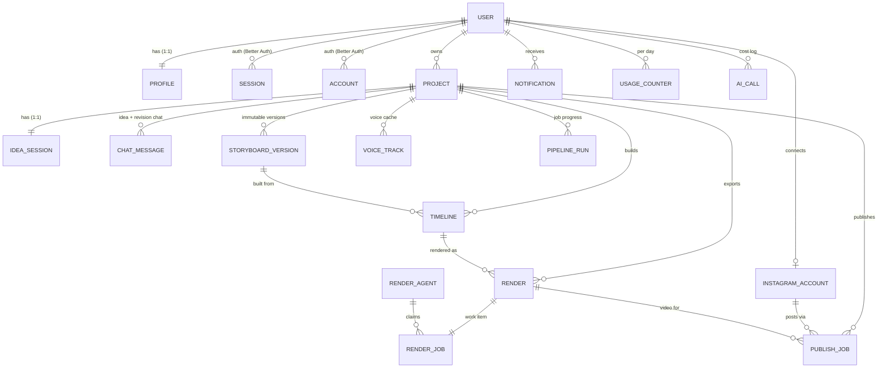
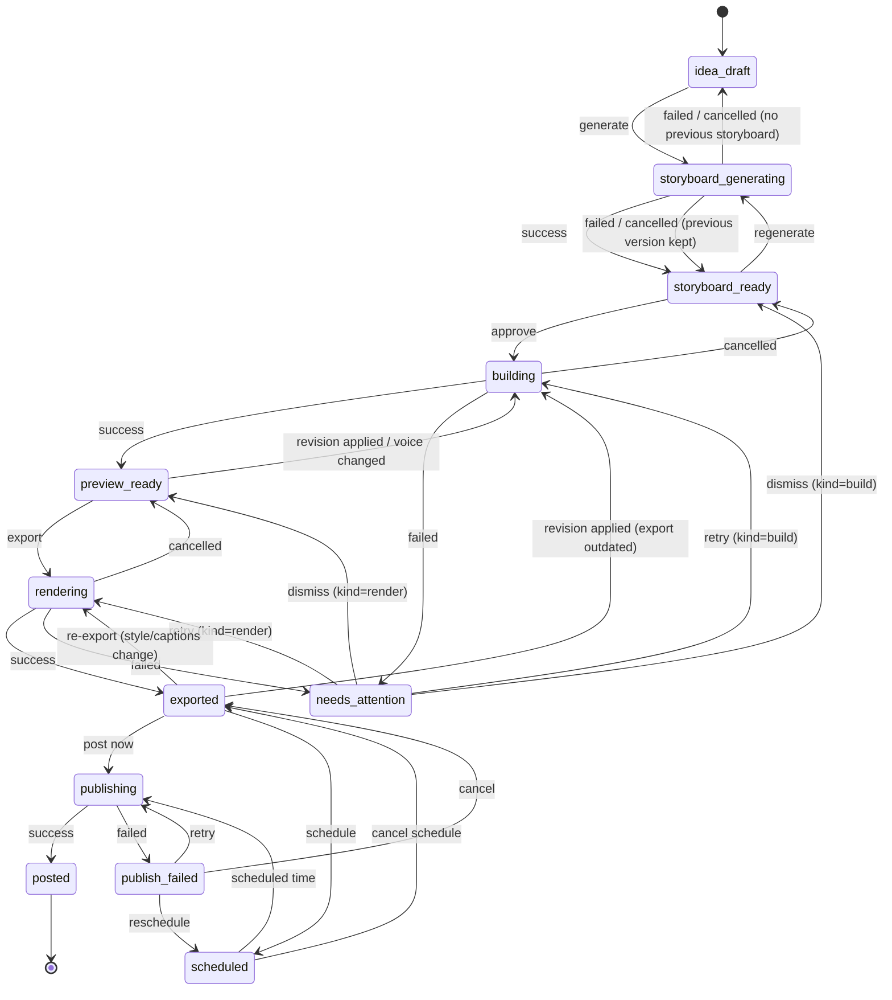
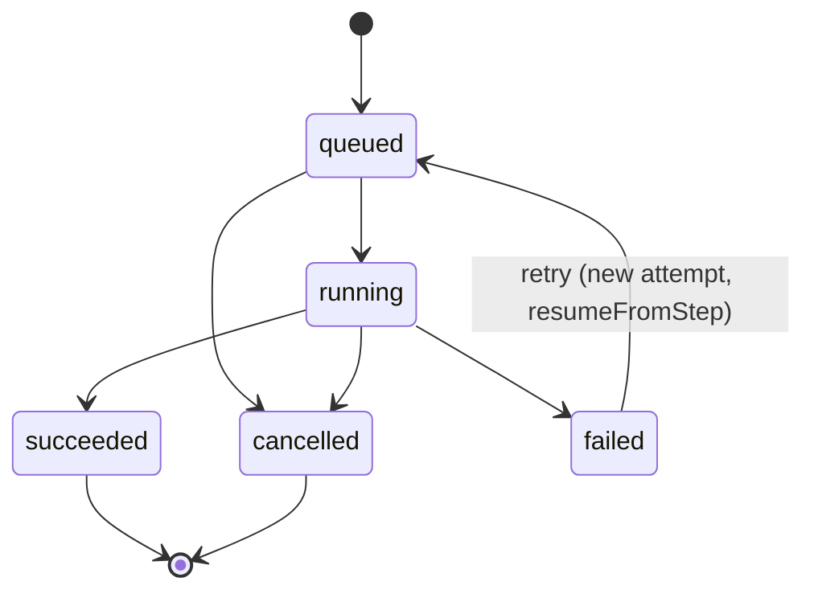
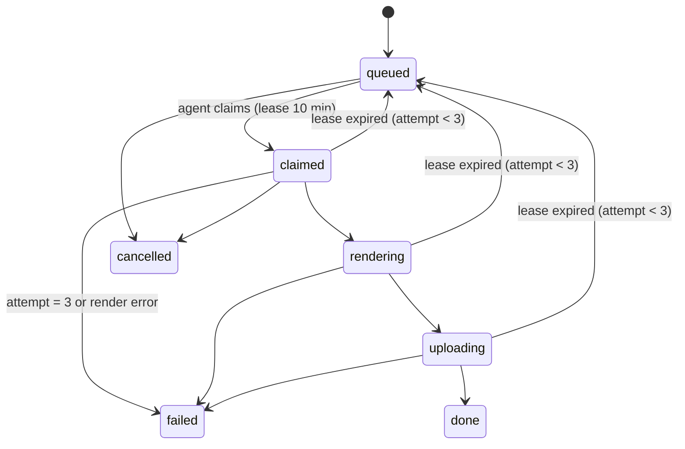

# Videozilla — Database Design (V1)

| | |
|---|---|
| **Document** | Database design: schema, constraints, indexes, relationships, state machines, transactions, lifecycle |
| **Version** | 1.0 — approved 2026-10-16 (open questions use the stated defaults) |
| **Date** | 2026-10-16 |
| **Database** | MongoDB Atlas (AWS Mumbai, replica set), official `mongodb` Node driver 7.x |
| **Based on** | [PRD v1.3](PRD.md) §5, §9, §11, §16–§18, §20 · [System Design v0.1](SYSTEM_DESIGN.md) §6–§11, §13, §15 |
| **Companion** | [API Design](API_DESIGN.md) — every API error about state or conflicts maps to a rule in this document |

---

## Table of contents

1. [Principles and conventions](#1-principles-and-conventions)
2. [Assumptions](#2-assumptions)
3. [Entity relationship overview](#3-entity-relationship-overview)
4. [Collection specifications](#4-collection-specifications)
5. [State machines](#5-state-machines)
6. [Transactions](#6-transactions)
7. [Concurrency control and idempotency](#7-concurrency-control-and-idempotency)
8. [Index catalogue and query patterns](#8-index-catalogue-and-query-patterns)
9. [Validation strategy](#9-validation-strategy)
10. [Data lifecycle, retention and deletion](#10-data-lifecycle-retention-and-deletion)
11. [Schema changes vs. PRD / System Design](#11-schema-changes-vs-prd--system-design)
12. [Migrations and schema versioning](#12-migrations-and-schema-versioning)
13. [Security, access and privacy](#13-security-access-and-privacy)
14. [Backups, recovery and environments](#14-backups-recovery-and-environments)
15. [Sizing and growth](#15-sizing-and-growth)
16. [Open questions](#16-open-questions)

---

## 1. Principles and conventions

| Rule | Detail |
|---|---|
| **Database name** | `videozilla` (production), `videozilla_staging`, `videozilla_dev` |
| **Collection names** | `snake_case`, plural (e.g. `storyboard_versions`). Better Auth's own collections keep their names: `user`, `session`, `account`, `verification`. |
| **Field names** | `camelCase` |
| **Primary keys** | `_id: ObjectId`, exposed in the API as a 24-char hex string |
| **User reference** | `userId: string` — the Better Auth user id (hex string of `user._id`). Present on **every** user-owned document, even when it could be derived, so every query can be scoped by user (System Design AD-13). |
| **Other references** | Stored as `ObjectId` (e.g. `projectId`). No database-level foreign keys exist in MongoDB, so integrity rules are enforced by the repository layer, transactions and the purge jobs (§6, §10). |
| **Timestamps** | `createdAt`, `updatedAt` as BSON `Date` in UTC on every document. Time zones are applied only in the UI (default `Asia/Kolkata`). |
| **Enums** | Lower-case `snake_case` strings, validated by Zod and by MongoDB `$jsonSchema` (§9). |
| **Soft delete** | `deletedAt: Date \| null` + `purgeAt: Date \| null`. Never physically deleted by user actions; the purge job deletes later (§10). |
| **Optimistic concurrency** | `rev: int` on documents users can edit concurrently (`projects`, `idea_sessions`, `publish_jobs`). |
| **Document schema version** | `schemaVersion: int` on documents whose shape will evolve (`storyboard_versions`, `timelines`, `idea_sessions`). |
| **Money** | Not stored in V1 (billing deferred). |
| **Large payloads** | Anything that can exceed ~500 KB (long timelines) goes to R2; MongoDB keeps metadata + `dataKey` (System Design §7.2). Hard limit per document: 16 MB. |
| **Secrets** | Never stored in plain text. Instagram tokens are encrypted by the app before saving (§13). |

---

## 2. Assumptions

These follow the recommendations in [System Design §20](SYSTEM_DESIGN.md#20-open-questions-for-the-product-owner). Please confirm or correct them (§16).

| # | Assumption |
|---|---|
| A1 | Only the two approved ElevenLabs voices exist. Projects store `voiceGender` (`female` \| `male`); voice tracks also store the resolved `voiceId` so a cache never mixes voices. |
| A2 | Midnight is the only style in V1 (`styleId` field kept for later styles). |
| A3 | Optional captions toggle exists but is off by default → `captionsEnabled: boolean` on projects. |
| A4 | One Instagram account per user in V1 (the schema allows more later). |
| A5 | Rendering happens on the local render agent (`render_jobs` queue) in V1. |
| A6 | A project can be posted **once**; posting again requires Duplicate (PRD §11). |

---

## 3. Entity relationship overview



### 3.1 Relationship and cascade rules

| Parent → child | Cardinality | Reference field | On parent soft delete | On parent purge / hard delete |
|---|---|---|---|---|
| user → profile | 1 : 1 | `profiles.userId` | — | delete |
| user → projects | 1 : N | `projects.userId` | — | delete all (account deletion, §6.12) |
| project → idea_session | 1 : 1 | `idea_sessions.projectId` | keep | delete |
| project → chat_messages | 1 : N | `chat_messages.projectId` | keep | delete |
| project → storyboard_versions | 1 : N | `storyboard_versions.projectId` | keep | delete |
| project → voice_tracks | 1 : N | `voice_tracks.projectId` | keep | delete (+ R2 audio) |
| project → timelines | 1 : N | `timelines.projectId` | keep | delete (+ R2 timeline data) |
| project → renders | 1 : N | `renders.projectId` | keep | delete (+ R2 video, cover) |
| render → render_job | 1 : 1 | `render_jobs.renderId` | cancel if `queued` | delete |
| project → publish_jobs | 1 : N | `publish_jobs.projectId` | **cancel** `scheduled` ones (§6.6) | delete |
| project → pipeline_runs | 1 : N | `pipeline_runs.projectId` | **cancel** active runs (§6.6) | delete |
| user → instagram_account | 1 : 0..1 | `instagram_accounts.userId` | — | delete (and revoke token) |
| instagram_account → publish_jobs | 1 : N | `publish_jobs.igAccountId` | on disconnect: cancel `scheduled` (§6.10) | — |

---

## 4. Collection specifications

Notation: **R** = required, `?` = optional / nullable. "Check" lists the constraints enforced by Zod in the app **and** by the MongoDB validator where marked ✔︎V.

### 4.1 Better Auth collections (managed)

`user`, `session`, `account`, `verification` are created and written **only by Better Auth** (MongoDB adapter). Our code reads them only through Better Auth's API. Relevant fields: `user._id`, `name`, `email` (unique), `emailVerified`, `image`, `createdAt`. Better Auth creates its own indexes on first write.

> We do **not** add validators to these collections, to avoid breaking library upgrades.

### 4.2 `profiles`

| Field | Type | R | Default | Check |
|---|---|---|---|---|
| `_id` | ObjectId | R | | |
| `userId` | string | R | | 24-hex ✔︎V; unique |
| `displayName` | string | R | user's name | ≤ 60 chars |
| `defaultLanguage` | string | R | `en` | `en` \| `hi` ✔︎V |
| `defaultLengthPreset` | int | R | 60 | 60 \| 90 ✔︎V |
| `defaultVoiceGender` | string | R | `female` | `female` \| `male` ✔︎V |
| `defaultStyleId` | string | R | `midnight` | known style id |
| `defaultAudience` | string | R | `students` | `kids` \| `students` \| `college` \| `general` ✔︎V |
| `defaultBoardOrExam` | string? | | null | `cbse` \| `icse` \| `state` \| `jee` \| `neet` \| `upsc` \| null |
| `timezone` | string | R | `Asia/Kolkata` | valid IANA zone |
| `emailNotifications` | bool | R | true | |
| `onboardingCompletedAt` | Date? | | null | set when onboarding is completed or skipped (F1.12) |
| `about` | string? | | null | "What do you teach or create about?", ≤ 200 chars; tailors idea suggestions (added in F1.12, PRD F1-FR4) |
| `role` | string | R | `user` | `user` \| `admin` ✔︎V (admin view, M7) |
| `limitsOverride` | object? | | null | per-counter overrides (§4.17) |
| `createdAt`, `updatedAt` | Date | R | | |

Created by the Better Auth `user.create.after` hook (upsert, so a retried hook can't duplicate it).

### 4.3 `projects`

| Field | Type | R | Default | Check |
|---|---|---|---|---|
| `_id` | ObjectId | R | | |
| `userId` | string | R | | ✔︎V |
| `title` | string | R | "Untitled video" | 1–80 chars, trimmed ✔︎V |
| `language` | string | R | profile | `en` \| `hi` ✔︎V |
| `lengthPreset` | int | R | profile | 60 \| 90 ✔︎V |
| `audience` | string | R | profile | enum as profile ✔︎V |
| `boardOrExam` | string? | | profile | enum as profile |
| `styleId` | string | R | `midnight` | known style |
| `voiceGender` | string | R | profile | `female` \| `male` ✔︎V |
| `captionsEnabled` | bool | R | false | (A3) |
| `status` | string | R | `idea_draft` | §5.1 enum ✔︎V |
| `statusChangedAt` | Date | R | now | |
| `attention` | object? | | null | `{ kind: "storyboard"\|"build"\|"render"\|"publish", step, errorCode, message, at }` — set iff status ∈ {`needs_attention`, `publish_failed`} |
| `currentStoryboardVersion` | int? | | null | ≥ 1; must exist in `storyboard_versions` |
| `currentTimelineId` | ObjectId? | | null | |
| `latestRenderId` | ObjectId? | | null | |
| `exportOutdated` | bool | R | false | true when the storyboard/settings changed after the latest export |
| `postedAt` | Date? | | null | set once (A6) |
| `permalink` | string? | | null | Instagram URL |
| `duplicatedFrom` | ObjectId? | | null | |
| `revisionCount` | int | R | 0 | ≥ 0; soft cap 50 (PRD F7-FR10) |
| `rev` | int | R | 0 | incremented on every update ✔︎V (≥ 0) |
| `deletedAt` | Date? | | null | |
| `purgeAt` | Date? | | null | `deletedAt + 30 d`; both null or both set ✔︎V |
| `createdAt`, `updatedAt` | Date | R | | |

**Invariants**
- `status = posted` ⇒ `postedAt` and `permalink` set; the project is read-only except title.
- `latestRenderId` set ⇒ the render belongs to the same project and `isLatest = true`.
- `deletedAt` set ⇒ no `pipeline_runs.active = true` and no `publish_jobs.status = scheduled` for the project (§6.6).

### 4.4 `idea_sessions`

One per project (unique `projectId`), autosaved.

| Field | Type | R | Check |
|---|---|---|---|
| `projectId`, `userId` | ObjectId, string | R | unique `projectId` |
| `schemaVersion` | int | R | 1 |
| `mode` | string | R | `topic` \| `idea` \| `notes` |
| `topicInput` | string | | ≤ 200 |
| `ideaInput` | string | | ≤ 500 (PRD F2-FR3) |
| `notesText` | string | | ≤ 20,000 (PRD F2-FR4) ✔︎V `maxLength` |
| `suggestions` | array | | ≤ 30 items `{ id, title, hook, angle, keyPoints[] }` |
| `brief` | object? | | `{ title, hook, angle, audience, keyPoints[1–5], outOfScope[], sourceNotesSummary? }` |
| `briefUpdatedAt` | Date? | | |
| `rev` | int | R | |
| `createdAt`, `updatedAt` | Date | R | |

### 4.5 `chat_messages`

Both the Idea chat and the Revision chat (PRD F2-FR5, F7).

| Field | Type | R | Check |
|---|---|---|---|
| `projectId`, `userId` | | R | |
| `thread` | string | R | `idea` \| `revision` ✔︎V |
| `role` | string | R | `user` \| `assistant` ✔︎V |
| `content` | string | R | 1–4,000 chars |
| `scopeSceneId` | string? | | `s1`… (scene-scoped revision) |
| `status` | string | R | §5.7 enum |
| `clientMessageId` | string | R for `role=user` | idempotency; unique per project (§7) |
| `revisionPlan` | object? | | stored on assistant replies: operations, clarification or unsupported reason |
| `versionBefore`, `versionAfter` | int? | | set when a revision created a version |
| `undoneAt` | Date? | | |
| `runId` | ObjectId? | | pipeline run that processed it |
| `createdAt`, `updatedAt` | Date | R | |

### 4.6 `storyboard_versions`

Immutable once inserted (only `accuracyReport` may be filled in later by the async check).

| Field | Type | R | Check |
|---|---|---|---|
| `projectId`, `userId` | | R | |
| `version` | int | R | ≥ 1, unique per project, strictly increasing |
| `schemaVersion` | int | R | 1 |
| `data` | object | R | the Storyboard contract (System Design §7.1); ≤ 100 KB |
| `source` | string | R | `generate` \| `revision` \| `manual_edit` \| `restore` \| `duplicate` ✔︎V |
| `basedOnVersion` | int? | | parent version (null for first generate) |
| `changeSummary` | string | R | ≤ 300 |
| `changedSceneIds` | string[] | R | drives the incremental build |
| `validationReport` | object | R | `{ repairs[], warnings[], wordCount, estimatedDurationSec }` |
| `accuracyReport` | object? | | per-scene flags (PRD F3-FR10) |
| `model` | string? | | Gemini model used |
| `createdAt` | Date | R | |

Keep the newest 30 versions per project; older ones are pruned, never the current one (§10).

### 4.7 `voice_tracks`

Cache of synthesised audio per scene text.

| Field | Type | R | Check |
|---|---|---|---|
| `projectId`, `userId` | | R | |
| `sceneId` | string | R | |
| `textHash` | string | R | SHA-256 of the prepared narration |
| `voiceId` | string | R | must be one of the two approved voice ids (A1) |
| `language` | string | R | `en` \| `hi` |
| `speed` | double | R | 0.85–1.18 ✔︎V |
| `model` | string | R | e.g. `eleven_multilingual_v2` |
| `audioKey` | string | R | R2 key |
| `durationMs` | int | R | > 0 |
| `words` | array | R | `{ text, startMs, endMs }[]`; ≤ 200 |
| `timingSource` | string | R | `tts` \| `forced_alignment` \| `estimated` |
| `characters` | int | R | billed characters (cost tracking) |
| `createdAt` | Date | R | |

Unique: `{ projectId, sceneId, textHash, voiceId, speed }`.

### 4.8 `timelines`

| Field | Type | R | Check |
|---|---|---|---|
| `projectId`, `userId` | | R | |
| `storyboardVersion` | int | R | |
| `styleId` | string | R | |
| `schemaVersion` | int | R | 1 |
| `hash` | string | R | hash of (storyboard version data, voice tracks, style, captions flag) |
| `data` | object? | | inline Timeline if < 500 KB |
| `dataKey` | string? | | R2 key otherwise; exactly one of `data` / `dataKey` ✔︎V |
| `durationMs` | int | R | |
| `voiceTrackIds` | ObjectId[] | R | in scene order |
| `speed` | double | R | |
| `syncReport` | object | R | `{ counts: {exact, fuzzy, proportional, default}, durationSec }` |
| `createdAt` | Date | R | |

Unique: `{ projectId, hash }` (identical builds are reused).

### 4.9 `renders`

| Field | Type | R | Check |
|---|---|---|---|
| `projectId`, `userId` | | R | |
| `timelineId` | ObjectId | R | |
| `status` | string | R | §5.4 enum ✔︎V |
| `progress` | int | R | 0–100 |
| `isLatest` | bool | R | at most one `true` per project — **partial unique index** (§8) |
| `videoKey`, `coverKey`, `srtKey` | string? | | set when `exported` |
| `sizeBytes`, `durationMs` | int? | | |
| `outputReport` | object? | | ffprobe summary `{ width, height, fps, codec, audioCodec, durationMs }` |
| `error` | object? | | `{ code, message }` |
| `purgeAt` | Date? | | set to `now + 30 d` when superseded |
| `createdAt`, `updatedAt` | Date | R | |

### 4.10 `render_jobs`

Work queue for the render agent (System Design §10.3).

| Field | Type | R | Check |
|---|---|---|---|
| `renderId` | ObjectId | R | unique |
| `projectId`, `userId` | | R | |
| `timelineKey` | string | R | R2 key of the timeline JSON for the agent |
| `status` | string | R | §5.5 enum ✔︎V |
| `priority` | int | R | 0 (fair queueing, §7.4) |
| `agentId` | string? | | set on claim |
| `leaseExpiresAt` | Date? | | set iff status ∈ {`claimed`, `rendering`, `uploading`} ✔︎V |
| `attempt` | int | R | 0–3 |
| `progress` | int | R | 0–100 |
| `outputReport` | object? | | |
| `error` | object? | | |
| `queuedAt`, `startedAt?`, `finishedAt?` | Date | | |
| `createdAt`, `updatedAt` | Date | R | |

### 4.11 `render_agents`

`agentId` (unique), `hostname`, `version`, `concurrency`, `lastHeartbeatAt`, `currentJobIds[]`, `cpuLoad`, `status` (`online` \| `offline`, derived by the watchdog).

### 4.12 `instagram_accounts`

| Field | Type | R | Check |
|---|---|---|---|
| `userId` | string | R | |
| `igUserId` | string | R | unique among connected accounts |
| `username`, `accountType`, `profilePicUrl` | string | R | `accountType`: `BUSINESS` \| `MEDIA_CREATOR` |
| `accessTokenEnc` | object | R | `{ v, iv, tag, data }` AES-256-GCM; never returned by the API |
| `tokenExpiresAt` | Date | R | |
| `tokenRefreshedAt` | Date | R | |
| `scopes` | string[] | R | must include `instagram_business_content_publish` |
| `status` | string | R | §5.8 enum ✔︎V |
| `connected` | bool | R | true unless `disconnected` — drives the partial unique index |
| `lastError` | object? | | |
| `createdAt`, `updatedAt` | Date | R | |

### 4.13 `publish_jobs`

| Field | Type | R | Check |
|---|---|---|---|
| `projectId`, `userId`, `renderId`, `igAccountId` | | R | |
| `caption` | string | R | ≤ 2,200 chars ✔︎V; ≤ 30 hashtags, ≤ 20 mentions (app) |
| `shareToFeed` | bool | R | default true |
| `coverKey` | string? | | |
| `mode` | string | R | `now` \| `scheduled` |
| `scheduledAt` | Date? | | R iff `mode = scheduled`; ≥ now + 10 min and ≤ now + 75 d at creation |
| `waitForNewExport` | bool | R | PRD F9 edge case |
| `status` | string | R | §5.6 enum ✔︎V |
| `containerId`, `mediaId`, `permalink` | string? | | |
| `attempts` | int | R | 0–5 |
| `idempotencyKey` | string | R | unique |
| `active` | bool | R | true while `scheduled`/`publishing` — at most one active job per project (§8) |
| `error` | object? | | `{ code, message, igCode? }` |
| `rev` | int | R | |
| `publishedAt`, `cancelledAt` | Date? | | |
| `createdAt`, `updatedAt` | Date | R | |

### 4.14 `pipeline_runs`

| Field | Type | R | Check |
|---|---|---|---|
| `projectId`, `userId` | | R | |
| `kind` | string | R | `storyboard` \| `revision` \| `build` \| `render` \| `publish` ✔︎V |
| `status` | string | R | §5.3 enum ✔︎V |
| `active` | bool | R | true while `queued`/`running` — **at most one active run per (project, kind)** (§8) |
| `trigger` | object | R | `{ by: "user"\|"system"\|"retry", messageId?, storyboardVersion? }` |
| `inngestEventId`, `inngestRunId` | string? | | |
| `idempotencyKey` | string | R | unique |
| `steps` | array | R | `{ name, status, attempt, startedAt?, finishedAt?, progress?, detail?, error? }[]`, ≤ 20 |
| `resumeFromStep` | string? | | for retries |
| `error` | object? | | `{ code, message, retryable }` |
| `startedAt`, `finishedAt` | Date? | | |
| `createdAt`, `updatedAt` | Date | R | |

### 4.15 `notifications`

`userId`, `type` (`render_ready` \| `render_failed` \| `post_published` \| `post_failed` \| `ig_reconnect` \| `storyboard_ready` \| `build_failed`), `title` ≤ 80, `body` ≤ 300, `projectId?`, `readAt?`, `emailedAt?`, `createdAt`. TTL 90 days.

### 4.16 `ai_calls`

`userId`, `projectId?`, `runId?`, `task` (`ideas` \| `brief` \| `idea_chat` \| `storyboard` \| `revision` \| `length_fix` \| `accuracy`), `model`, `inputTokens`, `outputTokens`, `latencyMs`, `status` (`ok` \| `retry` \| `failed` \| `fallback`), `error?`, `createdAt`. TTL 180 days.

### 4.17 `usage_counters`

`userId`, `date` (string `YYYY-MM-DD` in IST), `storyboards`, `revisions`, `builds`, `renders`, `illustrations`, `ideas` (idea suggestions, briefs and idea chat, added in M2), `voiceCharacters`, `updatedAt`. Unique `{userId, date}`. Incremented with `$inc` in the same operation that checks the limit (§7.5). TTL on a `expiresAt` = date + 40 days.

### 4.18 `voice_stats`

`key` (`voiceId:language`, unique), `wpm` (double, at speed 1.0), `runs`, `updatedAt`. Global (not per user) — it describes the voice, not the user.

### 4.19 `config`

`key` (unique), `value`, `updatedAt`, `updatedBy`. Keys: `models`, `voices` (the two approved ids + labels), `styles`, `limits`, `features`. Read through a 60-second in-memory cache.

### 4.20 `migrations`

`name` (unique), `appliedAt`, `checksum`. Written only by the migration runner (§12).

---

## 5. State machines

All transitions are performed with a **compare-and-set update**: the filter includes the allowed source states, so an illegal or concurrent transition matches nothing and is rejected (API returns `409 INVALID_STATE`).

```ts
// Pattern used for every state change
updateOne(
  { _id, userId, deletedAt: null, status: { $in: ALLOWED_FROM[to] } },
  { $set: { status: to, statusChangedAt: now, updatedAt: now }, $inc: { rev: 1 } },
)
// matchedCount === 0 → reload; if status already === to → idempotent success, else 409
```

### 5.1 Project status



| To | Allowed from | Triggered by | Side effects |
|---|---|---|---|
| `storyboard_generating` | `idea_draft`, `storyboard_ready` | user | create `pipeline_runs{kind:storyboard}` (§6.2) |
| `storyboard_ready` | `storyboard_generating`, `building` (cancel), `needs_attention` (dismiss) | system / user | |
| `idea_draft` | `storyboard_generating` (failed, no versions) | system | |
| `building` | `storyboard_ready`, `preview_ready`, `exported`, `needs_attention` | user / revision | `exportOutdated = true` if from `exported` |
| `preview_ready` | `building`, `rendering` (cancel), `needs_attention` (dismiss) | system / user | |
| `rendering` | `preview_ready`, `exported`, `needs_attention` | user | create `renders` + `render_jobs` (§6.8) |
| `exported` | `rendering`, `scheduled` (cancel), `publish_failed` (cancel) | system / user | `exportOutdated = false` |
| `needs_attention` | `building`, `rendering` | system | set `attention{…}` |
| `scheduled` | `exported`, `publish_failed` | user | requires not `exportOutdated` or `waitForNewExport` |
| `publishing` | `exported`, `scheduled`, `publish_failed` | user / scheduler | |
| `posted` | `publishing` | system | `postedAt`, `permalink`; project becomes read-only |
| `publish_failed` | `publishing` | system | `attention{kind:publish}` |

**Orthogonal state:** `deletedAt` (soft delete) is allowed from **any** status except `publishing` (wait for the attempt to finish; the API returns `409 PUBLISH_IN_PROGRESS`).

**Revisions do not have their own project status.** While a revision runs on `storyboard_ready`, the project stays `storyboard_ready` and the active `pipeline_runs{kind:revision}` tells the UI it is busy. On `preview_ready` / `exported`, the applied revision moves the project to `building` (incremental rebuild).

### 5.2 Allowed actions per project status (used by the API)

| Status | Edit idea | Generate | Revise | Approve/build | Export | Post/schedule | Rename | Delete |
|---|---|---|---|---|---|---|---|---|
| `idea_draft` | ✔︎ | ✔︎ | — | — | — | — | ✔︎ | ✔︎ |
| `storyboard_generating` | — | — | — | — | — | — | ✔︎ | ✔︎ (cancels) |
| `storyboard_ready` | ✔︎ | ✔︎ | ✔︎ | ✔︎ | — | — | ✔︎ | ✔︎ |
| `building` | — | — | queued | — | — | — | ✔︎ | ✔︎ (cancels) |
| `preview_ready` | — | — | ✔︎ | rebuild (voice change) | ✔︎ | — | ✔︎ | ✔︎ |
| `rendering` | — | — | queued | — | — | — | ✔︎ | ✔︎ (cancels) |
| `exported` | — | — | ✔︎ | rebuild (voice change) | ✔︎ (re-export) | ✔︎ | ✔︎ | ✔︎ |
| `scheduled` | — | — | — | — | — | edit/cancel | ✔︎ | ✔︎ (cancels post) |
| `publishing` | — | — | — | — | — | — | ✔︎ | — |
| `posted` | — | — | — | — | — | — | ✔︎ | ✔︎ |
| `needs_attention` | — | — | — | retry | retry | — | ✔︎ | ✔︎ |
| `publish_failed` | — | — | — | — | — | retry/reschedule | ✔︎ | ✔︎ |

"queued" = the revision is accepted and runs after the current build/render (per-project concurrency 1).

### 5.3 Pipeline run status



`active = true` exactly when `status ∈ {queued, running}`. Step status: `pending → running → (succeeded | failed | skipped)`; a retried step increments `attempt`.

### 5.4 Render status

`queued → rendering → uploading → exported`; `queued|rendering|uploading → failed`; `queued|rendering → cancelled`. On `exported`, the previous latest render gets `isLatest = false` and `purgeAt = now + 30 d` (§6.9).

### 5.5 Render job status (agent queue)



Every agent write includes `{ agentId, status }` in the filter, so a job whose lease was taken over by another attempt can't be overwritten by a stale agent.

### 5.6 Publish job status

`scheduled → publishing → published`; `publishing → failed`; `failed → publishing` (retry) or `→ scheduled` (reschedule); `scheduled|failed → cancelled`. `active = true` iff `status ∈ {scheduled, publishing}`.

### 5.7 Chat message status

User messages: `pending → processing → (applied | clarification | unsupported | failed)`; `applied → undone`. Assistant messages are stored as `applied` / `clarification` / `unsupported` / `failed`.

### 5.8 Instagram account status

`active ⇄ needs_reconnect` (token refresh failure or auth error ⇄ successful reconnect); `active|needs_reconnect → disconnected` (user disconnects, deauthorize webhook, or account deletion). `connected = (status ≠ disconnected)`.

---

## 6. Transactions

All transactions use `session.withTransaction()` with `readConcern: snapshot`, `writeConcern: majority`, and the driver's automatic retry on `TransientTransactionError` / `UnknownTransactionCommitResult`.

**Rules for every transaction**
- No external calls inside it (Gemini, ElevenLabs, R2, Instagram happen **before or after**, inside Inngest steps).
- Fewer than 20 document writes, and done within 1 second.
- Every write is scoped by `userId`.

| # | Operation | Documents written atomically | Notes |
|---|---|---|---|
| 6.1 | **Create project** | `projects` insert + `idea_sessions` insert | The idea session always exists for a project |
| 6.2 | **Start storyboard generation** | `projects` status CAS → `storyboard_generating` + `pipeline_runs` insert (`active:true`) + `usage_counters` `$inc` (with limit check) | Partial unique index stops a second active run; the event is sent to Inngest **after** commit (outbox, §7.6) |
| 6.3 | **Save storyboard version** (generate / revision / manual edit / restore) | `storyboard_versions` insert (`version = current + 1`) + `projects` (`currentStoryboardVersion`, status, `exportOutdated`, `rev`) + `chat_messages` update (revision) + `pipeline_runs` step/status | Unique `{projectId, version}` makes concurrent saves fail cleanly → retry |
| 6.4 | **Undo revision** | `storyboard_versions` insert (`source: restore`, copy of `versionBefore`) + `projects` pointer + `chat_messages.undoneAt` | Only the latest applied revision can be undone (PRD F7) |
| 6.5 | **Build completed** | `timelines` insert (or reuse by hash) + `projects` (`currentTimelineId`, status `preview_ready`) + `pipeline_runs` succeeded | Voice tracks are written earlier, idempotently, per scene (cache) |
| 6.6 | **Soft delete project** | `projects` (`deletedAt`, `purgeAt`) + `pipeline_runs` active → `cancelled` + `publish_jobs` `scheduled` → `cancelled` + `render_jobs` `queued` → `cancelled` | Inngest cancel events are sent after commit. Blocked while `publishing`. |
| 6.7 | **Restore project** | `projects` (`deletedAt`/`purgeAt` → null) | Cancelled jobs are **not** revived; status is recomputed (`building`/`rendering` → their stable predecessor) |
| 6.8 | **Start export** | `projects` CAS → `rendering` + `renders` insert (`queued`) + `render_jobs` insert + `pipeline_runs` insert + `usage_counters` `$inc` | |
| 6.9 | **Render completed** | `renders` (old latest → `isLatest:false`, `purgeAt`; new → `exported`, `isLatest:true`) + `projects` (`latestRenderId`, status `exported`, `exportOutdated:false`) + `render_jobs` `done` + `pipeline_runs` succeeded + `notifications` insert | Order inside the transaction: unset the old latest first (partial unique index) |
| 6.10 | **Disconnect Instagram** | `instagram_accounts` → `disconnected` (token data removed) + `publish_jobs` `scheduled` → `cancelled` + affected `projects` `scheduled` → `exported` | |
| 6.11 | **Publish succeeded** | `publish_jobs` → `published` (`mediaId`, `permalink`, `active:false`) + `projects` → `posted` (`postedAt`, `permalink`) + `pipeline_runs` + `notifications` | |
| 6.12 | **Delete account** | Not one transaction (can be thousands of docs). Run as an Inngest job: (1) revoke and disconnect Instagram, cancel jobs; (2) delete per collection in batches by `userId`; (3) delete R2 prefix `users/{userId}/`; (4) Better Auth deletes `user`, `session`, `account`. | Idempotent and resumable; completes within 30 days (PRD F1-FR13) |
| 6.13 | **Duplicate project** | `projects` insert + `idea_sessions` copy + `storyboard_versions` copy of the current version as version 1 (`source: duplicate`) | Renders, timelines and publish jobs are not copied |

---

## 7. Concurrency control and idempotency

### 7.1 Optimistic concurrency (`rev`)

User edits to `projects`, `idea_sessions` and `publish_jobs` send the `rev` they read (API `If-Match`). The update filters on `{ _id, userId, rev }` and increments `rev`. A mismatch → `409 VERSION_CONFLICT` with the current document, and the UI shows "updated in another tab".

### 7.2 One active run per project and kind

A partial unique index on `pipeline_runs { projectId: 1, kind: 1 }` where `active: true`. Inserting a second active run fails with a duplicate-key error, which the API maps to `409 RUN_IN_PROGRESS`, or queues the request for revisions.

### 7.3 Idempotency keys

| Collection | Unique key | Source |
|---|---|---|
| `pipeline_runs` | `idempotencyKey` = `{projectId}:{kind}:{storyboardVersion\|messageId\|renderId}` | server-derived |
| `publish_jobs` | `idempotencyKey` = client `Idempotency-Key` header (or derived `{projectId}:{renderId}`) | client + server |
| `chat_messages` | `{ projectId, clientMessageId }` | client-generated UUID |
| `voice_tracks` | `{ projectId, sceneId, textHash, voiceId, speed }` | content hash |
| `timelines` | `{ projectId, hash }` | content hash |

A duplicate-key error on insert ⇒ read and return the existing document (same response as the first call).

### 7.4 Render queue claiming (fair)

```ts
findOneAndUpdate(
  { status: "queued" },
  { $set: { status: "claimed", agentId, leaseExpiresAt: now + 10min, startedAt: now }, $inc: { attempt: 1 } },
  { sort: { priority: 1, queuedAt: 1 }, returnDocument: "after" },
)
```

Fairness (PRD §16.2): when a user already has a job `claimed`/`rendering`, their next job is queued with `priority = 1`, so other users' first jobs go ahead.

### 7.5 Usage limits without races

```ts
updateOne(
  { userId, date, [counter]: { $lt: limit } },
  { $inc: { [counter]: 1 }, $setOnInsert: { expiresAt } },
  { upsert: true },
)
```

`matchedCount = 0` on an existing document → `429 LIMIT_REACHED`. Upsert races are resolved by the unique `{userId, date}` index with a single retry.

**Implementation note (F1.13):** don't rely on the duplicate-key error. Inside a transaction a write error aborts it, so the request fails instead of answering 429. Instead, (1) upsert on exactly `{ userId, date }` with `$setOnInsert` to make sure the day's document exists (MongoDB retries that upsert itself on a race), then (2) `$inc` **without upsert**, with a filter that also accepts a counter **missing** from the day's document (`$or: [{ [counter]: { $lte: limit - amount } }, { [counter]: { $exists: false } }]`). Matching nothing in step 2 means the limit is reached. See [F1.13 design note](features/F1.13-usage-limits.md).

### 7.6 Transactional outbox for Inngest events

To avoid "DB says running, but the job was never sent", the event payload is written as `pipeline_runs.outbox = { name, data, sentAt: null }` inside the transaction. After commit, it's sent and `sentAt` is set. The watchdog re-sends any run with `active: true`, `outbox.sentAt: null` older than 30 s. Inngest de-duplicates by event `id` (= `idempotencyKey`).

---

## 8. Index catalogue and query patterns

| Collection | Index | Type | Serves |
|---|---|---|---|
| `profiles` | `{ userId: 1 }` | unique | load profile per request |
| `projects` | `{ userId: 1, deletedAt: 1, updatedAt: -1, _id: -1 }` | compound | library list, cursor pagination (API §6) |
| `projects` | `{ userId: 1, deletedAt: 1, status: 1, updatedAt: -1 }` | compound | library filters, "needs attention" |
| `projects` | `{ purgeAt: 1 }` | partial (`purgeAt` is date) | purge job |
| `idea_sessions` | `{ projectId: 1 }` | unique | |
| `chat_messages` | `{ projectId: 1, thread: 1, createdAt: 1, _id: 1 }` | compound | chat history pagination |
| `chat_messages` | `{ projectId: 1, clientMessageId: 1 }` | unique, partial (`clientMessageId` exists) | idempotent send |
| `storyboard_versions` | `{ projectId: 1, version: -1 }` | unique | current / history / next version |
| `voice_tracks` | `{ projectId: 1, sceneId: 1, textHash: 1, voiceId: 1, speed: 1 }` | unique | voice cache |
| `timelines` | `{ projectId: 1, hash: 1 }` | unique | build reuse |
| `renders` | `{ projectId: 1, createdAt: -1 }` | compound | render history |
| `renders` | `{ projectId: 1 }` | **unique partial** (`isLatest: true`) | one latest render per project |
| `renders` | `{ purgeAt: 1 }` | partial | purge old renders |
| `render_jobs` | `{ status: 1, priority: 1, queuedAt: 1 }` | compound | agent claim |
| `render_jobs` | `{ status: 1, leaseExpiresAt: 1 }` | compound | lease expiry sweep |
| `render_jobs` | `{ renderId: 1 }` | unique | |
| `render_agents` | `{ agentId: 1 }` | unique | |
| `instagram_accounts` | `{ userId: 1 }` | **unique partial** (`connected: true`) | one connected account per user (A4) |
| `instagram_accounts` | `{ igUserId: 1 }` | **unique partial** (`connected: true`) | an IG account can't be connected to two users |
| `instagram_accounts` | `{ status: 1, tokenExpiresAt: 1 }` | compound | token refresh cron |
| `publish_jobs` | `{ idempotencyKey: 1 }` | unique | |
| `publish_jobs` | `{ projectId: 1 }` | **unique partial** (`active: true`) | one active post per project |
| `publish_jobs` | `{ status: 1, scheduledAt: 1 }` | compound | missed-schedule recovery |
| `publish_jobs` | `{ igAccountId: 1, status: 1 }` | compound | disconnect cascade |
| `pipeline_runs` | `{ projectId: 1, kind: 1 }` | **unique partial** (`active: true`) | one active run per kind |
| `pipeline_runs` | `{ projectId: 1, createdAt: -1 }` | compound | status polling |
| `pipeline_runs` | `{ idempotencyKey: 1 }` | unique | |
| `pipeline_runs` | `{ active: 1, updatedAt: 1 }` | partial (`active: true`) | watchdog |
| `notifications` | `{ userId: 1, readAt: 1, createdAt: -1 }` | compound | list + unread count |
| `notifications` | `{ createdAt: 1 }` | TTL 90 d | |
| `ai_calls` | `{ userId: 1, createdAt: -1 }` | compound | admin usage |
| `ai_calls` | `{ createdAt: 1 }` | TTL 180 d | |
| `usage_counters` | `{ userId: 1, date: 1 }` | unique | |
| `usage_counters` | `{ expiresAt: 1 }` | TTL 0 | |
| `voice_stats` | `{ key: 1 }` | unique | |
| `config` | `{ key: 1 }` | unique | |

**Not indexed on purpose:**
- Free-text search over narration (not needed in V1).
- **Title search:** the library index narrows the query to one user's non-deleted projects (at most a few thousand), and a case-insensitive "contains" regex filters that small set. A case-insensitive regex can't use an index anyway. If libraries grow large, add Atlas Search.

---

## 9. Validation strategy

Two layers:

1. **Application (source of truth):** Zod schemas in `packages/schema` validate every write in the repository layer and every API input. They also hold rules MongoDB can't express (cross-field invariants, enum sets from config, hashtag counts).
2. **Database safety net:** `$jsonSchema` validators with `validationAction: "error"` and `validationLevel: "moderate"` (existing invalid documents can still be fixed) on the core collections: `projects`, `storyboard_versions`, `renders`, `render_jobs`, `publish_jobs`, `pipeline_runs`, `instagram_accounts`, `profiles`. They catch bugs and stop the render agent's restricted user from writing nonsense.

Example — `projects` validator (abridged):

```js
{
  $jsonSchema: {
    bsonType: "object",
    required: ["userId", "title", "language", "lengthPreset", "voiceGender", "status", "rev", "createdAt", "updatedAt"],
    properties: {
      userId: { bsonType: "string", pattern: "^[0-9a-f]{24}$" },
      title: { bsonType: "string", minLength: 1, maxLength: 80 },
      language: { enum: ["en", "hi"] },
      lengthPreset: { enum: [60, 90] },
      voiceGender: { enum: ["female", "male"] },
      status: { enum: ["idea_draft", "storyboard_generating", "storyboard_ready", "building", "preview_ready", "rendering",
                       "exported", "scheduled", "publishing", "posted", "publish_failed", "needs_attention"] },
      rev: { bsonType: "int", minimum: 0 },
      revisionCount: { bsonType: "int", minimum: 0 },
      deletedAt: { bsonType: ["date", "null"] },
      purgeAt: { bsonType: ["date", "null"] }
    }
  },
  // both null or both dates
  $expr: { $eq: [ { $eq: ["$deletedAt", null] }, { $eq: ["$purgeAt", null] } ] }
}
```

Example — `render_jobs` lease rule:

```js
{ $or: [
  { status: { $in: ["claimed", "rendering", "uploading"] }, leaseExpiresAt: { $type: "date" }, agentId: { $type: "string" } },
  { status: { $in: ["queued", "done", "failed", "cancelled"] } }
] }
```

Validators are created and changed only by migrations (§12).

---

## 10. Data lifecycle, retention and deletion

| Data | Retention | Mechanism |
|---|---|---|
| Soft-deleted projects (+ all children + R2 files) | 30 days after delete | daily `cron.purge` (Inngest), batch deletes by `projectId`, then R2 prefix delete |
| Superseded renders (+ R2 files) | 30 days | `renders.purgeAt` → `cron.purge` |
| Storyboard versions | newest 30 per project (never the current one) | prune on save (§6.3, after commit) |
| Voice tracks not used by any timeline of the last 5 versions | 7 days | weekly cleanup job |
| Chat messages | lifetime of the project | cascade |
| Notifications | 90 days | TTL index |
| AI call logs | 180 days | TTL index |
| Usage counters | 40 days | TTL index |
| Better Auth sessions / verifications | per Better Auth expiry | Better Auth |
| Account deletion | all user data within 30 days (target: minutes) | §6.12; DPDP Act "erasure on request" |
| Backups | Atlas snapshot retention (§14) | deleted data ages out of backups within the retention window — stated in the privacy policy |

---

## 11. Schema changes vs. PRD / System Design

| # | Change | Reason |
|---|---|---|
| 1 | `projects.attention {kind, step, errorCode, message}` replaces `failedStep` / `errorCode` | Retry needs to know whether to resume a build, render or publish |
| 2 | `projects.statusChangedAt`, `exportOutdated`, `postedAt`, `permalink`, `revisionCount`, `duplicatedFrom`, `captionsEnabled`, `boardOrExam` added | PRD F1, F2-FR6, F7-FR10, F8-FR6, F9; System Design Q8 |
| 3 | `voiceId` → `voiceGender` on projects; voice tracks keep the resolved `voiceId` | Only two approved voices (A1) |
| 4 | `pipeline_runs.active` + partial unique index; steps embedded | Enforce one active run per kind at the database level |
| 5 | `pipeline_runs.outbox` | Reliable event delivery to Inngest (§7.6) |
| 6 | `publish_jobs.active` + partial unique; `mode`, `waitForNewExport` | One active post per project; PRD F9 edge cases |
| 7 | `instagram_accounts.connected` + partial unique indexes | One connected account per user, and an IG account can't be connected to two users |
| 8 | `render_jobs.priority`, `queuedAt`, lease rule validator | Fair queueing, safe lease handling |
| 9 | `renders.isLatest` partial unique, `purgeAt` | Exactly one latest render |
| 10 | `storyboard_versions.basedOnVersion`, `changedSceneIds`, `validationReport` | History and incremental builds |
| 11 | `chat_messages.clientMessageId`, statuses, `revisionPlan` | Idempotent sends, undo, clarifications |
| 12 | New: `voice_stats`, `migrations`, `profiles.role` / `limitsOverride` / `defaultAudience` | Duration fitting, schema management, admin |
| 13 | `timelines.dataKey` (R2) for large timelines | 16 MB document limit headroom |
| 14 | Index creation moves from app start-up (as in the M1 draft) to migrations | Predictable deploys; no index build on cold starts |

---

## 12. Migrations and schema versioning

- **Tooling:** numbered migration files in `packages/db/migrations/NNN_description.ts`, run by `npm run db:migrate` in CI before deploy. Applied migrations are recorded in the `migrations` collection with a checksum; editing an applied migration fails the run.
- **What migrations do:** create collections, validators and indexes (with `{ hidden: true }` first for large collections, then unhide), and backfill fields.
- **Document `schemaVersion`:** readers accept current and previous versions and upgrade on read (lazy). A backfill migration rewrites old documents when convenient.
- **Backwards-compatible first:** add new fields as optional → deploy code that writes them → backfill → make required. Never rename in place; add new, copy, then remove later.
- **Local dev:** the same migrations run against the local replica set (`npm run db`), so dev matches production.

---

## 13. Security, access and privacy

### 13.1 Database users (least privilege)

| User | Used by | Permissions |
|---|---|---|
| `vz_web` | Web app + Inngest functions | read/write on app collections and Better Auth collections; no `dropCollection`, no index admin |
| `vz_render_agent` | Render agent on the PC | read/write on `render_jobs`, `render_agents`; update on `renders` (status, progress only — enforced by the validator plus a custom role with `update` on that collection); **no** access to `user`, `account`, `instagram_accounts` |
| `vz_migrate` | CI migrations | `dbAdmin` + `readWrite` |
| `vz_readonly` | Admin analytics (M7) | `read` on non-sensitive collections only (excludes `account`, `session`, `verification`, `instagram_accounts`) |

### 13.2 Network and encryption

- Atlas IP access list: Vercel egress + the render PC's IP (or Atlas Private Endpoint later). TLS required.
- Encryption at rest is on by default in Atlas.
- **Application-level encryption** for Instagram tokens: AES-256-GCM with `TOKEN_ENCRYPTION_KEY` (env), key version stored in `accessTokenEnc.v` for rotation.

### 13.3 Personal data inventory (DPDP Act)

| Data | Where | Purpose |
|---|---|---|
| Name, email, password hash | Better Auth `user`, `account` | sign-in |
| IP address, user agent | `session` | security |
| Profile preferences | `profiles` | defaults |
| User content (ideas, notes, scripts, voice audio, videos) | `idea_sessions`, `chat_messages`, `storyboard_versions`, R2 | the product |
| Instagram username and token | `instagram_accounts` | publishing |

The AI is instructed not to put personal data from notes into narration (PRD E6). All of the above is deleted on account deletion (§6.12).

---

## 14. Backups, recovery and environments

| Environment | Cluster | Backups | Notes |
|---|---|---|---|
| Local | single-node replica set (`npm run db`) | none | data in `apps/web/.cache/mongo` |
| Staging | Atlas Flex (Mumbai) | daily snapshots | separate database user and password |
| Production | Atlas M10+ (Mumbai) | continuous backup with **point-in-time recovery** (RPO ≤ 1 h; PRD target ≤ 24 h) | restore runbook tested before beta |

---

## 15. Sizing and growth

Per 60–90 s video: about 20–40 documents, about 150–400 KB in MongoDB. Large media lives in R2.

| Document | Typical size |
|---|---|
| Storyboard version | 8–20 KB |
| Timeline | 40–150 KB |
| Voice tracks | 1–3 KB each (7–14 scenes) |
| Chat messages | 1–3 KB each |

Private beta (50 users × 20 videos): about 1,000 projects, about 0.5 GB → fits Flex / M10 comfortably. At 10,000 users × 10 videos/month: about 30 GB/year in MongoDB, before purges.

---

## 16. Open questions

| # | Question | Default if not answered |
|---|---|---|
| D1 | Confirm assumptions A1–A6 (§2). | As written |
| D2 | Storyboard version history: keep the newest **30** per project — enough? | 30 |
| D3 | Soft-delete undo window: **30 days** before permanent deletion — OK? | 30 days |
| D4 | Production cluster: Atlas **M10** (backups + point-in-time recovery, about $57/month) at beta, or Flex with daily snapshots to start? | Flex for beta, M10 before public launch |
| D5 | Should admins be able to view users' project content (for support), or only metadata? | Metadata only |
