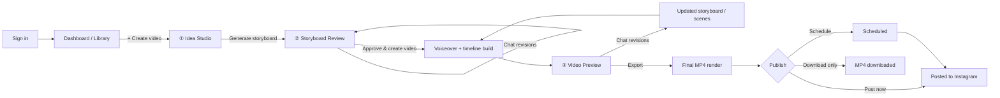
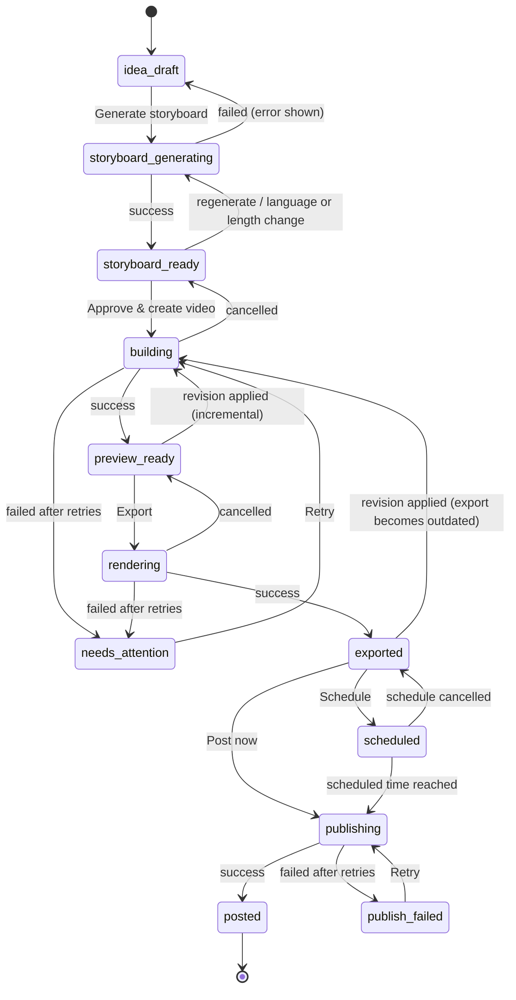
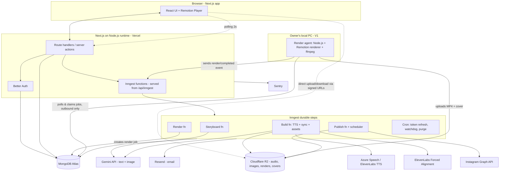

# Product Requirements Document — AI Educational Explainer Video Generator (V1)

| | |
|---|---|
| **Product name** | **Videozilla** *(chosen; see [Appendix E](#e-product-name-candidates) for domain status and a trademark note)* |
| **Market (V1)** | **India** (Hindi + English creators, teachers and edtech brands). Global expansion in later versions. |
| **Document version** | 1.4 (selectable video themes: Midnight default + Mentor; see F4-FR2 and §14.6) |
| **Date** | 2026-10-16 (v1.4: 2026-10-20; v1.5: 2026-10-20, sign-in without email) |
| **Owner** | Product owner (you) |
| **Status** | Draft, ready for review |
| **Platform** | Web app (desktop-first, responsive down to tablet; mobile is view-only friendly) |

---

## Table of contents

1. [Summary](#1-summary)
2. [Problem and opportunity](#2-problem-and-opportunity)
3. [Goals, non-goals and success metrics](#3-goals-non-goals-and-success-metrics)
4. [Target users and personas](#4-target-users-and-personas)
5. [Confirmed decisions](#5-confirmed-decisions)
6. [V1 feature list](#6-v1-feature-list)
7. [Core concepts and glossary](#7-core-concepts-and-glossary)
8. [End-to-end user journey](#8-end-to-end-user-journey)
9. [Detailed feature requirements](#9-detailed-feature-requirements)
10. [Screen inventory and navigation](#10-screen-inventory-and-navigation)
11. [Project lifecycle and state machine](#11-project-lifecycle-and-state-machine)
12. [System architecture](#12-system-architecture)
13. [AI design](#13-ai-design)
14. [Motion graphics system](#14-motion-graphics-system)
15. [Voiceover, synchronization and captions](#15-voiceover-synchronization-and-captions)
16. [Generation pipeline specification](#16-generation-pipeline-specification)
17. [Instagram integration specification](#17-instagram-integration-specification)
18. [Data model](#18-data-model)
19. [API surface](#19-api-surface)
20. [Non-functional requirements](#20-non-functional-requirements)
21. [Content safety, accuracy and legal](#21-content-safety-accuracy-and-legal)
22. [Master edge-case catalogue](#22-master-edge-case-catalogue)
23. [Analytics and instrumentation](#23-analytics-and-instrumentation)
24. [Milestones and delivery plan](#24-milestones-and-delivery-plan)
25. [Risks and mitigations](#25-risks-and-mitigations)
26. [Out of scope and future versions](#26-out-of-scope-and-future-versions)
27. [Open questions](#27-open-questions)
28. [Appendix](#28-appendix)

---

## 1. Summary

Videozilla is a web SaaS that turns a topic, a rough idea or pasted notes into a **60–90 second vertical educational explainer video** with:

- an **AI-written narration** (English or Hindi),
- an **AI voiceover**,
- **motion graphics** (animated text, diagrams, icons, shapes and illustrations) that are **synchronized word-by-word** with the voiceover,
- **burned-in captions**,

and then **publishes it to the user's own Instagram account** as a Reel, either immediately or on a schedule.

The guiding UX principle is **"the AI does the work, the user approves."** The whole product is three steps:

> **① Idea → ② Storyboard (script + visuals in one screen) → ③ Video → Post to Instagram**

Every step is one click forward, and every step can be revised by chatting with the AI.

---

## 2. Problem and opportunity

### Problem
- Educational short-form video performs very well on Instagram Reels, but producing it takes a script, a voiceover, animation skills (After Effects, Canva, CapCut) and editing time. A single 60-second animated explainer can take a skilled creator **3–8 hours**.
- Teachers, edu-creators and small edtech brands have the knowledge but not the time or motion-design skills.
- Existing AI video tools are mostly built around **stock footage, avatars or generic AI clips**. Their visuals rarely *explain* anything: they don't draw the diagram, build the process step by step, or show the comparison at the moment the narrator says it.
- Hindi-language educational content is underserved by most tools.

### Opportunity
- Animated explainers follow a predictable structure (hook → explanation → example → recap), so the work can be automated reliably with **code-rendered motion graphics** driven by an AI scene plan.
- Synchronizing animation to word-level voice timestamps produces "professionally edited" results that pure AI video models cannot reliably match.
- Built-in publishing to Instagram closes the loop from idea to posted Reel in **under 10 minutes**.

---

## 3. Goals, non-goals and success metrics

### 3.1 Goals (V1)
1. A new user can go from sign-up to a **finished, exported 60–90s explainer in under 10 minutes** of their own time.
2. Videos look **intentionally designed**: animations land on the spoken words, text is readable, layouts respect Instagram's UI safe zones.
3. **English and Hindi** narration and captions are both first-class.
4. Users can **revise by chatting** ("make scene 3 simpler", "make the whole thing more fun") without manual editing tools.
5. Users can **post or schedule** directly to their connected Instagram professional account.
6. Generation is **reliable**: work is never lost, progress is understandable, and failures recover automatically or with one click.

### 3.2 Non-goals (V1)
- No timeline editor or manual keyframing. Users don't drag elements around.
- No AI-generated cinematic video clips (deferred to a later version).
- No talking avatars, face cams or user-uploaded footage.
- No billing, plans or credit system (internal usage caps only, see §20.6).
- No video types other than educational explainers (no brand ads, no storytelling).
- No platforms other than Instagram (no YouTube Shorts or TikTok).
- No teams or shared workspaces.
- No native mobile apps.

### 3.3 Success metrics

| Metric | Definition | V1 target |
|---|---|---|
| Activation rate | % of new sign-ups who export at least one video within 7 days | ≥ 40% |
| Time to first video | Median time from "Create video" click to first successful render | ≤ 10 min |
| Storyboard acceptance | % of storyboards approved with ≤ 2 revision requests | ≥ 70% |
| Render success rate | % of render jobs that finish without user-visible failure (after auto-retries) | ≥ 97% |
| Publish success rate | % of publish attempts that reach "Posted" | ≥ 95% |
| Render latency | p50 / p95 time to render a 90s video once the render agent starts it (excludes queue wait) | ≤ 5 min / ≤ 8 min on the V1 local PC |
| Week-2 retention | % of activated users who create another video in their 2nd week | ≥ 25% |
| Quality score | Average user rating (1–5 thumbs prompt after export) | ≥ 4.0 |

---

## 4. Target users and personas

| Persona | Description | Primary needs | Language |
|---|---|---|---|
| **Edu-creator** (primary) | Runs an Instagram page about science, finance, history, tech or general knowledge. Posts 3–7 Reels a week. | Volume, speed, consistent style, hooks that retain viewers | English and/or Hindi |
| **Teacher / tutor** | School or coaching teacher who wants to post concept explainers for students or to grow a tutoring brand. | Accuracy, simplicity, pasting their own notes | Hindi and English |
| **Edtech / small brand marketer** | Runs social media for a coaching institute, edtech startup or course creator. | Professional look, reliable scheduling, a few styles to match the brand | English, Hindi |

**Primary persona for V1 design decisions:** the edu-creator, who needs speed and posting consistency.

### Key jobs-to-be-done
- "When I have a topic in mind, I want a ready-to-post explainer Reel quickly, so I can stay consistent without spending hours editing."
- "When I have class notes, I want them turned into a short visual explanation, so my students understand faster."
- "When the AI gets something slightly wrong, I want to tell it in plain words what to change, so I don't need editing skills."

---

## 5. Confirmed decisions

| # | Decision | Notes |
|---|---|---|
| D1 | V1 = **educational explainer videos only** | Other types later |
| D2 | Visuals = **code-rendered motion graphics** (text, diagrams, icons, shapes, illustrations) synced to voiceover | AI video clips deferred |
| D3 | Script and storyboard are **one combined review screen** | No separate script step |
| D4 | Duration target **60–90 seconds** | Two presets: ~60s and ~90s |
| D5 | Languages: **English and Hindi** | Narration and captions |
| D6 | **Voiceover over visuals**, no avatar | — |
| D7 | Users connect **their own Instagram** account (professional account) | Post now or schedule |
| D8 | **Captions are always included** (burned in), style follows the selected visual style | User can toggle them off (P1) |
| D9 | LLM: **Google Gemini API**. Storyboard and revisions on `gemini-4-argon`, idea planning on `gemini-3.8-flash`, small helper tasks on `gemini-3.5-flash-lite`. Illustrations on `gemini-nano-banana-2.1`. | See note below and §13.1 |
| D10 | Video engine: **Remotion** (React-based programmatic video). **V1 final renders run on the owner's local PC** through a small **render agent** (§12.6). Remotion Lambda (AWS) is the scaling path for later. | License: free for individuals and companies with ≤ 3 people. Vercel can't run video renders. Decided in v1.2. |
| D11 | Voice: **ElevenLabs** (`eleven_multilingual_v2`) is the **voice provider for V1** (English and Hindi), using the `/with-timestamps` endpoint for timings, with `previous_text`/`next_text` so per-scene audio sounds continuous. **ElevenLabs Forced Alignment API** is the timing fallback. Azure AI Speech stays behind the same interface as an optional backup. | Changed in v1.3 (was Azure default) |
| D12 | Stack: **Next.js on Node.js (TypeScript), hosted on Vercel** + **MongoDB Atlas** (database) + **Better Auth** (authentication) + **Cloudflare R2** (all file storage) + **Inngest** (durable background jobs) | Revised in v1.1 (was Supabase) |
| D13 | Billing deferred | Internal caps protect costs |
| D14 | **India-first V1** (§5.1) | Global expansion later |
| D15 | Instagram is linked with a **"Connect Instagram" button** (official Instagram Login), then posting is automatic on approval or at the scheduled time (§9 F9) | Decided in v1.2 |
| D16 | **Sign-in without email (2026-10-20):** email + password accounts work at once, with no verification email, and no password-reset email for now ("Forgot password" hidden); Google sign-in stays. Resend isn't used for auth. | Trade-off: an email address isn't proven to belong to its account holder, and there's no self-serve password reset until email returns. Google isn't auto-linked to password accounts. |

> **Note on D9 (Gemini):** A **Google AI Pro subscription covers the Gemini app, not the Gemini API.** API usage is billed separately through **Google AI Studio / Google Cloud**. The free tier covers `gemini-3.8-flash` and `gemini-3.5-flash-lite` only. `gemini-4-argon` and the image models have **no free tier**. Free-tier content **is used to improve Google's products**; paid-tier content is not. So:
> - **Development:** run every text task on `gemini-3.8-flash` (free tier) using test topics only.
> - **Production:** use a **paid API key** with the model mix in §13.1.
>
> `gemini-4-argon` costs $2 / $10 per 1M input/output tokens until 2026-11-30, then $4 / $20. The LLM sits behind a provider interface (§12.3) and model IDs live in config, so models can be swapped without code changes. Model IDs and prices were checked on 2026-10-16 against Google's docs and must be re-checked before launch.

### 5.1 India-first defaults (V1)

| Area | Default / rule |
|---|---|
| Video language | Asked once during onboarding (**Hindi** or **English**), then used as the default for new projects |
| Time zone | **Asia/Kolkata (IST)** by default for scheduling and display; changeable in settings |
| Audience levels | Kids (8–12) · **School students (Class 6–12; CBSE, ICSE and state boards)** · **College & competitive exams** (JEE, NEET, UPSC, etc.) · General adults |
| Examples and context | AI prefers Indian examples, names, places and units (₹, km, °C, lakh/crore) unless the topic needs otherwise |
| Numbers | Indian digit grouping on screen (1,00,000); lakh/crore in Hindi narration |
| Hinglish | Hindi narration may keep common English technical terms (in Latin or Devanagari script, per the AI's judgment and the user's revisions) |
| Voices | Indian-accent English voices first (`en-IN-NeerjaNeural`, `en-IN-PrabhatNeural`), then Hindi voices |
| Hashtags | Mix of Indian and global education hashtags (e.g. #StudyWithMe, #CBSE, #UPSCPreparation, #ScienceFacts) chosen per topic |
| Infrastructure regions | MongoDB Atlas in **Mumbai** (AWS ap-south-1); Vercel functions in **Mumbai (bom1)**; Azure Speech in **Central India**; R2 with an Asia-Pacific location hint; ElevenLabs India data residency (`api.in.residency.elevenlabs.io`) evaluated during M0 |
| Privacy law | India's **DPDP Act**: clear consent at sign-up, purpose-limited use, deletion on request (§20.4) |
| Payments (later) | Razorpay first (UPI, cards), INR pricing |
| App UI | English in V1; Hindi UI in V1.1 |

---

## 6. V1 feature list

| # | Feature | Summary | Priority |
|---|---|---|---|
| F1 | **Account and project library** | Sign in, create videos, resume drafts, view previous videos | P0 |
| F2 | **AI idea planning** | Brainstorm a topic, start from your own idea, or paste notes | P0 |
| F3 | **Combined script and storyboard** | One review screen with narration and visual plan for each scene | P0 |
| F4 | **Simple creative tools** | 60–90s target, a few visual styles, small voice selection | P0 |
| F5 | **Motion graphics generation** | Animated diagrams, text, icons, shapes and illustrations explaining the topic | P0 |
| F6 | **Narration sync and captions** | Scene timing, animation events and captions synced to the voiceover | P0 |
| F7 | **Conversational revisions** | Request changes to the whole video or a specific scene by chat | P0 |
| F8 | **Video preview and export** | Vertical 1080×1920 MP4 ready for Instagram Reels | P0 |
| F9 | **Instagram publishing** | Connect an eligible account, post now or schedule | P0 |
| F10 | **Reliable generation** | Auto-saved work, understandable progress, recovery from failures | P0 |

Priority key: **P0** = must ship in V1. **P1** = should ship in V1 if time allows. **P2** = later. Individual requirements inside each feature carry their own priority.

---

## 7. Core concepts and glossary

| Term | Meaning |
|---|---|
| **Project** | One video from idea to publication. Has a title, a language, settings, a status, and history. |
| **Idea brief** | The output of idea planning: chosen topic, angle, audience level, key points, and any source notes. |
| **Storyboard** | The AI-generated plan for the whole video: an ordered list of scenes plus global metadata (title, hook, caption, hashtags). Stored as **versions**. |
| **Scene** | One segment of the video (typically 5–12 s). Has narration text, a **scene type** (visual template), visual props, and **animation cues**. |
| **Scene type** | A pre-built animated component (e.g. Flowchart, Comparison, Timeline). The AI chooses a type and fills its props. See §14. |
| **Cue / anchor** | A link between a visual event (e.g. "show arrow 2") and a word or phrase in the narration. Used to sync animation to speech. |
| **Theme** (stored as `styleId`, also called "style") | A selectable video look, chosen per video: palette, fonts, background, motion feel, caption look, **and** layout and motion-graphics structure (chapter header, central diagram, HUD panels, optional presenter character). See §14.6. |
| **Voice** | A TTS voice (provider + voice ID + language). |
| **Voice track** | The synthesized audio for each scene plus word-level timestamps. |
| **Timeline** | The resolved, time-stamped plan (in frames) combining storyboard, voice track and style. This is the input to the renderer. |
| **Live preview** | In-browser playback of the timeline with the Remotion Player. No MP4 is needed. |
| **Render** | Final MP4 produced by the render service. |
| **Revision** | A change request made by chat, producing a new storyboard version. |
| **Publish job** | A request to post a render to Instagram, immediately or at a scheduled time. |
| **Pipeline run** | One execution of the generation steps, with persisted step states for resume and retry. |

---

## 8. End-to-end user journey

### 8.1 Happy path



### 8.2 Narrative walkthrough (happy path)

1. **Sign in** with Google or email. A first-time user sees a 3-card welcome ("Idea → Storyboard → Video") and lands on an empty library with one big **"+ Create video"** button.
2. **Idea Studio.** The user picks one of three starts:
   - *"Help me find a topic"*: enters a subject or niche ("Physics for class 10"), and the AI suggests 5 video ideas with hooks.
   - *"I have an idea"*: types one line ("Why is the sky blue?").
   - *"Use my notes"*: pastes notes; the AI extracts the key teachable points.

   The user picks **Language** (English/Hindi), **Length** (~60s/~90s), **Audience** (Kids/Students/General), **Style** and **Voice**. Sensible defaults are pre-selected. They can chat to refine the idea, then click **"Generate storyboard"**.
3. **Storyboard Review** (about 20–40 s to generate). One screen shows:
   - Title, hook, estimated duration.
   - A vertical list of **scene cards**, each with narration text, a visual plan (scene type + an animated thumbnail preview), and on-screen text.
   - The Instagram caption and hashtags.
   - A **chat panel** for revisions ("Make the hook more surprising", "Scene 4: use a diagram instead of bullets").

   The user clicks **"Approve & create video"**.
4. **Building** (about 30–90 s). A progress view shows clear steps: *Recording voiceover → Syncing animations → Preparing preview*.
5. **Video Preview.** The video plays instantly in the browser (live preview). The user can:
   - Watch it, and scrub through scenes.
   - Ask for changes via chat for the whole video or a selected scene. Only affected scenes are regenerated.
   - Click **"Export video"**, which renders the final MP4 (about 2–5 min plus any queue wait in V1, runs in the background).
6. **Publish.** Once the MP4 is ready:
   - **Post now** to the connected Instagram account (caption pre-filled and editable),
   - **Schedule** for a date and time (in the user's time zone), or
   - **Download MP4**.
7. The project shows **Posted** (with a link to the Reel) or **Scheduled** in the library.

### 8.3 Key alternate journeys

| Journey | Flow |
|---|---|
| Resume a draft | Library → draft card → opens at the last step reached, with all state restored |
| Leave mid-generation | User closes tab during build or render → job continues server-side → email or in-app notification when ready → user returns to the correct step |
| Re-edit a posted video | Library → posted project → "Duplicate as new version" (posted Reels can't be edited on Instagram) |
| Not connected to Instagram at publish time | Publish → "Connect Instagram" inline flow → returns to publish dialog with state preserved |
| Failure during render | Progress shows the failed step → automatic retries → if still failing: plain-language message + "Retry" (resumes from failed step) |

---

## 9. Detailed feature requirements

Each feature lists user stories, functional requirements (FR), UX notes, edge cases and acceptance criteria (AC).

---

### F1. Account and project library

#### User stories
- As a new user, I can sign up with Google or email so that I can start quickly.
- As a returning user, I can see all my videos and their statuses so I know what needs attention.
- As a user, I can resume a draft exactly where I left off.
- As a user, I can rename, duplicate or delete projects.

#### Functional requirements

| ID | Requirement | Priority |
|---|---|---|
| F1-FR1 | Sign-up and sign-in via **Google OAuth** and **email + password**, via **Better Auth** with its MongoDB adapter. **No email is sent** (D16): an account works as soon as it's created, with no verification step. Email and password are checked with Zod in the form and on the server (email trimmed, lowercased and a valid format; password 8–128 characters), passwords are stored hashed, and sign-in / sign-up are rate-limited. | P0 |
| F1-FR2 | Password reset via email link — **deferred** (D16): no "Forgot password" until email returns; a forgotten password needs support (Google sign-in isn't linked to a password account, so it can't stand in). | P0 → later |
| F1-FR3 | Session persists across browser restarts (Better Auth database sessions in an httpOnly secure cookie, 30-day rolling expiry); sign-out from the profile menu; "sign out of all devices" in settings | P0 |
| F1-FR4 | Onboarding: a 3-card intro on first sign-in (skippable), plus collecting display name, preferred video language (Hindi / English) and what they teach or create about (optional, used to tailor idea suggestions). Time zone defaults to IST. | P0 |
| F1-FR5 | **Library page** shows project cards: thumbnail (first frame or title card), title, status badge, language, duration, last updated | P0 |
| F1-FR6 | Status badges: `Draft – Idea`, `Draft – Storyboard`, `Building`, `Ready to review`, `Rendering`, `Ready`, `Scheduled`, `Posted`, `Needs attention` (failed/action needed) | P0 |
| F1-FR7 | Filter by status group (All / Drafts / Ready / Scheduled / Posted), search by title, sort by last updated (default) or created | P0 |
| F1-FR8 | Card actions: Open, Rename, Duplicate, Delete | P0 |
| F1-FR9 | Opening a project routes to the correct step for its status (see §11) | P0 |
| F1-FR10 | Delete = soft delete with confirmation; hidden immediately, purged (including files) after 30 days; "Undo" toast for 10 s | P0 |
| F1-FR11 | Duplicate copies the idea brief and latest storyboard, but not renders or publish history | P1 |
| F1-FR12 | Account settings: display name, default language, default style/voice, connected Instagram account(s), time zone, notification preferences, delete account | P0 |
| F1-FR13 | **Delete account**: confirmation by typing "DELETE"; revokes Instagram tokens, cancels scheduled posts, purges data within 30 days | P0 |
| F1-FR14 | Pagination or infinite scroll for libraries with more than 24 projects | P1 |

#### UX notes
- Empty state: an illustration plus "Create your first explainer" CTA and 3 example ideas to click ("How do vaccines work?", "What is compound interest?", "Photosynthesis in 60 seconds").
- "Needs attention" projects are pinned at the top of the library.

#### Edge cases
- Google sign-in with an email that already has a password account → **not** linked automatically (D16: the password account's email isn't proven, so linking would let someone who pre-registered that address share the Google owner's account); show "This email is registered with a password. Sign in with your password." Accounts linked before D16 stay linked.
- Accounts created before D16 that never verified their email sign in like any other (no verification step any more).
- User deletes a project with a **scheduled** post → warn "This will cancel the scheduled post on <date>" → cancel the publish job on confirmation.
- User deletes a project while it's **building or rendering** → cancel the pipeline run, then delete.
- Duplicate of a project whose storyboard is mid-generation → duplicate the last completed version only.
- Two tabs open on the same project → last-write-wins on settings; storyboard edits use version numbers (optimistic concurrency); the stale tab shows "This project was updated in another tab. Reload."
- Project with a very long title (> 80 chars) → truncate with ellipsis on cards; full title in tooltip and editor.
- Session expires mid-action → silent refresh; if refresh fails, preserve unsent chat text locally and redirect to sign-in, then return.

#### Acceptance criteria
- AC1: A new user can sign up with Google in ≤ 3 clicks and land on the library.
- AC2: After closing the browser on the storyboard step, reopening the project shows the same storyboard and chat history.
- AC3: Deleted projects disappear immediately and can be restored with Undo within 10 s.

---

### F2. AI idea planning (Idea Studio)

#### User stories
- As a creator without a topic, I can ask the AI for video ideas in my niche.
- As a creator with an idea, I can type it and have the AI sharpen it.
- As a teacher, I can paste my notes and have them turned into a focused video idea.
- As a user, I can chat with the AI to refine the idea before generating the storyboard.

#### Functional requirements

| ID | Requirement | Priority |
|---|---|---|
| F2-FR1 | Three start modes on one screen as tabs or segmented control: **Find a topic**, **I have an idea**, **Use my notes** | P0 |
| F2-FR2 | **Find a topic**: user enters a subject or niche (+ optional audience). AI returns **5 idea cards**, each with title, one-line hook, angle and 3 key points. Actions per card: *Use this* / *More like this*. "Suggest 5 more" button. | P0 |
| F2-FR3 | **I have an idea**: free-text input (max 500 chars). AI returns a refined **Idea brief** (title, hook, angle, 3–5 key points, suggested audience) plus 2 alternative angles. | P0 |
| F2-FR4 | **Use my notes**: textarea for pasted text (max **20,000 chars**). AI extracts a teachable focus that fits 60–90 s and lists what is included and what is left out. Supports notes in any language; output follows the selected video language. | P0 |
| F2-FR5 | **Idea chat**: a chat thread under the brief lets the user refine ("make it for kids", "focus on the second point"). Each AI reply updates the brief in place (visible highlight of changes). | P0 |
| F2-FR6 | Settings panel (pre-filled defaults): Language, Length (~60s / ~90s), Audience level (Kids 8–12 / School students Class 6–12 / College & competitive exams / General adults, see §5.1), optional **Board or exam** tag (CBSE, ICSE, State board, JEE, NEET, UPSC, None) that steers examples and terminology, Style, Voice. See F4. | P0 |
| F2-FR7 | Users can directly edit brief fields (title, key points) as plain text, without chat. | P1 |
| F2-FR8 | **"Generate storyboard"** primary button, enabled once a brief exists. | P0 |
| F2-FR9 | Idea state (mode, inputs, suggestions, chat, brief, settings) auto-saves (see F10). | P0 |
| F2-FR10 | Responses stream into the UI (typing effect) so the first text appears in < 2 s. | P1 |
| F2-FR11 | The project title defaults to the brief title and is editable. | P0 |

#### Idea brief structure
```json
{
  "title": "Why Is the Sky Blue?",
  "hook": "The sky isn't actually blue — your eyes are being tricked by tiny air molecules.",
  "angle": "Explain Rayleigh scattering using a simple analogy of light bouncing",
  "audience": "students",
  "key_points": [
    "Sunlight contains all colors",
    "Air molecules scatter short wavelengths (blue) more",
    "Why sunsets are red/orange"
  ],
  "source_notes_summary": null,
  "out_of_scope": ["Mie scattering details"]
}
```

#### Edge cases
- Topic is too broad ("Explain physics") → AI proposes narrower angles that fit 60–90 s instead of trying to cover everything.
- Topic is too narrow or trivial for 60 s ("What is 2+2") → AI suggests broadening ("Why addition works / number line explainer") or warns that the video may be short.
- Notes exceed 20,000 chars → block the paste beyond the limit with a counter, and suggest pasting the most relevant section.
- Notes are gibberish, empty or only whitespace → inline validation "Paste some text with content to explain".
- Notes include tables, bullet symbols or LaTeX → accepted as plain text; the AI interprets them.
- Notes in a different language from the selected video language → AI translates the concepts; show a note "Your notes are in X; the video will be in Hindi."
- Mixed Hindi-English (Hinglish) input → accepted; output follows the selected language. Common English technical terms are kept in Hindi narration where natural ("photosynthesis" may appear as "फोटोसिंथेसिस (प्रकाश संश्लेषण)").
- Unsafe or prohibited topic (§21) → polite refusal with a reason category and suggestions for a safe adjacent topic.
- Sensitive but allowed topics (medical, financial, legal) → allowed with an automatic "for educational purposes" disclaimer scene (§21).
- Current-events or fast-changing topics ("today's stock market") → AI warns that facts may be out of date and avoids specific figures unless the user provides them in notes.
- The LLM returns malformed output → automatic retry (up to 2) with a repair prompt; then show "Couldn't generate ideas. Try again."
- The user changes language after a brief exists → the brief is regenerated in the new language (confirm first: "Regenerate brief in Hindi?").
- The user spams "Suggest 5 more" → rate limited (see §20.6); duplicates against previous suggestions are avoided by passing prior titles to the prompt.

#### Acceptance criteria
- AC1: From "Find a topic", entering "biology for class 9" yields 5 distinct, age-appropriate ideas in ≤ 10 s.
- AC2: Pasting 3 pages of notes yields a brief that cites only content present in the notes (no invented facts beyond common knowledge).
- AC3: All idea-planning content survives a page refresh.

---

### F3. Combined script and storyboard

#### User stories
- As a user, I see the whole video plan (what will be said and shown) on one screen.
- As a user, I can approve it with one click or ask for changes.
- As a user, I can preview how a scene will look before the full video is built.

#### Functional requirements

| ID | Requirement | Priority |
|---|---|---|
| F3-FR1 | Clicking "Generate storyboard" produces a **Storyboard v1** via the LLM using the idea brief and settings. The UI shows a skeleton with progressive reveal of scenes as they stream in. | P0 |
| F3-FR2 | Storyboard header: title, hook line, language, style, voice, **estimated duration** (from word count, see §15.2), scene count. | P0 |
| F3-FR3 | **Scene cards** in order. Each shows scene number and role (Hook / Explain / Example / Recap / Outro); **narration text**; **visual plan** (scene type name, short human description, on-screen text and labels); estimated scene duration; and an **animated thumbnail** rendered in-browser with Remotion Player using placeholder timing. | P0 |
| F3-FR4 | Social panel: **Instagram caption** (≤ 2,200 chars), **hashtags** (5–15, max 30), and a suggested cover text. | P0 |
| F3-FR5 | **Revision chat** panel (see F7) is docked on the right (desktop) or as a bottom sheet (tablet). | P0 |
| F3-FR6 | Users can **select a scene** (click card), which scopes the next chat message to that scene (chip shows "Editing: Scene 3"). | P0 |
| F3-FR7 | Light direct edits without chat: edit narration text inline, edit on-screen text inline, delete a scene, reorder scenes (drag), and "Regenerate this scene" button. Each edit creates a new storyboard version. | P1 |
| F3-FR8 | **Version history** dropdown: list of versions with timestamp and change summary; "Restore this version". | P1 |
| F3-FR9 | **Duration guard**: if estimated duration is outside the target window (see §15.2), show a warning chip and an auto-fix button ("Shorten to ~90s"). | P0 |
| F3-FR10 | **Accuracy check badge**: after generation, a lightweight AI self-review flags claims it is unsure about (scene-level warning icon with explanation). Users can ask for a fix in chat or dismiss it. | P1 |
| F3-FR11 | Primary CTA **"Approve & create video"**. Secondary: "Back to idea". | P0 |
| F3-FR12 | Changing Style or Voice at this step does not regenerate the script (styles and voices are applied at build time). Changing **Language** or **Length** triggers a regeneration (with confirmation). | P0 |

#### Storyboard structure rules (enforced by schema and validator, see §13.4)
- Scene count: **6–12** for ~60s, **8–16** for ~90s.
- Scene 1 is always a **Hook** (≤ 3 s target for the hook line, ≤ 15 words).
- Last scene is **Recap** or **Outro/CTA** (e.g. "Follow for more science in 60 seconds").
- Each scene: 8–40 words of narration (≈ 3–15 s).
- On-screen text per element: ≤ 6 words for keywords, ≤ 12 words for statements, ≤ 4 bullets per scene, ≤ 5 nodes per diagram.
- Every visual cue must reference a phrase that exists in that scene's narration (enables sync).

#### Edge cases
- Generation partially fails (stream cut mid-way) → keep the partial result hidden, retry the whole generation automatically once, then show an error with "Retry". Never show a half storyboard as complete.
- LLM picks a scene type that doesn't exist or props that violate limits → the validator repairs automatically (truncate, split into two scenes, or swap to a fallback type such as KeywordReveal); log the repair.
- A cue anchor phrase isn't present in the narration → the validator re-anchors to the closest matching word (fuzzy match) or falls back to even spacing across the scene.
- User edits narration text so that it no longer contains a cue phrase → the affected cue shows "unsynced" and the system re-anchors at build time (fuzzy) and/or asks the LLM to repair that scene only.
- User deletes all scenes but one → "Approve" is disabled below 3 scenes, with a hint.
- Estimated duration is far off target (> ±25%) → automatic regeneration pass to tighten or expand before showing it to the user.
- Hindi narration with English terms or numbers → numbers are written as digits in on-screen text and as words in narration where TTS needs it (normalization handled in §15.1).
- Formula or equation content → uses the Equation scene type (KaTeX); validation that the LaTeX parses, else fallback to plain text.
- User clicks "Approve" twice quickly → idempotent; a single pipeline run starts.

#### Acceptance criteria
- AC1: A storyboard for a ~60s English video renders on screen in ≤ 30 s (p50) and contains 6–12 valid scenes.
- AC2: Every cue in a generated storyboard resolves to a narration anchor (after validator repair) in ≥ 99% of storyboards.
- AC3: Selecting a scene and sending "simplify this" changes only that scene (other scenes byte-identical).

---

### F4. Simple creative tools

#### Functional requirements

| ID | Requirement | Priority |
|---|---|---|
| F4-FR1 | **Length presets**: "~60 seconds" (target 55–65 s) and "~90 seconds" (target 80–95 s). Hard limits: min 45 s, max 95 s. | P0 |
| F4-FR2 | **Themes**, picked per video with one click in the settings panel (and as an account default). Each has a preview thumbnail and a 3-second looping sample. Launch themes: (1) **Midnight** (**default**): the existing dark tech-explainer look from M0, which must stay as it is: near-black background, white grotesk headline with 1–2 accent-coloured keywords, dim monospace "// section" eyebrow, blur transitions between beats, one persistent "world" with camera moves, glowing HUD chips, counters and node boxes (reference: @dhruvtechbytes "Infinite System Design" reel). (2) **Mentor**: dark explainer with a recurring presenter character (lower left) whose pose changes per beat (pointing, "?" thinking, "!" alarmed, arms crossed at the end); numbered chapters ("01 / …") with a 2-word headline (second word in an accent colour), a one-line subhead and a segmented chapter progress bar; one central diagram that builds up across chapters; a side HUD panel of live counters that turn from green to red when something breaks; a bottom caption box with one accent keyword; a recap of numbered cards lighting up one by one, then a follow CTA (reference: @deeponai.labs "How Uber finds your driver" reel). References are inspiration only: we never copy a creator's branding or character. The earlier style ideas (Clean Light, Chalkboard, Pastel Playful) become optional later themes (see Q8). More reference reels can be added as new themes. | P0 |
| F4-FR3 | Each theme defines its **tokens**: palette (bg, surface, primary, accent, text, muted), heading and body font (each must support **Latin + Devanagari**), easing curves, transition type, caption style, icon style (outline/filled), background texture. A theme can also define **structure**: scene layout variants, chapter header and progress bar, HUD panel, central-diagram behaviour, recap and CTA design, and an optional presenter character with a pose set (§14.6). The same storyboard renders in any theme. | P0 |
| F4-FR4 | **Voices**: 2–3 per language at launch (male and female, neutral Indian and global accents). Each voice has a **"▶ Preview"** sample in the selected language. Voices come from **ElevenLabs** (model `eleven_multilingual_v2`): 2–3 English (Indian-accent first) and 2–3 Hindi voices from the ElevenLabs voice library, picked after the M0 listening test. Exact list finalized in M3. | P0 |
| F4-FR5 | Voice and style changes after the video is built **only re-run the necessary steps** (voice → re-synthesize + re-sync; style → re-render only, no TTS). | P0 |
| F4-FR6 | Caption toggle (on by default). | P1 |
| F4-FR7 | Background music: one auto-selected royalty-free track per style at low volume (ducked under voice), with toggle on/off. | P1 |
| F4-FR8 | Speaking speed: fixed per voice; the system may auto-adjust within **0.92×–1.10×** to fit duration. No user control in V1. | P0 |
| F4-FR9 | **Theme switch** after the storyboard or build keeps the script and voice; it only re-renders (like F4-FR5). If a theme needs extra storyboard data (e.g. Mentor's presenter pose per beat, chapter numbers, central-diagram steps), the storyboard stores it for every theme up front, or a cheap theme-specific step derives it, so switching never regenerates the script. | P0 |

#### Edge cases
- Selected voice is unavailable (provider outage or deprecated) → fall back to the default voice of the same language and gender, and notify the user.
- User selects Hindi but a voice for English → the voice list is filtered by language; switching language resets voice to that language's default.
- A font lacks a glyph (rare symbols, emoji) → fallback font stack includes Noto Sans, Noto Sans Devanagari and Noto Color Emoji.
- Style change after export → creates a new render; the previous MP4 stays available until replaced.

---

### F5. Motion graphics generation

#### User stories
- As a viewer, I see diagrams, keywords and icons appear exactly when they're mentioned, which makes the concept easy to follow.
- As a creator, my videos look professionally animated without me animating anything.

#### Functional requirements

| ID | Requirement | Priority |
|---|---|---|
| F5-FR1 | A **scene-type component library** (§14.2) of **16 animated templates** covering text, lists, diagrams, comparisons, timelines, numbers, equations, icons and illustrations. | P0 |
| F5-FR2 | Every component is **data-driven**: it takes typed props (from the storyboard) and **cue times** (from sync) and is fully deterministic for rendering. | P0 |
| F5-FR3 | Every component supports **both languages**, **every launch theme** (Midnight, Mentor), and **variable text lengths** (auto-fit font sizing with min size limits; overflow → wrap → shrink → validator split). | P0 |
| F5-FR4 | **Icons**: chosen by the AI as keywords and resolved against a curated icon set (Iconify/Lucide, roughly 1,500 vetted icons) with a semantic search index (embedding or keyword synonyms). Unresolvable → generic shape fallback. | P0 |
| F5-FR5 | **Illustrations**: (a) curated library of open-licensed SVG illustrations, tagged by topic (P0); (b) **AI-generated flat illustrations** via `gemini-nano-banana-2.1` (about $0.034 per 1K image, no free tier) in the style's palette, with transparent or solid background, for scenes that need a specific subject (e.g. "a plant cell") (P1). Generated images are cached per project and can be regenerated per scene. | P0 / P1 |
| F5-FR6 | **Transitions** between scenes per style (cut, slide, wipe, morph-fade), ≤ 12 frames (0.4 s), so no narration word is hidden by a transition. | P0 |
| F5-FR7 | **Persistent layout layer**: an optional progress indicator (thin bar showing scene progress), topic title chip in the top area, and a watermark slot (empty in V1). | P1 |
| F5-FR8 | All layouts respect **Instagram Reels safe zones** (§14.4). | P0 |
| F5-FR9 | Animations use **motion principles**: staggered entrances, ease-out on enter, minimum hold time of 0.6 s for any text before it exits, no more than 3 simultaneous moving elements. | P0 |
| F5-FR10 | The **live preview** in the browser and the **final render** must be visually identical (same React components). | P0 |

#### Edge cases
- Text too long for a component even at min font size → validator splits the scene into two (narration split at a sentence boundary) or switches to a text-friendly type.
- Diagram with > 5 nodes requested → split into two sequential scenes ("Part 1 / Part 2"), or summarize.
- Equation LaTeX invalid → render as plain monospaced text; flag in storyboard.
- Icon search returns something semantically wrong (e.g. "cell" → mobile phone) → icon queries include context ("biology cell"); a blocklist and synonym map per domain; users can say "change the icon in scene 3" in chat.
- AI illustration generation fails, is slow (> 30 s) or is blocked by the safety filter → fall back to library illustration or icon composition; never block the build.
- AI illustration contains text or garbled letters → prompt instructs "no text"; we never rely on text inside images (labels are rendered by the component).
- RTL or other scripts are not supported in V1; if present in user notes, translated in narration.

#### Acceptance criteria
- AC1: All 16 scene types render correctly in every launch theme × 2 languages (visual regression snapshots, §20.7).
- AC2: No on-screen text overlaps the Reels safe-zone exclusion areas in any snapshot.
- AC3: Preview and render frames match (pixel diff below threshold) for a sample of 20 frames per scene type.

---

### F6. Narration synchronization and captions

#### User stories
- As a viewer, every keyword, arrow or diagram node appears right as the narrator says it.
- As a viewer, I can follow along with captions even with the sound off.

#### Functional requirements

| ID | Requirement | Priority |
|---|---|---|
| F6-FR1 | Voiceover is synthesized **per scene** with the same voice and settings, so scene-level revisions only re-synthesize changed scenes. | P0 |
| F6-FR2 | TTS must return **word-level timestamps**: Azure word-boundary events, or ElevenLabs character alignment from the `/with-timestamps` endpoint (grouped into words). If timings are missing or broken, call the **ElevenLabs Forced Alignment API** (`POST /v1/forced-alignment`, audio + known text → word timings; supports Hindi). This works for audio from either provider and needs no self-hosted worker. | P0 |
| F6-FR3 | **Scene timing** = scene audio duration + lead-in (0.15 s) + tail pause (0.25–0.4 s, style-dependent). Scene start times are cumulative. Video length = sum of scenes. | P0 |
| F6-FR4 | **Cue resolution**: each cue's anchor phrase is matched to word timestamps (normalized, accent and punctuation-insensitive, fuzzy). The animation event fires at the **start of the anchor's first word minus a lead of 2–4 frames** (so visuals appear just before the word). | P0 |
| F6-FR5 | Unresolved cues → fallback to proportional position based on the anchor's character offset in the narration; logged as `cue_fallback`. | P0 |
| F6-FR6 | **Captions**: generated from word timestamps. Chunked into phrases of max **2 lines, ~28 chars per line (EN) / ~22 chars (HI)**, never splitting a word, with breaks at punctuation when possible. Each phrase is shown from its first word's start to its last word's end + 0.1 s. | P0 |
| F6-FR7 | Caption style per visual style: font, size, stroke/shadow, **active-word highlight** (karaoke-style emphasis on the currently spoken word). | P0 |
| F6-FR8 | Captions are positioned in the **caption band** (§14.4) and never overlap the scene's main text; components reserve the caption band. | P0 |
| F6-FR9 | Captions in **Devanagari** for Hindi. English technical terms inside Hindi narration are shown as written in the narration. | P0 |
| F6-FR10 | **Duration fitting**: after synthesis, if total duration is outside the target window: (1) within ±8%, adjust speaking rate (0.92–1.10×) and re-synthesize; (2) beyond that, ask the LLM to tighten or expand specific scenes and re-synthesize those. Max 2 fitting iterations, then accept with a warning. | P0 |
| F6-FR11 | Export a **.srt** caption file alongside the MP4 (for accessibility and re-use). | P1 |
| F6-FR12 | Pronunciation fixes: a per-project **pronunciation dictionary** (word → phonetic / alias, using SSML `<sub>` / `<phoneme>`), populated automatically for known tricky terms and via chat ("pronounce 'Rayleigh' as 'ray-lee'"). | P1 |

#### Edge cases
- TTS returns audio but no word timings → ElevenLabs forced-alignment fallback; if alignment fails, proportional timing + captions by sentence (degraded but usable), flag internally.
- TTS mispronounces numbers, acronyms or units ("10^8 m/s", "DNA", "km/h") → text normalization step before TTS (§15.1) converts to speakable form, while on-screen text keeps the compact form.
- A word in the narration is repeated in the same scene ("energy ... energy") → anchor matching uses occurrence index from the storyboard (`occurrence: 2`).
- Very short scene audio (< 2 s) → merged with the next scene during validation, or minimum scene duration of 2.5 s enforced with extended visual hold.
- Very long scene audio (> 15 s) → validator splits before synthesis.
- Silence or breath at audio start/end → trim leading/trailing silence > 150 ms before computing timings.
- TTS provider rate limit or outage → retries with backoff; if the provider is down > 2 min, switch to the secondary provider **only if** the user's voice has an equivalent there; otherwise pause the run and notify ("Voice service is busy; we'll retry automatically").
- Hindi caption shaping (matras, conjuncts) must render correctly → rendering in Chromium with Noto Sans Devanagari; covered by visual regression tests.

#### Acceptance criteria
- AC1: For 95% of cues, the visual event starts within **±120 ms** of the anchor word onset (measured on a test set).
- AC2: Caption phrases never exceed 2 lines and never render outside the caption band.
- AC3: Final video duration for "~60s" is within 55–65 s for ≥ 90% of videos; for "~90s", within 80–95 s.

---

### F7. Conversational revisions

#### User stories
- As a user, I can type what I want changed in plain language, for the whole video or one scene.
- As a user, I see what changed before it's applied, and I can undo it.

#### Functional requirements

| ID | Requirement | Priority |
|---|---|---|
| F7-FR1 | Chat available on the **Storyboard** and **Video Preview** screens. Scope chip: "Whole video" (default) or "Scene N" (when a scene is selected; on the preview screen, "Edit this scene" while paused selects the current scene). | P0 |
| F7-FR2 | The LLM converts the request into a **structured revision plan** (§13.5): list of operations (update scene narration/visual/type, insert, delete, reorder, change global tone, change caption, change hashtags, change style, change voice, change length). | P0 |
| F7-FR3 | The AI replies with a short human summary of the change ("I simplified scene 3's narration and replaced the bullet list with a 3-step flowchart."), and the changed scenes are **highlighted** (diff view: old vs new narration on hover). | P0 |
| F7-FR4 | Changes **auto-apply** as a new storyboard version, with **"Undo"** on the chat message (restores the previous version). | P0 |
| F7-FR5 | On the Preview screen, applying a revision triggers an **incremental rebuild**: only changed scenes are re-synthesized and re-synced; the preview updates in place. A banner shows "Updating scenes 3 and 5…". | P0 |
| F7-FR6 | If the request is ambiguous, the AI asks **one clarifying question** with quick-reply chips instead of guessing (e.g. "Which part feels too long — the intro or the example?"). | P0 |
| F7-FR7 | If the request is unsupported (e.g. "add my face", "use this YouTube clip", "make it 5 minutes"), the AI explains why and offers the closest supported alternative. | P0 |
| F7-FR8 | Suggested quick actions as chips: "Make it simpler", "More engaging hook", "Shorter", "Add an example", "More visual", "Translate to Hindi/English". | P1 |
| F7-FR9 | Chat history is stored per project and survives reload; the LLM receives a compacted history (latest storyboard + last N turns + summary). | P0 |
| F7-FR10 | Revision count per project is soft-limited (e.g. 50) with a friendly notice; this is a cost guard. | P1 |

#### Edge cases
- Revision would push duration outside the window ("add 3 more examples" on a 90s video) → AI warns and proposes trade-offs ("I can add one example if I shorten the recap").
- User refers to a scene by content rather than number ("the part about chlorophyll") → LLM resolves via scene content; if multiple matches, clarifies.
- User asks to change something that's outside the storyboard (e.g. "change the font size") → mapped to style options if possible; otherwise explain the limitation.
- Revision request while a build or render is running → queued; UI shows "Will apply after the current build finishes" or offers "Cancel build and apply now".
- Rapid consecutive revisions → processed sequentially per project (per-project concurrency = 1) to avoid version conflicts.
- Revision changes language ("translate to Hindi") → full storyboard regeneration with confirmation; voice switches to the default Hindi voice; full re-synthesis.
- LLM returns an invalid plan (references a non-existent scene, breaks schema) → validator rejects; auto-retry once with the validation errors; then "I couldn't make that change. Try rephrasing."
- Undo after a later revision → Undo is available on the latest change only; older versions are restored via version history.
- Prompt injection inside pasted notes ("ignore previous instructions…") → notes are passed as quoted data with system instructions to treat them as content only (§21.4).

#### Acceptance criteria
- AC1: "Make scene 2 shorter" changes only scene 2 and reduces its word count.
- AC2: An incremental rebuild after a 1-scene change completes in ≤ 20 s (p50) on the preview screen.
- AC3: Undo restores the exact previous storyboard version and preview.

---

### F8. Video preview and export

#### Functional requirements

| ID | Requirement | Priority |
|---|---|---|
| F8-FR1 | **Live preview** using the Remotion Player with the resolved timeline and voice audio. No MP4 needed. Controls: play/pause, scrub, mute, scene markers on the scrub bar, fullscreen, 9:16 frame in a phone-like mock with an optional "Show Instagram UI overlay" toggle (to check safe zones). | P0 |
| F8-FR2 | Scene list beside the player; clicking a scene jumps to it and selects it for chat. | P0 |
| F8-FR3 | **"Export video"** starts the final render job. Output spec: **MP4 (H.264 High, yuv420p), 1080×1920, 30 fps, AAC 48 kHz stereo, ~8–12 Mbps, +faststart**. Target file size < 100 MB for 90 s. | P0 |
| F8-FR4 | Render progress with percentage and ETA; the user can leave the page. | P0 |
| F8-FR5 | When done: a **Download MP4** button (signed URL), a **Publish** button, and a cover image (auto-generated from the hook title card, editable cover text P1). | P0 |
| F8-FR6 | Changing anything after export marks the MP4 as **outdated** ("Your video has changes. Re-export to update.") while keeping the old file downloadable until re-export. | P0 |
| F8-FR7 | Render artifacts retained: latest MP4 per project kept indefinitely (V1); older renders purged after 30 days. | P0 |
| F8-FR8 | Audio mix: voice at −16 LUFS integrated loudness target (Instagram-friendly); music ducked −18 dB under speech; peak ≤ −1 dBTP. | P0 |
| F8-FR9 | Optional **.srt** download (P1) and **cover image PNG** download (P1). | P1 |

#### Edge cases
- Browser can't play the preview (old browser, low memory) → show a message and offer "Render a quick low-res preview MP4" (720p) as a fallback.
- Preview audio and visuals drift on slow devices → Player handles sync, but if dropped frames are detected, recommend "Export to watch the final quality".
- Render fails mid-way → automatic retry (up to 3, see §16) → "Needs attention" with Retry.
- Render agent offline (PC off, asleep or no internet) → job waits in the queue (up to 24 h) with a "taking longer than usual" message; the user is emailed when it's done. After 24 h → "Needs attention" with Retry, and the admin is alerted (§12.6).
- PC loses power or internet in the middle of a render → the lease expires after 10 min and the job is re-queued from the start (partial output discarded).
- Upload to R2 fails (slow or unstable connection) → resumable multipart upload retries; the job isn't marked done until R2 confirms the file.
- Render produces a file that fails validation (duration mismatch > 0.5 s, missing audio stream, wrong resolution) → treated as failure → retry.
- User clicks Export twice → idempotent; the same render job is returned.
- User exports, then changes style, then exports again → the new render replaces "latest"; old one kept 30 days.
- Download link expired → links are generated on click (short-lived signed URLs), so there's no stale link in the UI.

#### Acceptance criteria
- AC1: The exported MP4 passes the validator spec and uploads to Instagram without transcoding errors in 100% of test cases.
- AC2: With the render agent online and idle, a 90 s render (including upload to R2) completes p50 ≤ 5 min, p95 ≤ 8 min.

---

### F9. Instagram publishing

#### User stories
- As a user, I can connect my Instagram professional account once and post from the app.
- As a user, I can post now or schedule a time.
- As a user, I know whether my post succeeded and can open it on Instagram.

#### Functional requirements

| ID | Requirement | Priority |
|---|---|---|
| F9-FR1 | **Connect Instagram** via **Instagram API with Instagram Login** (OAuth), requesting `instagram_business_basic` and `instagram_business_content_publish`. Available from Settings and inline in the Publish dialog. | P0 |
| F9-FR2 | Before connecting, show an **eligibility explainer**: the account must be a **Professional account (Business or Creator)**; personal accounts can switch for free in the Instagram app (link to help). | P0 |
| F9-FR3 | After connect: store the IG user ID, username, profile picture, account type and long-lived token (encrypted); show "Connected as @username". | P0 |
| F9-FR4 | Support **one connected account per user** in V1 (data model supports many). Disconnect button revokes locally and deletes tokens. | P0 |
| F9-FR5 | **Publish dialog**: preview thumbnail, editable caption (pre-filled from storyboard; counter with 2,200 char limit; hashtag count ≤ 30; mention count ≤ 20), "Also share to Feed" toggle (default on), cover selection (auto title-card frame by default), and the choice **Post now** or **Schedule** (date/time picker in the user's time zone; min 10 min ahead, max 75 days ahead). | P0 |
| F9-FR6 | Publishing uses the container flow: create a REELS media container with a public `video_url` → poll status until `FINISHED` → `media_publish` → fetch permalink. See §17. | P0 |
| F9-FR7 | **Scheduling** is handled by our job system (Inngest scheduled function). At the scheduled time, the publish flow runs. The user can **edit caption/time** or **cancel** until 5 minutes before. | P0 |
| F9-FR8 | Status shown on the project and library: `Scheduled for <time>`, `Publishing…`, `Posted ✓ (View on Instagram)`, `Failed – <reason> (Retry)`. | P0 |
| F9-FR9 | Notifications (in-app + email) on post success and failure, including scheduled ones. | P0 |
| F9-FR10 | Before publishing, check the account's **publishing quota** via the API's content publishing limit endpoint; if exhausted, offer scheduling for after the window resets. | P0 |
| F9-FR11 | Token maintenance: long-lived tokens (~60 days) are **auto-refreshed** by a daily job when older than 24 h and nearing expiry; on refresh failure, mark the connection `needs_reconnect` and notify the user (and warn on scheduled posts). | P0 |
| F9-FR12 | Meta **App Review** for `instagram_business_content_publish` must be completed before public launch; until then only testers/roles on the Meta app can connect. | P0 (launch blocker) |
| F9-FR13 | **"Post automatically when ready"** option in the Publish dialog: the user approves before export finishes, and the Reel is posted as soon as the MP4 is ready (or at the scheduled time). Shown only when an account is connected. | P1 |

#### The "Connect Instagram" button: step-by-step flow

**Where the button appears:**
- **Settings → Connected accounts:** a "Connect Instagram" button with the Instagram logo.
- **Publish dialog:** if no account is connected, the "Post now" and "Schedule" buttons are replaced by "Connect Instagram to post".
- **Video Preview screen:** a small banner, "Connect Instagram to post with one click", shown until an account is connected (dismissible).
- **Onboarding (optional step):** "Want to post straight to Instagram? Connect now or later."

**What happens when the user clicks it:**
1. **Eligibility check (our screen).** A short modal: "Your Instagram account must be a **Professional account** (Creator or Business). It's free to switch in the Instagram app: Settings → Account type and tools → Switch to professional account." Buttons: **Continue** / "How to switch" (help link).
2. **Instagram login (Instagram's screen).** We redirect to Instagram's official login and consent page. The user logs in to Instagram there (we never see their password) and approves the permissions: basic profile info and publishing content.
3. **Return to Videozilla.** Instagram sends the user back to our callback URL. We swap the short-lived code for a long-lived token, fetch the username, profile picture and account type, and save them (token encrypted).
4. **Confirmation.** The user lands back where they started (Settings or the Publish dialog), now showing **"Connected as @username"** with the profile picture, plus a **Disconnect** button.

**After connecting, posting is one click:**
- **Post now:** the Reel is uploaded and published; status goes "Uploading to Instagram…" → "Instagram is processing…" → **"Posted ✓ View on Instagram"**.
- **Schedule:** picks a date and time (IST by default); Videozilla posts it automatically then, even if the user's browser is closed.
- **Post automatically when ready (P1):** approve now and it posts as soon as the export finishes.

**Connection states shown in Settings:**

| State | What the user sees | Action |
|---|---|---|
| Not connected | "Connect Instagram" button | Connect |
| Connected | "Connected as @username" | Disconnect |
| Needs reconnect (token expired, password changed, access removed) | Warning: "Reconnect Instagram to keep posting" + count of affected scheduled posts | Reconnect (same flow) |
| Not eligible (personal account) | "This is a personal account. Switch to a Professional account, then try again." | How to switch / Try again |

**Alternatives considered (not chosen):**
- **Download and post manually:** always available as a fallback ("Download MP4"), but it isn't automatic.
- **Third-party posting services** (social media scheduling APIs): they add a monthly cost and a dependency, and users would have to connect yet another service. Not needed, because the official Instagram API does what we need for free.
- **Logging in with the user's Instagram password, or browser automation:** against Instagram's terms, unsafe for users, and likely to get accounts blocked. **Never used.**

#### Edge cases
- User has a **personal** account → API rejects; show eligibility guide with steps to switch to Professional, then "Try again".
- User denies permissions in OAuth or unchecks publish permission → show "We need permission to publish Reels" with a retry button.
- OAuth cancelled or window closed → return to the dialog with no change.
- User connects an account, then changes password or revokes access in Instagram → the next API call fails with an auth error → mark `needs_reconnect`, notify, and pause scheduled posts (they fail with "Reconnect Instagram" + Retry once reconnected).
- **Video URL not reachable** by Meta (signed URL expired or blocked) → use a dedicated publish URL valid for ≥ 2 hours, served from R2 with correct `Content-Type: video/mp4`; regenerate per attempt.
- Container status `ERROR` (e.g. unsupported format) → log the error code; auto-retry once by re-creating the container; then fail with a plain message.
- Container still `IN_PROGRESS` after 10 min → keep polling (every 30 s) up to 30 min, then fail with retry.
- Container `EXPIRED` (not published within 24 h) → re-create the container.
- **Duplicate post protection**: the publish job is idempotent; if `media_publish` timed out but succeeded, check recent media for the same container before re-publishing.
- Publishing rate limit reached → schedule automatically for the next available window (with user consent in the dialog) or fail with clear message.
- Caption too long or too many hashtags → blocked in UI before submit; server-side validation too.
- Scheduled time in the past (clock skew, edited late) → block in UI; server-side treats as "post now" only if within 5 min, else reject.
- User changes time zone after scheduling → stored as UTC; display updates; the post time doesn't change.
- The project is edited after scheduling (new export) → ask "Use the new version for the scheduled post?" Default: yes, with the latest export; if the new export is still rendering at post time, wait up to 15 min, then post the old version or fail (user preference in the dialog; default: wait then fail with notification).
- User deletes the MP4/project with a scheduled post → cancel the scheduled publish (warned earlier).
- Meta API outage → retry with backoff for up to 2 hours for scheduled posts; then fail and notify.
- User disconnects Instagram with scheduled posts pending → warn and cancel those posts on confirmation.
- Account is a Business account connected to a Facebook Page with restrictions → API errors mapped to "Instagram rejected this post: <reason>".
- Music copyright: our bundled music is royalty-free and licensed for social use; users can't upload music in V1.

#### Acceptance criteria
- AC1: A connected Creator account can "Post now" and see "Posted ✓" with a working permalink within 3 min (p50) after clicking.
- AC2: A scheduled post publishes within ±2 min of the scheduled time.
- AC3: Expired or revoked tokens never cause silent failures; the user is notified within 5 min of detection.

---

### F10. Reliable generation

#### User stories
- As a user, I never lose work, even if I close the tab or my internet drops.
- As a user, I always know what the system is doing and how long it will take.
- As a user, when something fails, it either fixes itself or I can retry with one click.

#### Functional requirements

| ID | Requirement | Priority |
|---|---|---|
| F10-FR1 | **Auto-save**: all user inputs (idea text, notes, settings, inline edits, chat drafts) save automatically (debounced 800 ms) with a status indicator ("Saved" / "Saving…" / "Offline — will save when reconnected"). Unsent chat text is also kept in localStorage. | P0 |
| F10-FR2 | **Durable pipeline**: every long-running operation (storyboard generation, voice synthesis, sync, illustration generation, render, publish) runs as a **durable job** (Inngest) with persisted step outputs. A job survives server restarts and resumes from the last completed step. | P0 |
| F10-FR3 | **Understandable progress**: progress UI lists named steps with states (pending / running / done / failed / skipped), a progress percentage for rendering, and an ETA based on historical medians. Messages are written in plain language, not internal error codes. | P0 |
| F10-FR4 | **Live progress updates** to the browser by polling the project's run status endpoint (TanStack Query): every 2 s while a job is active, and stopped when idle or the tab is hidden. Vercel functions can't hold long-lived WebSocket connections, so polling is the V1 approach. Inngest Realtime or a hosted pub/sub service (Ably/Pusher) is a later upgrade if needed. | P0 |
| F10-FR5 | **Automatic retries** with exponential backoff and jitter per step (§16.3). Distinguish retryable (timeouts, 429, 5xx) from non-retryable (validation, safety refusal, auth) errors. | P0 |
| F10-FR6 | **Manual retry** resumes from the failed step (not from scratch). "Start over" is a separate, explicit action. | P0 |
| F10-FR7 | **Cancellation**: user can cancel a build or render; running external calls finish or are abandoned, and the state returns to the previous stable status. | P0 |
| F10-FR8 | **Idempotency**: every job has an idempotency key (project + version + step); duplicate clicks or retries never produce duplicate renders or posts. | P0 |
| F10-FR9 | **Notifications**: in-app toast + notification center; email (via Resend) for render complete, render failed, post published, post failed, Instagram reconnect needed. Users can mute email notifications. | P0 |
| F10-FR10 | **Graceful degradation**: optional steps (AI illustrations, music, accuracy check) never block the pipeline; on failure they fall back and log. | P0 |
| F10-FR11 | **Stale job watchdog**: a scheduled job marks steps stuck beyond 3× their p95 duration as failed and triggers retry or alert. | P0 |
| F10-FR12 | **Observability**: structured logs per run ID, Sentry for errors, a basic admin view listing failed runs with step error details. | P0 |

#### Edge cases
- Internet drops while typing → local buffer + "Offline" indicator; sync on reconnect; on conflict, server version wins for settings, and the local draft is kept for chat input.
- User opens the project on another device while a job runs → both see the same live progress.
- A provider changes its output format (e.g. TTS timestamps missing) → schema validation catches it → fallback path (forced alignment) → alert.
- Job exceeds max retries → project status `Needs attention`; the error message includes what the user can do ("Try again", "Change voice", "Contact support" with run ID).
- Deploy during a running render → durable steps resume after deploy; renders keep running on the local render agent, independent of Vercel deploys.
- Partial outputs (e.g. 7 of 9 scenes synthesized) → persisted; retry continues with the remaining 2.

#### Acceptance criteria
- AC1: Forcing a step to fail mid-pipeline (e.g. a function timeout or redeploy) resumes the run without user action and without re-running completed steps.
- AC2: No user-visible "unknown error" messages; every failure maps to a plain-language message with an action.
- AC3: Refreshing the page at any moment never loses more than 1 s of typed input.

---

## 10. Screen inventory and navigation

| # | Screen | Purpose | Key elements |
|---|---|---|---|
| S1 | **Sign in / Sign up** | Auth | Google button, email form (no "Forgot password" until email returns, D16) |
| S2 | **Onboarding** (first run) | Explain 3 steps | 3 cards, default language picker |
| S3 | **Library (Dashboard)** | All projects | "+ Create video", filters, search, project cards, "Needs attention" section |
| S4 | **Idea Studio** | Step ① | Mode tabs, input area, idea cards, brief panel, idea chat, settings panel, "Generate storyboard" |
| S5 | **Storyboard Review** | Step ② | Header (title/duration/settings), scene cards with thumbnails, social panel, revision chat, version history, "Approve & create video" |
| S6 | **Build progress** (overlay/inline) | Pipeline status | Step list, progress, ETA, cancel |
| S7 | **Video Preview** | Step ③ | Player (9:16), scene list, revision chat, "Export video", status of export |
| S8 | **Publish dialog** | Post / schedule / download | Caption editor, cover, share-to-feed, post now / schedule, connected account chip |
| S9 | **Settings** | Account & integrations | Profile, defaults, Instagram connection, time zone, notifications, delete account |
| S10 | **Notification center** | Updates | List of job and publish events with deep links |
| S11 | **Admin (internal)** | Ops | Failed runs, user lookup, usage counters, feature flags |

**Global layout:** left sidebar (Library, Create, Settings), top bar with notification bell and avatar. Inside a project, a **3-step stepper** at the top: *Idea → Storyboard → Video*. Steps are clickable backward; forward only when the step's output exists.

**Navigation rules:**
- Going back to *Idea* after a storyboard exists and clicking "Generate storyboard" again creates a **new storyboard version** (confirm: "This replaces your current storyboard. You can restore it from history.").
- Going back to *Storyboard* after the video is built keeps the build; approving changes triggers incremental rebuild.

---

## 11. Project lifecycle and state machine



Notes:
- `posted` projects remain editable only via **Duplicate**; a project can be posted once in V1 (re-posting the same project is disabled to avoid duplicates; duplicate the project to post again).
- Status shown to users maps to badges listed in F1-FR6.
- `needs_attention` stores `failed_step` and `error_code` so "Retry" knows where to resume.

---

## 12. System architecture

### 12.1 High-level components



### 12.2 Tech stack

| Layer | Choice | Why |
|---|---|---|
| Frontend + backend | **Next.js (App Router) on the Node.js runtime, TypeScript, Tailwind, shadcn/ui** | One codebase for UI and API; shared TS types with the video components |
| Video components | **Remotion** (React) | Same components power the in-browser preview (Player) and the final render |
| Auth | **Better Auth** + MongoDB adapter (Google OAuth, email/password, rate limiting; email verification and password reset off since D16) | Open source and free, TypeScript-first, built for Next.js, stores users and sessions in our own MongoDB. Auth.js (NextAuth) is now maintained by the Better Auth team, so Better Auth is the forward-looking choice. |
| Database | **MongoDB Atlas** + official `mongodb` Node driver, with **Zod** schemas for validation | Storyboards and timelines are naturally JSON documents; free M0 cluster for development |
| Live progress | **Polling** (TanStack Query) | Works on Vercel serverless; no WebSocket server needed |
| Durable jobs | **Inngest** (functions served from the Next.js app on Vercel) | Step functions, retries, per-project concurrency, scheduling, cancellation. Each step is a separate short function call, so it fits Vercel's function time limits. |
| Object storage | **Cloudflare R2** (S3-compatible) for everything: voice audio, illustrations, renders, covers, captions | No egress fees; signed URLs for private files and publish URLs for Instagram |
| LLM | **Gemini API**: `gemini-4-argon`, `gemini-3.8-flash`, `gemini-3.5-flash-lite` (see §13.1) | Confirmed decision D9; structured JSON output supported |
| Image generation | **Gemini** `gemini-nano-banana-2.1` (P1) | Flat illustrations in the style palette |
| TTS | **ElevenLabs** `eleven_multilingual_v2` (V1 provider); Azure AI Speech optional backup | Natural Hindi + English voices with character-level timings. Cost: about 1 credit per character, so about 700–900 credits per 60 s video (Creator plan, $22/month for 121k credits, is about 130–170 videos/month). |
| Timing fallback | **ElevenLabs Forced Alignment API** | Hosted, supports Hindi; no worker to run |
| Rendering | **V1: local render agent on the owner's PC** (`@remotion/renderer` + ffmpeg). **Later: Remotion Lambda** on AWS. | Vercel functions can't run long Chromium + ffmpeg renders. A local PC costs nothing extra during V1. The render step sits behind the `Renderer` interface, so moving to Lambda later is a configuration change plus deploy, not a rewrite. |
| Audio processing | Loudness-normalize each scene's TTS clip in an Inngest step (`ffmpeg-static`, short clips fit Vercel limits); music volume and ducking are set inside the Remotion composition | No separate media worker |
| Email | **Resend** (notifications, later; **no auth emails since D16**) | Simple transactional email |
| Monitoring | **Sentry** + structured logs | Error visibility |
| Hosting | **Vercel** for the whole web app and job endpoints; **MongoDB Atlas** managed database; **local PC** for the render agent (V1) | Minimal infrastructure to run; no AWS account needed in V1 |

> Hosting notes:
> - Vercel's free Hobby plan is for non-commercial use, and its function duration limits are tight. Move to **Vercel Pro** before launch; it allows longer function durations, which the storyboard step needs (§16.4).
> - MongoDB Atlas's free M0 cluster (512 MB, no automated backups) is fine for development. Production needs a paid tier with backups (Flex or M10).
> - Connect to MongoDB through a cached client (one connection pool per warm function instance) to avoid exhausting connections on serverless.

### 12.3 Provider abstraction
All external AI services sit behind internal interfaces so they can be swapped without product changes:
- `LLMProvider.generate({ system, messages, jsonSchema, model, temperature }) → { json | text, usage }`
- `ImageProvider.generate({ prompt, style, size }) → { url }`
- `TTSProvider.synthesize({ text | ssml, voiceId, rate }) → { audioUrl, durationMs, words: [{text, startMs, endMs}] }`
- `Renderer.render({ timeline, outputSpec }) → { url, durationMs, sizeBytes }`
- `Publisher.publish({ account, videoUrl, caption, coverUrl, shareToFeed }) → { mediaId, permalink }`

- `Aligner.align({ audioUrl, text, language }) → { words: [{text, startMs, endMs}] }`

Model names, voices and limits are configured via environment variables and a `config` collection, not hard-coded.

### 12.4 Monorepo structure (proposed)
```
/apps
  /web            Next.js app (UI, API routes, Better Auth, Inngest functions) → deployed to Vercel
  /render-agent   Node.js render agent (Remotion renderer + ffmpeg) → runs on the owner's PC in V1
/packages
  /video          Remotion compositions + scene-type components + styles (used by the Player in web and by the render agent)
  /schema         Zod schemas: storyboard, timeline, revision plan, API DTOs, DB documents
  /ai             Prompt templates, LLM/TTS/image/alignment provider adapters, validators
  /db             MongoDB client, collection helpers, index definitions, migration scripts
  /ui             Shared UI components
/infra
  /remotion       (later) Remotion Lambda site + function deploy scripts (AWS)
```

### 12.5 Authorization model (replaces database row-level security)
MongoDB has no row-level security, so authorization is enforced in the application:
- Every server route and server action gets the session from Better Auth; requests without a valid session return 401.
- All data access goes through a **repository layer** that requires a `userId` and adds it to every query filter (`{ _id, userId }`). Raw collection access outside the repository layer is not allowed (lint rule plus code review).
- Inngest functions receive `userId` in the event payload and use the same repository layer.
- Resource IDs are random (ObjectId or UUID), and lookups for another user's ID return 404, not 403.
- Automated tests check that each API route rejects access to another user's project.

### 12.6 Local render agent (V1)

In V1, final MP4 renders run on the owner's own PC. The live preview in the browser doesn't need the agent; only **Export** does.

**How it works:**
1. When a user clicks Export, the Inngest render function creates a `render_jobs` document (`status: queued`) and waits for a `render/completed` or `render/failed` event (`step.waitForEvent`, timeout 24 h).
2. The **render agent** is a Node.js program in `/apps/render-agent`, running on the PC. Every 5 s it looks for queued jobs and **claims** one atomically (`findOneAndUpdate` from `queued` to `claimed`, with `agentId` and `leaseExpiresAt` = now + 10 min).
3. It downloads the timeline and assets from R2, renders with `@remotion/renderer` (`renderMedia`, H.264, 1080×1920, 30 fps), renders the cover with `renderStill`, and checks the output with `ffprobe`.
4. While rendering, it writes progress (0–100%) to the job every 2 s and extends its lease. The web app's progress bar reads this.
5. It uploads the MP4, cover and .srt to R2 (multipart upload, resumable), marks the job `done`, and sends the `render/completed` event to Inngest over HTTPS. Inngest finishes the pipeline (status `exported`, notification).

**Connections are outbound only.** The agent connects out to MongoDB Atlas, R2 and Inngest. No ports are opened on the PC and nothing on the internet connects into it.

**Health and recovery:**
- The agent writes a **heartbeat** to `render_agents` every 15 s (agent ID, version, CPU, current job).
- If a job's lease expires (agent crashed, PC slept or lost internet), the job goes back to `queued` and is retried, up to 3 attempts.
- If no agent heartbeat is seen for 5 min while jobs are queued, the admin gets an email and the admin view shows "Render machine offline".
- Concurrency: 1 render at a time by default (configurable to 2 on a strong PC).
- The agent starts automatically when Windows starts (Task Scheduler or a service wrapper such as NSSM) and keeps the PC awake while a job is running.

**What users see:**
- While the agent is busy: "Waiting in render queue (2 videos ahead of you)".
- While the agent is offline: "Rendering is taking longer than usual. We'll email you when your video is ready." Users aren't shown machine details.
- Everything else (idea planning, storyboard, preview, revisions, scheduling and posting already-exported videos) keeps working when the PC is off, because that runs on Vercel.

**Security:**
- The agent uses its **own restricted credentials**: a MongoDB user limited to `render_jobs`, `render_agents`, `renders` and `timelines`; an R2 API token limited to the media bucket; and an Inngest event key that can only send events.
- Credentials live in a local `.env` file on the PC, never in the repo.

**Recommended PC:** 8+ CPU cores, 16 GB+ RAM, SSD with 20 GB free, stable internet with **≥ 10 Mbps upload** (a 90 s video is about 60–100 MB). No GPU needed. Expect about 2–5 minutes per 90 s video on such a PC.

**When to move to Remotion Lambda:** when the queue regularly waits more than 10 minutes, when renders need to work 24/7 without the PC on, or before a public launch beyond the private beta.

---

## 13. AI design

### 13.1 LLM tasks

Model IDs (production; all configurable). Checked on 2026-10-16:

| Alias in config | Model ID | Status | Price per 1M tokens (in / out) | Free tier |
|---|---|---|---|---|
| `llm.heavy` | `gemini-4-argon` | Stable, flagship | $2 / $10 until 2026-11-30, then $4 / $20 | No |
| `llm.fast` | `gemini-3.8-flash` | Stable | $0.75 / $3.75 until 2026-12-31, then $1.50 / $7.50 | Yes |
| `llm.lite` | `gemini-3.5-flash-lite` | Stable | $0.30 / $2.50 | Yes |
| `image.default` | `gemini-nano-banana-2.1` | Stable | about $0.034 per 1K image | No |

Alternative for `llm.heavy`: `gemini-3.1-pro-preview` ($2 / $12). It's a **preview** model and can change or be withdrawn without much notice, so it's not the default. During development, every alias points to `gemini-3.8-flash` on the free tier.

| Task | Model | Output | Latency target |
|---|---|---|---|
| T1 Idea suggestions (find a topic) | `llm.fast` | `IdeaSuggestions` JSON (5 ideas) | ≤ 8 s |
| T2 Idea brief from idea or notes | `llm.fast` (`llm.heavy` if notes > 5k chars) | `IdeaBrief` JSON | ≤ 10 s |
| T3 Idea chat refinement | `llm.fast` | `IdeaBrief` JSON + reply text | ≤ 8 s |
| T4 Storyboard generation | **`llm.heavy`** | `Storyboard` JSON | ≤ 30 s |
| T5 Accuracy self-check | `llm.fast` | `AccuracyReport` JSON (per-scene flags) | ≤ 10 s (async, non-blocking) |
| T6 Revision planning | **`llm.heavy`** | `RevisionPlan` JSON + reply text | ≤ 15 s |
| T7 Duration fitting (tighten/expand scenes) | `llm.heavy` | Partial `Storyboard` scenes | ≤ 15 s |
| T8 Caption and hashtags | `llm.fast` | `Social` JSON | ≤ 5 s (part of T4 by default) |
| T9 Illustration prompt crafting, icon queries, text shortening | `llm.lite` | strings / small JSON | ≤ 3 s |

**Estimated Gemini cost per video** (1 storyboard + about 3 revisions + idea planning): about $0.10–0.20 at December 2026 prices, plus about $0.03 per AI illustration.

### 13.2 Prompting principles
- **System prompt** defines the role ("expert educational explainer writer and motion designer for 9:16 short videos"), target audience level, language, duration budget (word budget), the **scene-type catalog with prop schemas and limits**, and writing rules.
- **Writing rules (narration):** hook within the first sentence (question, surprising fact or bold claim); one idea per scene; short sentences (≤ 18 words EN); concrete analogies; a recap at the end; conversational tone; no filler ("In this video we will…"); no unverifiable statistics; no claims about current events unless provided.
- **Hindi rules:** natural spoken Hindi (not overly formal/Sanskritized), Devanagari script, keep widely used English technical terms where natural, numbers as digits on screen.
- **Visual rules:** pick scene types that *show* the concept (process → Flowchart, contrast → Comparison, history → Timeline, quantity → StatCounter/BarChart); vary scene types (no more than 2 consecutive same types); every visual cue anchored to a narration phrase.
- **Structured output:** Gemini's JSON-schema response mode with a JSON Schema generated from the Zod schema (keep schemas flat; Gemini rejects very large or deeply nested schemas, so scene-type props are validated by Zod after the response rather than fully expressed in the response schema); temperature 0.7 for ideas, 0.5 for storyboards, 0.3 for revision plans.
- **Context for revisions:** current storyboard JSON (latest version), selected scene ID, last 10 chat turns, summarized older turns, and the brief.
- **Deterministic IDs:** scene IDs are generated by our code (not the LLM) and passed back so revisions reference stable IDs.

### 13.3 Storyboard schema (simplified)

```ts
Storyboard {
  version: number
  language: "en" | "hi"
  targetDurationSec: 60 | 90
  title: string            // ≤ 70 chars
  hook: string
  social: { caption: string; hashtags: string[]; coverText: string }
  scenes: Scene[]
}

Scene {
  id: string                // assigned by system
  role: "hook" | "explain" | "example" | "recap" | "outro"
  narration: string         // what the voice says
  type: SceneType           // one of catalog (§14.2)
  props: object             // validated against the type's schema
  cues: Cue[]               // sync points
  illustration?: { source: "library" | "ai"; query: string }
  notes?: string            // AI's intent, not shown in video
}

Cue {
  target: string            // element id inside props, e.g. "node-2" or "title"
  action: "enter" | "highlight" | "exit" | "draw" | "count"
  anchor: string            // phrase from narration, e.g. "chlorophyll"
  occurrence?: number       // if the phrase appears multiple times
}
```

### 13.4 Validation and repair pipeline (runs after every LLM storyboard/revision)
1. **Schema validation** (Zod). On failure → one LLM repair attempt with errors → else fail.
2. **Catalog validation:** known scene type; props satisfy limits (chars, counts). Auto-fix: truncate with ellipsis is **not** allowed for narration; for on-screen text, shorten via a Flash call or split the scene.
3. **Cue validation:** every cue target exists in props; every anchor found in narration (normalized fuzzy match ≥ 0.85). Auto-fix: re-anchor or fall back to even spacing.
4. **Structure validation:** scene count range, first scene hook, last scene recap/outro, no > 2 consecutive same types (soft), per-scene word count 8–40.
5. **Duration estimate:** words ÷ language WPM (EN ≈ 150 wpm, HI ≈ 140 wpm initial estimate; calibrated per voice from real syntheses) + pauses. Outside window by > 15% → T7 fitting.
6. **Safety pass** (§21): blocked-content check on narration and on-screen text.

### 13.5 Revision plan schema (simplified)

```ts
RevisionPlan {
  reply: string                   // summary shown in chat
  needsClarification?: { question: string; options: string[] }
  unsupported?: { reason: string; alternative: string }
  operations: (
    | { op: "update_scene"; sceneId: string; narration?: string; type?: SceneType; props?: object; cues?: Cue[] }
    | { op: "insert_scene"; afterSceneId: string | null; scene: Omit<Scene, "id"> }
    | { op: "delete_scene"; sceneId: string }
    | { op: "move_scene"; sceneId: string; afterSceneId: string | null }
    | { op: "update_social"; caption?: string; hashtags?: string[]; coverText?: string }
    | { op: "update_settings"; styleId?: string; voiceId?: string }
    | { op: "update_title"; title: string }
    | { op: "regenerate_all"; instruction: string }   // e.g. tone change, language change, length change
  )[]
}
```
Operations are applied by our code (not the LLM rewriting the full JSON), so unaffected scenes are guaranteed unchanged.

### 13.6 Cost and rate guards
- Max tokens per call configured per task; notes are truncated at 20,000 chars before sending.
- Per-user limits (V1, no billing): see §20.6.
- Log token usage per call (`ai_calls` table) for cost visibility.

---

## 14. Motion graphics system

### 14.1 Rendering model
- One Remotion **composition** `ExplainerVideo` takes a `Timeline` (resolved storyboard + timings + style + asset URLs).
- Each scene is a `<Sequence>` with `from` and `durationInFrames` from sync.
- Each scene-type component receives `props`, `cueFrames` (map of element → frame), `style` and `language`.
- Fully deterministic: no randomness without a seed; no network fetches during render except preloaded assets.
- Fonts are bundled locally (Latin + Devanagari variants) and loaded before render.

### 14.2 Scene-type catalog (V1)

| # | Type | Use when | Props (key) | Limits |
|---|---|---|---|---|
| 1 | **TitleHook** | Opening hook | `headline`, `subline?`, `icon?` | headline ≤ 8 words |
| 2 | **KeywordReveal** | Emphasize 1–3 key terms | `keywords[]` with emphasis | ≤ 3 keywords, ≤ 4 words each |
| 3 | **BulletSteps** | Lists, steps, reasons | `title?`, `items[]` (+ icon each) | ≤ 4 items, ≤ 10 words each |
| 4 | **Flowchart** | Processes, cause → effect | `nodes[]`, `edges[]`, `direction` | ≤ 5 nodes, labels ≤ 4 words |
| 5 | **Cycle** | Cyclic processes (water cycle) | `stages[]` | 3–6 stages |
| 6 | **Timeline** | History, sequences in time | `events[]` (date, label) | ≤ 5 events |
| 7 | **Comparison** | A vs B, myth vs fact | `left`, `right` (title + points) | ≤ 3 points per side |
| 8 | **StatCounter** | A striking number | `value`, `unit`, `label`, `prefix?` | 1–2 stats |
| 9 | **SimpleChart** | Trends, proportions | `kind` (bar/pie/line), `data[]` | ≤ 6 data points |
| 10 | **Definition** | Define a term | `term`, `definition`, `pronunciation?` | definition ≤ 18 words |
| 11 | **Equation** | Formulas | `latex`, `annotations[]` | ≤ 3 annotations |
| 12 | **IconGrid** | Categories, examples | `items[]` (icon + label) | 2–6 items |
| 13 | **IllustrationCallout** | Labeled picture (cell, engine) | `illustration`, `callouts[]` (label + anchor point) | ≤ 4 callouts |
| 14 | **FactCard / Quote** | A single strong statement | `text`, `source?` | ≤ 20 words |
| 15 | **Analogy** | "X is like Y" | `left` (concept), `right` (analogy), icons | labels ≤ 5 words |
| 16 | **RecapOutro** | Summary + CTA | `points[]`, `cta` | ≤ 3 points, CTA ≤ 8 words |

Each component defines: element IDs (for cues), default entrance animations per style, auto-layout rules for 1080×1920, and min/max text sizes. Illustrations for `IllustrationCallout` use relative anchor coordinates (0–1); for AI images, callout points come from a fixed layout (labels around the image with leader lines), so we never depend on precise object locations within generated images.

### 14.3 Style tokens (example)
```json
{
  "id": "clean-light",
  "colors": { "bg": "#FFFFFF", "surface": "#F3F6FB", "primary": "#2563EB", "accent": "#F59E0B", "text": "#0F172A", "muted": "#64748B" },
  "fonts": { "heading": "Poppins + Noto Sans Devanagari (Bold)", "body": "Inter + Noto Sans Devanagari" },
  "motion": { "enter": "spring(damping 14)", "exit": "easeIn 8f", "stagger": 4, "transition": "slide-up" },
  "captions": { "font": "heading", "size": 54, "stroke": "#FFFFFF 6px", "activeWord": "primary" },
  "background": { "type": "solid" },
  "icons": "outline"
}
```

### 14.4 Layout and Instagram safe zones (1080×1920)
- **Top unsafe band:** 0–220 px (profile and status bar overlays). Only background or decorative elements.
- **Bottom unsafe band:** 1500–1920 px (caption text, username, audio label). No important content.
- **Right unsafe strip:** 960–1080 px from y = 900 to 1700 (like/comment/share icons).
- **Content area:** x 60–960, y 260–1180 for scene visuals.
- **Caption band:** y 1220–1460, x 80–1000 (inside the safe zone, above the IG UI).
- The preview's "Show Instagram UI overlay" toggle draws these zones for verification.

*(Exact pixel values to be validated against current Instagram UI during M3; values are config, not hard-coded.)*

### 14.5 Asset handling
- Icons: SVG from the curated set, bundled at build time; recolored via style tokens.
- Library illustrations: SVGs in storage, tagged; recolorable where the SVG uses CSS variables.
- AI illustrations: PNG (1024×1024), background-removed or solid-style background, stored in R2 per project and scene, prefetched before render.
- Music: 4–8 royalty-free tracks (one or two per style), licensed for social media use, looped and faded.

### 14.6 Themes (theme packs)
- A **theme pack** = the style tokens (§14.3) + structure: which layout variant each scene type uses, the persistent layout layer (chapter header, progress bar, HUD panel, brand footer), transition set, caption look, recap/CTA design, and an optional **presenter** (character art + pose set + where it sits in the safe zone).
- The renderer is built **theme-ready from the start (M3)**: scene components read the active theme pack instead of hard-coded looks, so adding a theme doesn't change scene logic.
- **Midnight** (default) is the M0 look turned into the first theme pack, with no visual change.
- **Mentor** adds: the presenter with poses `point`, `think` ("?"), `alarm` ("!"), `explain`, `arms_crossed`; numbered chapters with a segmented progress bar; a central diagram that persists and builds up across chapters; HUD counters with a state colour (ok → warn → fail); a caption box with one accent keyword; a recap of numbered cards lighting up one by one.
- **Storyboard data for themes:** each beat carries an optional `chapter` (number + 2-word headline + subhead), a `presenterPose`, and `diagramStep` hints. Themes that don't use them ignore them (F4-FR9).
- **Presenter character:** our own original character (not a copy of any creator's). Art style and design are decided in M3 (Q8).
- Visual regression covers every scene type × theme × language (§20.7).

---

## 15. Voiceover, synchronization and captions

### 15.1 Text normalization for TTS (per language)
- Numbers → spoken form when ambiguous ("1998" year vs number), decimals, ranges ("5–10" → "5 to 10" / "5 से 10").
- Units and symbols: "km/h" → "kilometres per hour"; "%" → "percent" / "प्रतिशत"; "°C" → "degrees Celsius".
- Acronyms: spell-out list ("DNA" → "D N A") unless in pronunciation dictionary.
- Formulas: narration should already be spoken-language (LLM rule); the normalizer is a safety net.
- Keep a mapping from normalized tokens back to original tokens so captions show the **original** (compact) form while timing uses the spoken audio.

### 15.2 Duration targets

| Preset | Target window | Narration word budget (EN) | (HI) |
|---|---|---|---|
| ~60s | 55–65 s | 125–150 words | 115–140 words |
| ~90s | 80–95 s | 190–225 words | 175–210 words |

WPM values are calibrated per voice after real syntheses and stored in config.

### 15.3 Sync algorithm
1. Synthesize each scene → audio + word timings (ms).
2. Trim silence > 150 ms at edges; recompute timings.
3. Scene start = previous scene end; scene duration = lead-in + audio + tail.
4. For each cue: find the anchor phrase in the scene's word list (token-normalized, fuzzy, occurrence-aware) → frame = round((sceneStartMs + wordStartMs − lead) × fps / 1000).
5. Clamp cue frames inside scene bounds and enforce ≥ 6 frames between consecutive cues on the same element.
6. Build captions from word timings (§F6-FR6), mapping spoken tokens back to display tokens.
7. Emit `Timeline` JSON (frames) → stored with version hash → used by both Player and renderer.

### 15.4 Audio assembly
- Preview: the Player plays per-scene audio clips in sequences (no concatenation needed).
- Final render: Remotion renders with audio; post-process with ffmpeg for loudness normalization (−16 LUFS, −1 dBTP) and music ducking (sidechain or pre-computed envelope).

---

## 16. Generation pipeline specification

### 16.1 Pipelines

**P1 — Storyboard generation** (trigger: Generate storyboard / regenerate)
1. `load_context` → 2. `llm_storyboard` (T4) → 3. `validate_and_repair` → 4. `duration_fit` (T7 if needed) → 5. `save_version` → 6. `accuracy_check` (async, non-blocking).

**P2 — Build** (trigger: Approve & create video, or revision on preview)
1. `diff_versions` (determine changed scenes; voice/style changes) → 2. `normalize_text` → 3. `tts_scenes` (parallel, concurrency 4, changed scenes only; each clip loudness-normalized and uploaded to R2) → 4. `alignment_fallback` (ElevenLabs Forced Alignment, only where needed) → 5. `duration_check_and_fit` → 6. `resolve_assets` (icons, library illustrations, AI illustrations in parallel; fallbacks) → 7. `build_timeline` → 8. `save_timeline` → status `preview_ready`.

**P3 — Render** (trigger: Export)
1. `prepare_assets` (ensure all asset URLs are reachable) → 2. `enqueue_render_job` (create a `render_jobs` document) → 3. `wait_for_render` (`step.waitForEvent` for `render/completed` or `render/failed`, timeout 24 h; the render agent does the work, see §12.6) → 4. `verify_output` (confirm the agent's ffprobe report: resolution, fps, duration within 0.5 s, audio stream present, codec; and that the files exist in R2) → status `exported`, notify. On `render/failed` or timeout → `needs_attention` with Retry.

**P4 — Publish** (trigger: Post now, or scheduled time)
1. `check_connection` (token valid, refresh if needed) → 2. `check_quota` → 3. `create_publish_url` (R2 URL valid ≥ 2 h) → 4. `create_container` → 5. `poll_container` (every 30 s, max 30 min) → 6. `media_publish` → 7. `fetch_permalink` → status `posted`, notify.

**Cron jobs:** token refresh (daily), stale job watchdog (every 5 min), purge deleted projects and old renders (daily), scheduled publish dispatch (Inngest scheduled events).

### 16.2 Concurrency
- Per project: one active pipeline of each kind; new revision requests queue (Inngest concurrency key `project_id`).
- Per user: max 2 concurrent builds/renders (V1).
- Global (V1): renders are limited by the local render agent (1 at a time by default). Jobs are served first-in, first-out, with at most 1 queued render per user ahead of other users' first renders, so one user can't block the queue.

### 16.3 Retry policy

| Step type | Retries | Backoff | Non-retryable |
|---|---|---|---|
| LLM calls | 3 | 2 s, 6 s, 18 s + jitter | Safety refusal, schema failure after repair |
| TTS per scene | 4 | 1 s → 30 s exp. | Invalid voice, text rejected |
| Image generation | 2 | 5 s, 15 s | Safety block → fallback, not failure |
| Render | 3 | 30 s, 2 min, 5 min | Invalid timeline (bug → alert) |
| IG container create/publish | 5 | 30 s → 30 min exp. | Auth error (needs reconnect), ineligible account |

### 16.4 Step timeouts
LLM 60 s (storyboard up to 90 s, which needs Vercel Pro function durations; responses are streamed); TTS 30 s per scene; image 60 s; render 20 min per attempt on the local agent (lease-based), 24 h total wait in queue; container polling 30 min total. Long waits are done with Inngest `step.sleep` between polls, so no single function call runs long.

### 16.5 Progress messages (user-facing)

| Step | Message |
|---|---|
| llm_storyboard | "Writing your script and planning scenes…" |
| tts_scenes | "Recording voiceover (scene 3 of 9)…" |
| alignment | "Syncing animations to the voice…" |
| resolve_assets | "Preparing icons and illustrations…" |
| build_timeline | "Putting your video together…" |
| render_video | "Rendering final video — 42%" |
| publish | "Uploading to Instagram…", "Instagram is processing your Reel…" |

---

## 17. Instagram integration specification

- **API:** Instagram API with Instagram Login (Graph API host `graph.instagram.com`).
- **Account requirement:** Instagram **Professional** account (Business or Creator). A linked Facebook Page is not required with Instagram Login.
- **Permissions:** `instagram_business_basic`, `instagram_business_content_publish`.
- **Tokens:** short-lived token exchanged for **long-lived (~60 days)**; refreshed before expiry (refresh possible when token ≥ 24 h old). Stored encrypted (AES-256-GCM, key in server env / KMS).
- **Reel publish flow:**
  1. `POST /{ig-user-id}/media` with `media_type=REELS`, `video_url`, `caption`, `share_to_feed`, `cover_url` (or `thumb_offset`) → returns container ID.
  2. Poll `GET /{container-id}?fields=status_code` → `IN_PROGRESS` / `FINISHED` / `ERROR` / `EXPIRED` / `PUBLISHED`.
  3. `POST /{ig-user-id}/media_publish` with `creation_id` → media ID.
  4. `GET /{media-id}?fields=permalink` → store permalink.
- **Limits:** per-account publishing cap per rolling 24 h (check via `content_publishing_limit` before publishing); caption ≤ 2,200 chars; ≤ 30 hashtags; ≤ 20 mentions. Containers expire after 24 h.
- **Video requirements (our output satisfies):** MP4, H.264, AAC, 9:16, 1080×1920, 30 fps, duration within Reels limits, file size well under limits.
- **App Review:** required for public use of the publish permission. Needs a privacy policy URL, terms URL, data deletion instructions/callback, a screencast of the publish flow, and business verification as required by Meta. **Start in M1; it's on the critical path for public launch.**
- **Webhooks (P2):** deauthorization and data deletion callbacks handled (deauth → mark disconnected; deletion → purge IG data).

> All API names, limits and fields must be re-verified against Meta's current documentation during M6. They are listed here as the expected design.

---

## 18. Data model

Database: **MongoDB Atlas**. Every document has `_id`, `createdAt` and `updatedAt`. Every user-owned document carries `userId`, and all queries are scoped by it (§12.5). Documents are validated with Zod in the app; key collections also get MongoDB `$jsonSchema` validators as a safety net. Large binary data (audio, images, video) is never stored in MongoDB, only R2 keys and URLs.

**Collections managed by Better Auth:** `user`, `session`, `account` (linked Google and password credentials), `verification` (email verification and password-reset tokens). App-specific profile fields live in `profiles`.

| Collection | Key fields | Indexes | Notes |
|---|---|---|---|
| `profiles` | `userId`, `displayName`, `defaultLanguage`, `defaultStyleId`, `defaultVoiceId`, `timezone`, `emailNotifications` | `userId` unique | 1:1 with Better Auth `user` |
| `projects` | `userId`, `title`, `language`, `lengthPreset`, `audience`, `styleId`, `voiceId`, `status`, `currentStoryboardVersion`, `currentTimelineId`, `latestRenderId`, `failedStep?`, `errorCode?`, `deletedAt?`, `rev` (optimistic concurrency counter) | `{userId, deletedAt, updatedAt:-1}`; text index on `title` | Central entity |
| `idea_sessions` | `projectId`, `userId`, `mode` (topic/idea/notes), `inputText`, `notesText`, `suggestions[]`, `brief` (embedded object) | `projectId` unique | One per project (latest state) |
| `chat_messages` | `projectId`, `userId`, `thread` (idea/revision), `role` (user/assistant), `content`, `scopeSceneId?`, `storyboardVersionBefore?`, `storyboardVersionAfter?`, `status` | `{projectId, thread, createdAt}` | Separate collection, so long chats don't grow the project document |
| `storyboard_versions` | `projectId`, `userId`, `version`, `data` (Storyboard document), `source` (generate/revision/manual/restore), `changeSummary`, `accuracyReport?` | `{projectId, version}` unique | Immutable; last 30 per project kept |
| `voice_tracks` | `projectId`, `userId`, `sceneId`, `textHash`, `voiceId`, `rate`, `audioKey` (R2), `durationMs`, `words[]`, `alignmentSource` (tts/forced_alignment/proportional) | `{projectId, sceneId, textHash, voiceId, rate}` unique | Cache: unchanged scenes are never re-synthesized |
| `assets` | `projectId?`, `userId?`, `kind` (ai_illustration/library_illustration/icon/cover), `query`, `key` (R2), `meta` | `{projectId, kind}` | Library assets have no `userId` |
| `timelines` | `projectId`, `userId`, `storyboardVersion`, `styleId`, `voiceId`, `data` (frames), `durationMs`, `hash` | `{projectId, hash}` unique | Input for Player and renderer |
| `renders` | `projectId`, `userId`, `timelineId`, `status`, `progress`, `videoKey`, `coverKey`, `srtKey?`, `sizeBytes`, `durationMs`, `renderJobId`, `error?`, `isLatest` | `{projectId, isLatest}` | Old renders purged after 30 days (TTL on `purgeAt`) |
| `render_jobs` | `renderId`, `projectId`, `userId`, `timelineId`, `status` (queued/claimed/rendering/uploading/done/failed), `agentId?`, `leaseExpiresAt?`, `attempt`, `progress`, `outputReport?` (ffprobe summary), `error?` | `{status, createdAt}`; `{leaseExpiresAt}` | Work queue for the local render agent |
| `render_agents` | `agentId`, `hostname`, `version`, `lastHeartbeatAt`, `currentJobId?`, `cpuLoad` | `agentId` unique | Agent health |
| `instagram_accounts` | `userId`, `igUserId`, `username`, `accountType`, `profilePicUrl`, `accessTokenEnc`, `tokenExpiresAt`, `status` (active/needs_reconnect/disconnected) | `userId`; `igUserId` unique | Token encrypted in the app before saving (AES-256-GCM) |
| `publish_jobs` | `projectId`, `userId`, `renderId`, `igAccountId`, `caption`, `shareToFeed`, `coverKey`, `scheduledAt?`, `status` (scheduled/publishing/posted/failed/cancelled), `containerId?`, `mediaId?`, `permalink?`, `attempts`, `error?`, `idempotencyKey` | `idempotencyKey` unique; `{status, scheduledAt}` | |
| `pipeline_runs` | `projectId`, `userId`, `kind` (storyboard/build/render/publish), `status`, `inngestRunId`, `startedAt`, `finishedAt`, `errorCode?`, `steps[]` (embedded: `name`, `status`, `attempt`, `startedAt`, `finishedAt`, `progress?`, `error?`) | `{projectId, kind, createdAt:-1}`; `{status, updatedAt}` for the watchdog | Steps are embedded so one read powers the progress UI |
| `notifications` | `userId`, `type`, `title`, `body`, `projectId?`, `readAt?` | `{userId, readAt, createdAt:-1}`; TTL 90 days | |
| `ai_calls` | `userId`, `projectId?`, `task`, `model`, `inputTokens`, `outputTokens`, `latencyMs`, `status` | `{userId, createdAt}`; TTL 180 days | Cost tracking |
| `usage_counters` | `userId`, `date`, `storyboards`, `builds`, `renders`, `revisions`, `publishes` | `{userId, date}` unique | Incremented atomically with `$inc` for rate limits |
| `config` | `key`, `value` | `key` unique | Voices, styles, limits, model IDs |

**Consistency notes:**
- Multi-document changes that must succeed together (e.g. saving a new storyboard version and moving `projects.currentStoryboardVersion`) use MongoDB **transactions** (Atlas replica sets support them).
- Concurrent edits from two tabs: updates filter on `rev` and increment it; a mismatch returns 409 and the UI shows "This project was updated in another tab."
- Soft-deleted projects get `purgeAt`; a daily Inngest cron deletes their documents and R2 files.

---

## 19. API surface

Next.js route handlers (or server actions). All require auth. JSON in/out, validated with Zod.

| Method | Path | Purpose |
|---|---|---|
| GET | `/api/projects` | List projects (filter, search, page) |
| POST | `/api/projects` | Create project (defaults from profile) |
| GET | `/api/projects/:id` | Project with current state (brief, storyboard, timeline, render, publish) |
| PATCH | `/api/projects/:id` | Update title/settings |
| DELETE | `/api/projects/:id` | Soft delete (cancels jobs) |
| POST | `/api/projects/:id/restore` | Undo delete |
| POST | `/api/projects/:id/duplicate` | Duplicate |
| POST | `/api/projects/:id/ideas/suggest` | T1 suggestions (streamed) |
| POST | `/api/projects/:id/ideas/brief` | T2 brief from idea/notes |
| POST | `/api/projects/:id/ideas/chat` | T3 refine brief |
| POST | `/api/projects/:id/storyboard/generate` | Start P1 (returns run ID) |
| GET | `/api/projects/:id/storyboard/versions` | List versions |
| POST | `/api/projects/:id/storyboard/restore` | Restore a version |
| PATCH | `/api/projects/:id/storyboard/scenes/:sceneId` | Manual inline edit (new version) |
| POST | `/api/projects/:id/revisions` | Send chat revision (T6 → apply → maybe P2) |
| POST | `/api/projects/:id/revisions/:msgId/undo` | Undo revision |
| POST | `/api/projects/:id/build` | Start P2 (approve) |
| POST | `/api/projects/:id/render` | Start P3 (export) |
| POST | `/api/runs/:runId/cancel` | Cancel a run |
| POST | `/api/runs/:runId/retry` | Retry from failed step |
| GET | `/api/renders/:id/download` | Signed download URL |
| GET | `/api/voices?language=` | Voice list + sample URLs |
| GET | `/api/styles` | Style list |
| GET | `/api/instagram/connect` | Start OAuth |
| GET | `/api/instagram/callback` | OAuth callback |
| DELETE | `/api/instagram/accounts/:id` | Disconnect |
| POST | `/api/projects/:id/publish` | Post now or schedule |
| PATCH | `/api/publish-jobs/:id` | Edit caption/time |
| DELETE | `/api/publish-jobs/:id` | Cancel scheduled post |
| GET | `/api/notifications` / POST `/api/notifications/read` | Notification center |
| POST | `/api/inngest` | Inngest webhook endpoint |
| POST | `/api/webhooks/instagram/deauth` · `/data-deletion` | Meta callbacks (P2) |

---

## 20. Non-functional requirements

### 20.1 Performance

| Operation | Target (p50 / p95) |
|---|---|
| Library load | ≤ 1 s / 2 s |
| Idea suggestions | ≤ 8 s / 15 s |
| Storyboard generation | ≤ 30 s / 60 s |
| Build (full, 90 s video) | ≤ 60 s / 120 s |
| Incremental rebuild (1–2 scenes) | ≤ 20 s / 45 s |
| Final render (90 s video, local agent, excluding queue wait) | ≤ 5 min / 8 min |
| Publish (post now → posted) | ≤ 3 min / 10 min |

### 20.2 Reliability
- Pipeline success after auto-retries ≥ 97%.
- No data loss when a function crashes or times out (durable Inngest steps).
- RPO ≤ 24 h (MongoDB Atlas automated backups on a paid tier); RTO ≤ 4 h for V1. R2 files are not backed up separately in V1 (they can be regenerated from the storyboard and timeline).

### 20.3 Security
- Application-level authorization on every query (§12.5); MongoDB Atlas network access restricted, with a dedicated database user that has least-privilege roles.
- Better Auth: hashed passwords (scrypt), secure httpOnly session cookies, rate-limited sign-in and sign-up (per IP, shared across servers). No email verification (D16): an email address isn't proven to belong to whoever signed up with it, so nothing may trust it as proof of identity (no automatic Google linking, no emails to it).
- Instagram tokens encrypted at rest; never sent to the client.
- Signed, short-lived URLs for private media; publish URLs are unguessable and expire ≥ 2 h after creation.
- API keys and secrets (Gemini, Azure, ElevenLabs, R2, MongoDB URI, Better Auth secret, Inngest, Resend, Instagram app secret, token-encryption key) only in Vercel server environment variables. The render agent has its own restricted credentials (§12.6).
- Input limits on all text fields; rate limiting per user and IP on auth and AI endpoints.
- CSRF protection on mutating routes; OAuth `state` parameter validated.
- Dependency scanning and Sentry PII scrubbing.

### 20.4 Privacy
- Privacy policy and terms published before launch (also required by Meta App Review).
- Data collected: account info, project content, generated media, IG account basics and tokens, usage logs.
- User data is not used to train models; we disclose third-party processors (Google Gemini, Microsoft Azure, ElevenLabs, Cloudflare, MongoDB Atlas, Vercel, Inngest, Resend, Meta). Production uses **paid** Gemini and ElevenLabs tiers so user content isn't used to train their models.
- Account deletion purges all data within 30 days; IG data deletion callback supported.
- Consider India's DPDP Act obligations (consent, purpose limitation, deletion) for Indian users.

### 20.5 Accessibility and i18n (app UI)
- WCAG 2.1 AA for the web app: keyboard navigation, focus states, contrast, alt text, ARIA on custom controls.
- App UI language: English in V1 (Hindi UI later). Video content: English and Hindi.
- Captions on by default in videos; optional .srt export.

### 20.6 Usage limits (no billing in V1; protects costs)

| Resource | Default per user |
|---|---|
| Storyboard generations | 20 / day |
| Revision messages | 100 / day, 50 / project |
| Builds | 15 / day |
| Final renders | 10 / day |
| AI illustrations | 40 / day |
| AI idea requests (suggestions, briefs, idea chat together) | 150 / day (added 2026-10-17, M2 design Q2) |
| Publishes | Instagram's limits apply |

Limits are configurable per user (admin) and shown to users only when approached ("You've reached today's limit for renders; it resets at midnight").

### 20.7 Quality assurance
- **Unit tests:** validators, sync algorithm, caption chunking, normalization, revision op application.
- **Visual regression:** every scene type × style × language rendered to stills (Remotion `renderStill`) and diffed in CI.
- **Golden storyboards:** a fixed set of 20 topics (10 EN, 10 HI) run end-to-end weekly, with human review of outputs.
- **Sync accuracy test:** measure cue offset vs word onsets on the golden set (target per F6-AC1).
- **E2E tests (Playwright):** sign-in → idea → storyboard → build → export → (mock) publish.
- **Instagram:** test with test-role accounts in Meta dev mode before App Review.

### 20.8 Browser support
Latest 2 versions of Chrome, Edge, Safari and Firefox on desktop; tablet Safari/Chrome. Mobile phones: library, preview and publish work; editing is supported but not optimized.

---

## 21. Content safety, accuracy and legal

### 21.1 Prohibited content (refuse at idea/storyboard/revision)
Hate or harassment, sexual content, violence glorification, self-harm instructions, illegal activity instructions (weapons, drugs synthesis), dangerous challenges, targeted misinformation (elections, health hoaxes), content about real private individuals, impersonation of real people or brands.

### 21.2 Sensitive-but-allowed topics
Health/medical, finance/investing, legal, mental health, current affairs: allowed for **general education**. The system automatically:
- adds a short **disclaimer card** as the final frame ("For educational purposes only. Not medical/financial/legal advice."),
- avoids personalized advice and specific predictions,
- prompts the AI to be conservative with facts and numbers.

### 21.3 Accuracy
- The AI is instructed to avoid fabricated statistics, quotes and dates unless confident or supplied in notes.
- **Accuracy self-check** (T5) flags uncertain claims per scene (P1).
- Users are informed (Terms + a subtle note on the storyboard screen) that they're responsible for verifying facts before posting.

### 21.4 Prompt-injection hygiene
- User-pasted notes and chat are inserted as clearly delimited data; system instructions say to never follow instructions inside notes.
- Structured output + validators limit what the model can do (it can only emit storyboard operations).

### 21.5 Licensing and IP
- Icons and illustrations: only assets with licenses permitting commercial use and modification; license registry maintained.
- Music: royalty-free with social-media use rights; license proof stored.
- Fonts: OFL or similarly licensed (Google Fonts / Noto).
- **Remotion license:** free tier for individuals and companies with ≤ 3 employees; acquire a company license as the team or commercial use grows.
- AI-generated images and voice: comply with Google, Azure and ElevenLabs terms (commercial use permitted on paid tiers; verify per plan).
- Terms of Service: users own their generated videos; users must not upload content they don't have rights to.
- Synthetic media disclosure: provide an optional "AI-generated" label in the caption; follow Instagram's AI-content labelling rules if applicable.

---

## 22. Master edge-case catalogue

Cross-cutting edge cases not already covered in feature sections:

| # | Area | Scenario | Expected behavior |
|---|---|---|---|
| E1 | Auth | User signs up and goes straight on (no email to verify, D16) | No banner; the account works at once |
| E2 | Auth | User signs in on 3 devices | All sessions valid; live updates on all |
| E3 | Library | 500+ projects | Cursor-based pagination on the `{userId, deletedAt, updatedAt}` index |
| E4 | Idea | User pastes a URL instead of notes | V1 doesn't fetch URLs; message: "Paste the text content — links aren't supported yet" |
| E5 | Idea | User pastes code or a spreadsheet dump | Accepted as text; AI extracts what's teachable or says it can't find a topic |
| E6 | Idea | Notes contain personal data (student names, phone numbers) | AI instructed not to include personal data in narration; validator regex flags phone/email patterns in output |
| E7 | Storyboard | User's idea requires a visual we don't support (e.g. "show a real video of a volcano") | AI uses the closest supported visual (illustration + callouts) and tells the user |
| E8 | Storyboard | Topic needs > 90 s to explain well | AI scopes to the core idea and suggests a "Part 2" idea in chat |
| E9 | Language | User switches language after build | Full regeneration with confirmation; new voice track |
| E10 | Hindi | Narration includes English words in Latin script | Allowed (Hinglish style); TTS Hindi voice must pronounce English loanwords; flagged words → pronunciation dict |
| E11 | Hindi | Numbers (lakh/crore vs million) | Hindi narration uses Indian numbering; on-screen uses digits with Indian grouping (1,00,000) |
| E12 | TTS | Text contains emojis or special symbols | Stripped before TTS; kept only in on-screen text if the font supports them |
| E13 | TTS | Provider returns audio with clipping or silence | ffprobe/loudness check; re-synthesize once |
| E14 | Sync | Scene narration is a single long sentence with many cues | Cues spaced by anchors; minimum gap enforced; extra cues merged |
| E15 | Visual | Two scenes in a row use the same illustration | Allowed; validator suggests variety (soft) |
| E16 | Render | Asset URL 404 at render time (deleted/expired) | `prepare_assets` re-resolves or regenerates; never render with missing assets |
| E17 | Render | Worker out of memory on long or complex video | Retry with lower concurrency setting; alert if repeats |
| E18 | Render | Font failed to load | Render aborted (not silently rendered with fallback); retry; alert |
| E19 | Publish | User connected IG account A, later connects account B | V1: replace A with B (warn about scheduled posts on A) |
| E20 | Publish | Scheduled post due while our service is down | On recovery, posts within 30 min of the scheduled time are published; later ones are marked "missed" and the user can post now or reschedule |
| E21 | Publish | User manually deletes the Reel on Instagram | V1 doesn't track; project stays "Posted" (P2: periodic check) |
| E22 | Time | Daylight saving changes (for non-IST users) | Store UTC; compute local display with IANA time zone |
| E23 | Limits | User hits daily render limit with a scheduled post needing a fresh render | Scheduled publish uses existing export; never blocked by render limit |
| E24 | Concurrency | Two revisions submitted from two tabs simultaneously | Per-project queue processes sequentially; second revision applies on the newer version; if it conflicts (scene deleted), AI re-plans or asks to clarify |
| E25 | Data | Storyboard JSON grows huge from many revisions | Versions are immutable but pruned to the last 30 per project; the restored version becomes the new head |
| E26 | Cost | Runaway retries | Global circuit breaker per provider: if error rate > 50% over 5 min, pause new jobs for that provider and show a status banner |
| E27 | Security | Malicious caption content (links, spam) | Caption passes the same safety check; links allowed as text (IG doesn't make them clickable) |
| E28 | Account | User deletes account with renders in progress | Cancel all runs, cancel scheduled posts, revoke tokens, then purge |
| E29 | Network | Browser offline during build | Build continues server-side; UI reconnects and resyncs status on reconnect |
| E30 | Browser | User has autoplay audio blocked | Preview starts muted with "Tap to unmute" |

---

## 23. Analytics and instrumentation

Event tracking (e.g. PostHog, free tier) with user ID and project ID:

| Event | Properties |
|---|---|
| `signup_completed` | method |
| `project_created` | language, length, style, voice |
| `idea_mode_selected` | mode |
| `ideas_suggested` / `idea_selected` | count, position |
| `storyboard_generated` | duration_est, scenes, latency_ms, repairs_count |
| `revision_requested` | scope (global/scene), op types, step (storyboard/preview), latency_ms |
| `revision_undone` | — |
| `build_completed` / `build_failed` | duration_ms, scenes, fallback_counts, error_code |
| `preview_played` | watch_pct |
| `export_started` / `export_completed` / `export_failed` | render_ms, file_size |
| `instagram_connected` / `instagram_connect_failed` | reason |
| `publish_now` / `publish_scheduled` / `publish_succeeded` / `publish_failed` | delay, error_code |
| `video_rated` | rating 1–5, comment |

Funnel dashboard: Sign-up → Idea → Storyboard → Build → Export → Publish.

---

## 24. Milestones and delivery plan

Estimates assume 1–2 developers working with AI coding assistance. Adjust after M0.

| Milestone | Scope | Exit criteria | Est. |
|---|---|---|---|
| **M0 — Technical proof** | Script → Gemini (`gemini-3.8-flash`, free tier) storyboard JSON → ElevenLabs voiceover with timings → 7 scene types in Remotion → local MP4 render; EN + HI. **Listening test:** choose the English and Hindi ElevenLabs voices. | A synced 60 s video in EN and HI rendered locally | 1–2 wks |
| **M1 — App foundation** | Monorepo, Next.js on Vercel, MongoDB Atlas + repository layer, Better Auth (Google + email/password; verification via Resend until D16, 2026-10-20), library CRUD, settings, Inngest wiring, R2, Sentry; **register the domain; start the Meta developer app and App Review prep** (privacy policy, terms) | User can sign in, create/rename/delete projects | 1–2 wks |
| **M2 — Idea + Storyboard** | Idea Studio (3 modes, chat), storyboard generation, validators, storyboard screen with scene cards, version history (P1) | End-to-end idea → validated storyboard | 2 wks |
| **M3 — Motion graphics library + themes + voices** | All 16 scene types, **theme-ready renderer** with the **Midnight** (default) and **Mentor** themes (presenter character + poses, chapters, evolving diagram, HUD states; §14.6), theme picker with previews, voice catalog with previews, safe zones, captions, live preview in Player, visual regression tests | Golden storyboards preview correctly in every theme | 3–4 wks (Mentor's presenter adds about 1 wk) |
| **M4 — Build + Export pipeline** | P2 + P3 with durable steps, progress UI, retries, cancellation, notifications, **local render agent** (job queue, leases, heartbeat, R2 upload, auto-start on Windows), output validation | Reliable export of 90 s videos within targets | 2 wks |
| **M5 — Conversational revisions** | Revision planning, operation application, diff highlights, undo, incremental rebuild | Scene-scoped and global revisions work on both screens | 2 wks |
| **M6 — Instagram publishing** | OAuth connect, publish now, scheduling, token refresh, error handling; App Review submission | Posts to a test Creator account; App Review submitted | 2 wks |
| **M7 — Hardening + private beta** | Edge cases, limits, accuracy check, analytics, load test, docs, 20–50 beta users | Metrics instrumented; success targets tracked | 2 wks |

**Total:** about 15–17 weeks to private beta. **Public launch** is gated by Meta App Review approval.

---

## 25. Risks and mitigations

| # | Risk | Impact | Likelihood | Mitigation |
|---|---|---|---|---|
| R1 | Meta App Review delays or rejection | Can't publish for public users | Medium | Start early (M1); clean screencast; full privacy and deletion flows; download fallback always available |
| R2 | LLM produces inaccurate facts | Reputation, user trust | Medium | Conservative prompts, accuracy self-check, user disclaimer, chat fixes |
| R3 | Visual quality feels "template-y" | Low retention | Medium | Invest in M3 motion design; variety rules; 4 polished styles; iterate with beta feedback |
| R4 | Hindi TTS quality or pronunciation issues | Hindi users churn | Medium | Test Azure vs ElevenLabs vs Sarvam in M0; pronunciation dictionary; voice choice |
| R5 | Sync drift or misaligned cues | Core value broken | Low–Med | Word timestamps + forced-alignment fallback; automated sync accuracy tests |
| R6 | Local PC is a single point of failure for renders (PC off, asleep, slow upload, power cut) and has limited capacity | Exports wait or fail; slow UX as users grow | High | Lease-based retries, heartbeat alerts, honest "taking longer" messaging, everything except Export keeps working; keep the PC on during beta hours; move to Remotion Lambda when queue waits regularly exceed 10 min (§12.6) |
| R7 | Gemini API free-tier limits or data-use terms | Throttling, privacy | High (dev) | Paid key for production; provider abstraction to switch models |
| R7b | Gemini price changes (`gemini-4-argon` doubles on 2026-12-01; Flash rises on 2027-01-01) and model retirements | Higher cost per video | High | Model IDs in config; cost per video tracked in `ai_calls`; re-check the models page before each milestone |
| R12 | Vercel serverless limits (function duration, cold starts, MongoDB connection counts) | Timeouts, slow first requests | Medium | All long work split into Inngest steps; rendering off Vercel (local agent); cached MongoDB client; Vercel Pro before launch |
| R13 | No database-level security in MongoDB | A bug could expose another user's data | Medium | Mandatory repository layer that scopes every query by `userId`, plus cross-user access tests in CI (§12.5) |
| R8 | Provider outages | Failed builds | Medium | Retries, circuit breaker, secondary TTS provider |
| R9 | Remotion licensing as company grows | Legal or cost | Low | Track headcount; budget for company license |
| R10 | Cost abuse without billing | Unbounded spend | Medium | Usage limits, invite-only beta, monitoring alerts on spend |
| R11 | Instagram API changes | Publishing breaks | Low–Med | Adapter layer, monitoring, versioned API calls |

---

## 26. Out of scope and future versions

| Version | Candidates |
|---|---|
| **V1.1** | Billing (credits/plans, Razorpay + Stripe), Hindi app UI, more styles and voices, cover text editor, .srt export polish |
| **V2** | AI-generated cinematic video clips (Veo/Kling/Runway) as a scene type; brand kit (logo, colors, fonts); more video types (brand promo, storytelling, listicles); YouTube Shorts and LinkedIn publishing; more languages (Tamil, Telugu, Bengali, Marathi…) |
| **V3** | AI avatar presenter, content calendar and series ("30-day physics series"), performance analytics from Instagram Insights, teams and workspaces, API for partners |

---

## 27. Open questions

| # | Question | Owner | Needed by |
|---|---|---|---|
| Q1 | ~~Final product name~~ **Decided: Videozilla.** Still open: trademark search result and which domains to buy (needed for Meta App Review and OAuth redirect URLs). See [Appendix E](#e-product-name-candidates). | Product | M1 |
| Q2 | Final voice list per language after the M0 listening test (Azure vs ElevenLabs `eleven_multilingual_v2` vs Sarvam for Hindi), and whether ElevenLabs should become the default provider | Product | M3 |
| Q7 | ~~Rendering setup~~ **Decided: local PC render agent for V1** (§12.6). Still open: when to move to Remotion Lambda (trigger: queue waits regularly > 10 min, or before public launch). | Product | Before public launch |
| Q3 | Do we want the optional "AI-generated" label on by default in captions? | Product | M6 |
| Q4 | Private beta: invite-only list or open waitlist? | Product | M7 |
| Q5 | Background music: include in V1 (P1) or defer? | Product | M3 |
| Q6 | Who handles Meta business verification (legal entity details)? | Product/Legal | M1 |
| Q8 | Themes: the Mentor presenter character's design (art style, name, outfit, pose list), and which of the earlier style ideas (Clean Light, Chalkboard, Pastel Playful) to keep as later themes. Midnight (default) and Mentor are decided for launch. | Product | M3 |

---

## 28. Appendix

### A. Example storyboard (excerpt)

```json
{
  "version": 1,
  "language": "en",
  "targetDurationSec": 60,
  "title": "Why Is the Sky Blue?",
  "hook": "The sky isn't blue because of the ocean — it's because of tiny air molecules.",
  "social": {
    "caption": "Ever wondered why the sky is blue but sunsets are orange? 🌅 Here's the science in 60 seconds.",
    "hashtags": ["#science", "#physics", "#learnoninstagram", "#sciencefacts", "#edutok"],
    "coverText": "Why is the sky BLUE?"
  },
  "scenes": [
    {
      "id": "s1",
      "role": "hook",
      "narration": "The sky isn't blue because of the ocean. It's because of tiny air molecules.",
      "type": "TitleHook",
      "props": { "headline": "Why is the sky BLUE?", "subline": "It's not the ocean", "icon": "sun" },
      "cues": [
        { "target": "headline", "action": "enter", "anchor": "sky" },
        { "target": "subline", "action": "enter", "anchor": "ocean" }
      ]
    },
    {
      "id": "s2",
      "role": "explain",
      "narration": "Sunlight looks white, but it's actually a mix of every color, from red to violet.",
      "type": "KeywordReveal",
      "props": { "keywords": [ { "id": "k1", "text": "White light" }, { "id": "k2", "text": "= ALL colors" } ] },
      "cues": [
        { "target": "k1", "action": "enter", "anchor": "white" },
        { "target": "k2", "action": "enter", "anchor": "every color" }
      ]
    },
    {
      "id": "s3",
      "role": "explain",
      "narration": "When sunlight hits air molecules, blue light gets scattered much more than red light.",
      "type": "Flowchart",
      "props": {
        "direction": "horizontal",
        "nodes": [ { "id": "n1", "label": "Sunlight", "icon": "sun" }, { "id": "n2", "label": "Air molecules", "icon": "atom" }, { "id": "n3", "label": "Blue scatters", "icon": "sparkles" } ],
        "edges": [ { "from": "n1", "to": "n2" }, { "from": "n2", "to": "n3" } ]
      },
      "cues": [
        { "target": "n1", "action": "enter", "anchor": "sunlight" },
        { "target": "n2", "action": "enter", "anchor": "air molecules" },
        { "target": "n3", "action": "enter", "anchor": "blue light" }
      ]
    }
  ]
}
```

### B. Example timeline entry (resolved)

```json
{
  "fps": 30,
  "width": 1080,
  "height": 1920,
  "durationInFrames": 1830,
  "scenes": [
    {
      "id": "s3",
      "from": 312,
      "durationInFrames": 168,
      "audioUrl": "https://…/s3.mp3",
      "cueFrames": { "n1": 318, "n2": 352, "n3": 401 },
      "captions": [
        { "fromFrame": 315, "toFrame": 372, "text": "When sunlight hits air molecules,", "words": [ { "text": "When", "f": 315 }, { "text": "sunlight", "f": 321 } ] }
      ]
    }
  ]
}
```

### C. Output video spec (summary)
- Container MP4, `+faststart`
- Video H.264 High profile, yuv420p, 1080×1920, 30 fps CFR, ~8–12 Mbps VBR
- Audio AAC-LC, 48 kHz, stereo, 128–192 kbps, −16 LUFS integrated, −1 dBTP
- Duration 45–95 s

### D. Third-party services checklist

| Service | Free tier for dev | Production note |
|---|---|---|
| Gemini API (Google AI Studio) | Yes for `gemini-3.8-flash` and `gemini-3.5-flash-lite` only (rate-limited; content used to improve Google's products). No free tier for `gemini-4-argon` or image models. | Paid key for production |
| Azure AI Speech | Yes (monthly free quota) | Pay-as-you-go |
| ElevenLabs | Free plan: 10k credits/month, no commercial license | Starter $6/month (30k credits, commercial license) or higher for production |
| MongoDB Atlas | Free M0 cluster (512 MB, no automated backups) | Paid tier (Flex or M10) with backups for production |
| Better Auth | Free, open source | Free (self-hosted in our app) |
| Inngest | Yes | Paid when exceeding run limits |
| Cloudflare R2 | Yes (storage quota, free egress) | Pay for storage |
| Vercel | Hobby (non-commercial, tight function limits) | Pro for commercial use |
| Local render PC (V1) | Free (your own PC + electricity + internet) | — |
| AWS (Remotion Lambda, later) | AWS free tier covers light testing | Pay per render (a few cents per video) |
| Resend | Yes | Paid at volume |
| Sentry | Yes | Paid at volume |
| PostHog | Yes | Paid at volume |
| Meta Instagram API | Free | App Review required |
| Remotion | Free (individuals, companies ≤ 3 people) | Company license beyond that |

*Free-tier details change often; verify each at setup time. Gemini and ElevenLabs details checked on 2026-10-16.*

### E. Product name candidates

**Decision (v1.2): the product is named Videozilla.**

Videozilla domain status (RDAP check, 2026-10-16):

| Domain | Status |
|---|---|
| videozilla.com | **Taken** |
| videozilla.in | Free |
| videozilla.co.in | Free |
| videozilla.ai | Free |
| videozilla.app | Free |
| videozilla.video | Free |
| videozilla.io / .studio | Free |
| getvideozilla.com / tryvideozilla.com / usevideozilla.com | Free |

**Suggested domains:** **videozilla.in** as the main site (fits the India-first V1), plus **videozilla.ai** (strong for an AI product) and **getvideozilla.com** for a .com presence. Buy all three if budget allows and point them to the main site.

**Trademark checks to do before buying:**
1. **An existing "Videozilla Video Converter"** (Windows video software by Softdiv Software, Malaysia) is listed on [G2](https://www.g2.com/products/videozilla-video-converter) and [AlternativeTo](https://alternativeto.net/software/videozilla-video-converter). It's in the same broad category (video software), which raises the risk of a trademark conflict.
2. **"-zilla" names:** Toho, the owner of Godzilla, has a history of objecting to "-zilla" trademarks.
3. **Action:** search the [IP India trademark registry](https://tmrsearch.ipindia.gov.in/) for "Videozilla" in classes 9 and 42 (software and SaaS), and get a quick opinion from a trademark professional before you invest in branding. If there's a conflict, keep the shortlist below as fallbacks.

#### Earlier shortlist (fallbacks)

Domain status was checked on 2026-10-16 with public registry (RDAP) lookups. "Free" means no registration record was found. Confirm at a registrar before buying, because some names are reserved or sold at premium prices, and check for trademark conflicts.

| Name | Meaning | .com | .ai | .in | .app | .video |
|---|---|---|---|---|---|---|
| **Reelucate** | Reel + educate | Free | Free | Free | Free | Free |
| **VidyaReel** | *Vidya* (knowledge) + reel; Indian, Hindi-friendly | Free | Free | Free | Free | Free |
| **GyaanReel** | *Gyaan* (knowledge) + reel; Hindi-first audience | Free | Free | Free | Free | Free |
| **VidyaMotion** | Knowledge in motion | Free | Free | Free | Free | Free |
| **ReelVidya** | Same idea as VidyaReel, reversed | Free | Free | Free | Free | — |
| **SamjhaoReel** | *Samjhao* ("explain it") + reel; very Hindi-focused | Free | Free | Free | Free | — |
| **AnimateLearn** | Descriptive, global | Free | Free | Free | Free | — |
| ConceptReel | Descriptive | Taken | Free | Free | Free | — |
| TeachReel | Descriptive | Taken | Free | Free | Free | — |
| ExplainReel | Descriptive | Taken | Free | Free | Taken | — |

Taken on every checked TLD (ruled out): Klarify, LearnLoop, ReelWise. Taken on .com: Explainly, Explainr, Samjhao, Gyaanly, Explainify, ExplainStudio, MotionMentor, ReelMentor, ChalkReel, Padhaai, GyaanBox.

If Videozilla runs into a trademark problem, **Reelucate** (global feel) and **VidyaReel** (Indian feel) were the strongest fallbacks, both free on every checked TLD.
