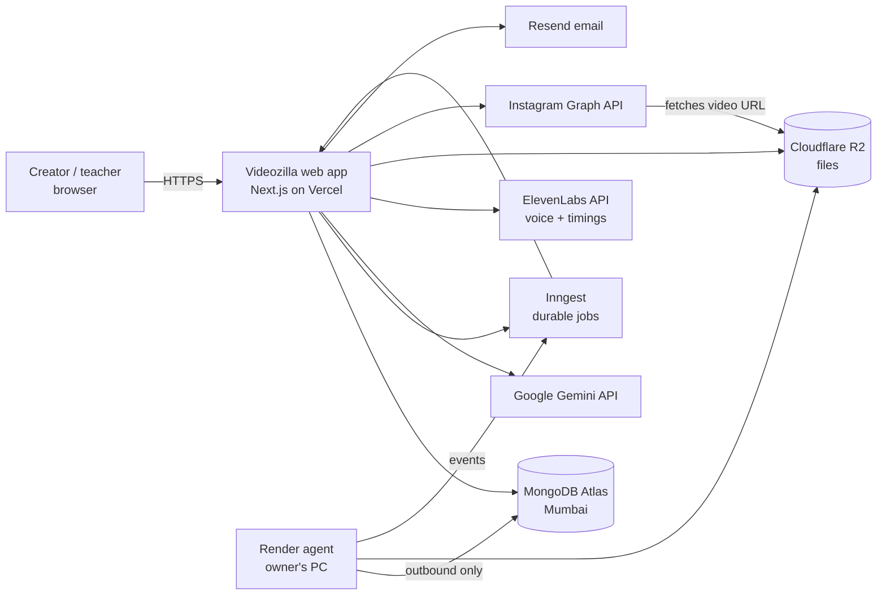
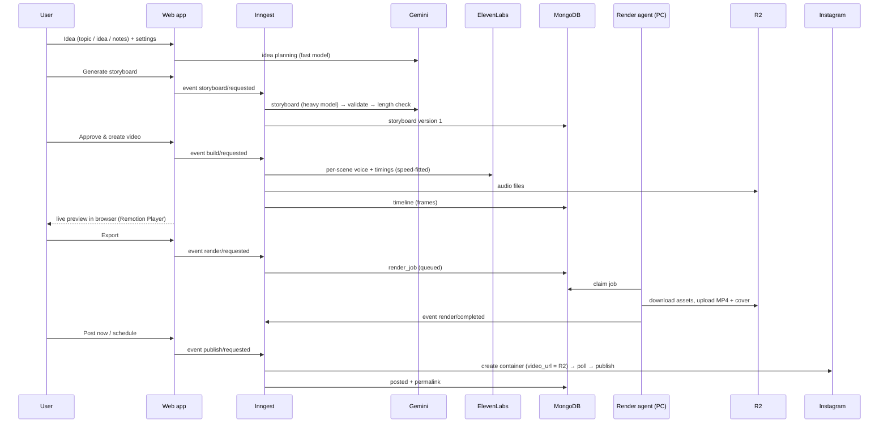
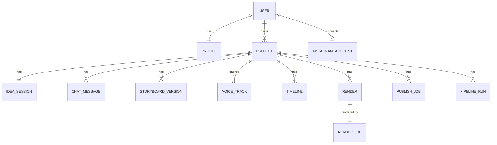
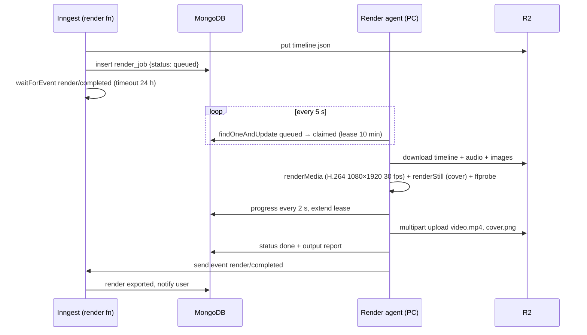

# Videozilla — System Architecture & Technical Design (V1)

| | |
|---|---|
| **Document** | System architecture and technical design |
| **Version** | 0.1 — draft for review |
| **Date** | 2026-10-16 |
| **Based on** | [PRD v1.3](PRD.md) and the M0 technical proof (`m0/`) |
| **Status** | **Approved by the product owner on 2026-10-16.** Open questions use the recommended defaults unless revisited. |

> **Note on existing code.** A draft of the M1 web app (`apps/web/`) was written before this document. That was out of order. It is **uncommitted and on hold**. Once this design is approved, the draft will be reviewed against it and kept, changed or discarded as decided. Nothing in this document is final because the draft exists.

---

## Table of contents

1. [Purpose and scope](#1-purpose-and-scope)
2. [What M0 proved](#2-what-m0-proved)
3. [Architecture overview](#3-architecture-overview)
4. [Key design decisions](#4-key-design-decisions)
5. [Code organisation (monorepo)](#5-code-organisation-monorepo)
6. [Domain model and data storage](#6-domain-model-and-data-storage)
7. [Core data contracts: storyboard and timeline](#7-core-data-contracts-storyboard-and-timeline)
8. [AI design (Gemini)](#8-ai-design-gemini)
9. [Voice and synchronisation](#9-voice-and-synchronisation)
10. [Video rendering](#10-video-rendering)
11. [Job orchestration (Inngest)](#11-job-orchestration-inngest)
12. [Web application](#12-web-application)
13. [Authentication, authorisation and security](#13-authentication-authorisation-and-security)
14. [Instagram publishing](#14-instagram-publishing)
15. [File storage (R2)](#15-file-storage-r2)
16. [Observability and error handling](#16-observability-and-error-handling)
17. [Environments and deployment](#17-environments-and-deployment)
18. [Capacity, performance and cost](#18-capacity-performance-and-cost)
19. [Testing strategy](#19-testing-strategy)
20. [Open questions for the product owner](#20-open-questions-for-the-product-owner)
21. [Technical risks](#21-technical-risks)
22. [Build sequence after approval](#22-build-sequence-after-approval)

---

## 1. Purpose and scope

This document describes **how** Videozilla V1 will be built: the components, how they talk to each other, the data they store, the contracts between them, and the technical choices behind them. The PRD defines **what** is built and why. Where this document refines a PRD decision based on M0 learnings, the change is marked **(refined)**.

**In scope:** everything needed for V1 as defined in the PRD (F1–F10), for India-first English and Hindi educational explainers, rendered on a local PC and published to Instagram.

**Out of scope:** billing, AI video clips, avatars, other platforms, teams (all deferred in the PRD).

---

## 2. What M0 proved

M0 (`m0/`) is a command-line prototype of the full pipeline. It produced real videos end to end.

| Area | Result | Impact on the design |
|---|---|---|
| Gemini storyboards | `gemini-3.8-flash` returns valid JSON storyboards in about 45 s. It sometimes picks invalid props, so a validator and repair step are essential. It was often "busy" (503). | Keep validation and repair; add retry with backoff and a fallback model (§8). |
| Script length | One script came back at 86 words against a 125–150 target. | Automatic length correction (§8.4). |
| ElevenLabs voice + timings | The `with-timestamps` endpoint gives character-level timings in English and Hindi. 6 scenes were synthesised in about 7 s. | Timings come from the TTS itself; forced alignment is only a fallback (§9). |
| **Approved voices** | The product owner's two voices are Voice Library voices. The **free plan blocks them over the API (HTTP 402)**. | Only these two voices may ever be used, with no fallback. A paid ElevenLabs plan is a **launch blocker** (§20). |
| Sync | 95–100% of animation cues matched the spoken word exactly or fuzzily. | Keep the anchor-phrase cue design (§9.3). |
| Duration | A slow voice made a 60 s video run 73 s. | Speed fitting with a learned rate per voice (§9.4). |
| Visual style | The product owner chose a dark "tech explainer" look based on a reference reel: headline beats instead of captions, glowing line-art, a persistent world. | The "midnight" style is the default (§10.2). |
| Rendering | A 60–70 s video renders in **~1.2× real time (light style)** to **~2.4× real time (midnight, with glow and blur)** on the 16-thread / 32 GB PC. | Within budget for a local render agent; Lambda later (§10.4). |

---

## 3. Architecture overview

### 3.1 System context



### 3.2 Containers

| Container | Technology | Runs on | Responsibility |
|---|---|---|---|
| **Web app** | Next.js 16 (App Router, Cache Components), TypeScript | Vercel (Mumbai `bom1` functions) | UI, auth, API routes, server actions, Inngest function endpoint |
| **Background jobs** | Inngest functions served from the web app | Vercel + Inngest Cloud | Storyboard generation, voice build, render orchestration, publishing, crons |
| **Database** | MongoDB Atlas | Atlas (AWS Mumbai) | All application data, auth data, job state |
| **File storage** | Cloudflare R2 | Cloudflare | Audio, images, timelines, MP4s, covers, captions |
| **Render agent** | Node.js + Remotion renderer + ffmpeg | Owner's Windows PC (V1) | Pulls render jobs, renders MP4s, uploads to R2 |
| **Video package** | React + Remotion | Bundled into the web app (preview) and the render agent (final render) | One set of scene components for both preview and render |
| **External AI** | Gemini (text), ElevenLabs (voice) | Vendor APIs | Script, storyboard, revisions, voiceover |
| **Email** | Resend | Vendor | Notifications (later). No auth emails since 2026-10-20 (PRD D16) |
| **Publishing** | Instagram API with Instagram Login | Meta | Post and schedule Reels |

### 3.3 End-to-end flow



---

## 4. Key design decisions

Each decision records the reason and the alternatives considered.

| # | Decision | Why | Alternatives considered |
|---|---|---|---|
| AD-1 | **Code-rendered motion graphics (Remotion)**, not AI video clips | Exact word-level sync, readable Hindi text, deterministic and cheap renders, and the same components for preview and render | AI video models (no sync, garbled text, expensive); Manim (math only) |
| AD-2 | **LLM writes a structured storyboard; code renders it** | The LLM can only choose from scene types we can render well; validation catches its mistakes | LLM writes arbitrary React/SVG code (unreliable, unsafe) |
| AD-3 | **Gemini** for all text AI, with a busy-retry and fallback model | Product-owner decision; M0 showed good quality and JSON reliability | Claude, OpenAI (kept possible behind the provider interface) |
| AD-4 | **ElevenLabs only, with exactly two approved voices** (female `LZOm…`, male `yRis…`), no fallback voice | Product-owner requirement | Azure (removed from use), premade voices (forbidden) |
| AD-5 | **Per-scene voice synthesis** with neighbouring-scene context | Scene-level revisions re-record only changed scenes; context keeps prosody continuous | One take for the whole video (any change re-records everything) |
| AD-6 | **Anchor-phrase cues** → word timestamps → frames | Visuals land on the spoken word; works in Hindi (proven in M0) | Even spacing; manual timing |
| AD-7 | **"Midnight" dark style with headline beats; no word-by-word captions** (refined) | Product-owner choice from the reference reel | Captions band (kept only for the optional light styles) |
| AD-8 | **Next.js on Vercel + MongoDB Atlas + Better Auth + R2 + Inngest** | Product-owner stack; serverless-friendly; Inngest gives durable steps without running our own queue | Supabase, Postgres, BullMQ/Redis workers |
| AD-9 | **Inngest durable steps** for every long operation | Survives function timeouts and deploys, built-in retries and concurrency keys, resume from the failed step | Hand-rolled job table + cron |
| AD-10 | **Render agent on the owner's PC** (V1), Remotion Lambda later | Product-owner decision; zero infrastructure cost; Vercel can't render video | Lambda now, rented render server |
| AD-11 | **Outbound-only render agent** that pulls jobs from MongoDB | No open ports on the PC; works behind home routers | Webhook push to the PC (needs a tunnel) |
| AD-12 | **Polling for progress** (2 s while a job is active) | Works on Vercel serverless; simple | WebSockets (needs a separate server), Inngest Realtime (later) |
| AD-13 | **Application-level authorisation** via a repository layer that always filters by `userId` | MongoDB has no row-level security | Separate database per user |
| AD-14 | **Storyboards and timelines as versioned JSON documents** | Matches the data's shape; immutable versions give undo and history | Normalised scene tables |
| AD-15 | **Cache Components on** (Next.js 16 default) — static shells, user data inside `<Suspense>` | Instant navigation; recommended for this version | Turning it off (simpler, but against the framework direction) |

---

## 5. Code organisation (monorepo)

One Git repository with npm workspaces. The M0 code is split into reusable packages so the web app, background jobs and render agent all share **one** implementation of each part.

```
/apps
  /web              Next.js app: UI, auth, server actions, route handlers, Inngest functions
  /render-agent     Node CLI/service that runs on the PC: claims jobs, renders, uploads
/packages
  /schema           Zod schemas + TS types: Storyboard, Beat, Scene props, Timeline, RevisionPlan, events
  /pipeline         Pure logic: validate/repair, timeline builder, cue resolution, beats, duration fitting, text utils
  /ai               Gemini client, prompts, idea/storyboard/revision generators (from m0/src/llm)
  /voice            ElevenLabs adapter (approved voices only), forced alignment (from m0/src/tts)
  /video            Remotion compositions, scene components, illustration actors, styles, fonts (from m0/src/video)
/docs               PRD, this document, ADRs, runbooks
/m0                 Prototype — kept as reference until the packages replace it, then archived
```

**Rules**
- `packages/*` are pure TypeScript with no Next.js imports, so the render agent and tests can use them.
- Only `apps/web` talks to MongoDB for user data; the render agent gets a **restricted** database user (§13.5).
- Model IDs, voice IDs, limits and style IDs live in configuration (env or the `config` collection), never hard-coded in logic.

---

## 6. Domain model and data storage

### 6.1 Entities



### 6.2 Collections

All documents have `_id`, `createdAt`, `updatedAt`. Every user-owned document carries `userId` (the Better Auth user id, as a string).

| Collection | Purpose | Key fields | Indexes |
|---|---|---|---|
| `user`, `session`, `account`, `verification` | Managed by Better Auth | — | Created by Better Auth |
| `profiles` | Defaults and preferences | `userId`, `displayName`, `defaultLanguage`, `defaultLengthPreset`, `defaultVoiceGender`, `defaultStyleId`, `timezone`, `emailNotifications` | `userId` unique |
| `projects` | One video | `userId`, `title`, `language`, `lengthPreset`, `audience`, `boardOrExam?`, `styleId`, `voiceGender`, `status`, `currentStoryboardVersion`, `currentTimelineId`, `latestRenderId`, `failedStep?`, `errorCode?`, `deletedAt`, `purgeAt`, `rev` | `{userId, deletedAt, updatedAt:-1}`, `{purgeAt}` partial |
| `idea_sessions` | Idea Studio state | `projectId`, `userId`, `mode`, `inputText`, `notesText`, `suggestions[]`, `brief` | `projectId` unique |
| `chat_messages` | Idea chat + revision chat | `projectId`, `userId`, `thread`, `role`, `content`, `scopeSceneId?`, `versionBefore?`, `versionAfter?`, `status` | `{projectId, thread, createdAt}` |
| `storyboard_versions` | Immutable storyboard versions | `projectId`, `userId`, `version`, `data` (§7.1), `source`, `changeSummary`, `accuracyReport?`, `model`, `validationReport` | `{projectId, version}` unique |
| `voice_tracks` | Voice cache per scene | `projectId`, `userId`, `sceneId`, `textHash`, `voiceId`, `speed`, `audioKey`, `durationMs`, `words[]`, `timingSource` | `{projectId, sceneId, textHash, voiceId, speed}` unique |
| `timelines` | Frame-exact render input | `projectId`, `userId`, `storyboardVersion`, `styleId`, `data` (§7.2) or `dataKey` (R2 if large), `durationMs`, `hash`, `syncReport` | `{projectId, hash}` unique |
| `renders` | Output videos | `projectId`, `userId`, `timelineId`, `status`, `progress`, `videoKey`, `coverKey`, `sizeBytes`, `durationMs`, `renderJobId`, `isLatest`, `purgeAt?` | `{projectId, isLatest}` |
| `render_jobs` | Work queue for the render agent | `renderId`, `projectId`, `userId`, `timelineKey`, `status`, `agentId?`, `leaseExpiresAt?`, `attempt`, `progress`, `outputReport?`, `error?` | `{status, createdAt}`, `{leaseExpiresAt}` |
| `render_agents` | Agent health | `agentId`, `hostname`, `version`, `lastHeartbeatAt`, `currentJobId?` | `agentId` unique |
| `instagram_accounts` | Connected account | `userId`, `igUserId`, `username`, `accountType`, `accessTokenEnc`, `tokenExpiresAt`, `status` | `userId`, `igUserId` unique |
| `publish_jobs` | Post / schedule | `projectId`, `userId`, `renderId`, `igAccountId`, `caption`, `shareToFeed`, `coverKey`, `scheduledAt?`, `status`, `containerId?`, `mediaId?`, `permalink?`, `attempts`, `idempotencyKey`, `error?` | `idempotencyKey` unique, `{status, scheduledAt}` |
| `pipeline_runs` | Progress for the UI | `projectId`, `userId`, `kind`, `status`, `inngestRunId`, `steps[]` (embedded), `errorCode?` | `{projectId, kind, createdAt:-1}` |
| `voice_stats` | Learned speaking rate per voice | `key` (`voiceId:language`), `wpm`, `runs` | `key` unique |
| `notifications` | In-app notifications | `userId`, `type`, `title`, `body`, `projectId?`, `readAt?` | `{userId, readAt, createdAt:-1}`, TTL 90 d |
| `ai_calls` | Cost and latency log | `userId`, `projectId?`, `task`, `model`, `inputTokens`, `outputTokens`, `latencyMs`, `status` | `{userId, createdAt}`, TTL 180 d |
| `usage_counters` | Daily caps (PRD §20.6) | `userId`, `date`, counters | `{userId, date}` unique |
| `config` | Model IDs, voices, styles, limits | `key`, `value` | `key` unique |

### 6.3 Consistency rules

- **Versions are immutable.** A revision writes a new `storyboard_versions` document and moves `projects.currentStoryboardVersion` in one **transaction**. Atlas supports transactions; the local dev database is a single-node replica set for the same reason.
- **Optimistic concurrency.** Project updates match on `rev` and increment it. A mismatch returns "updated in another tab" (PRD F1).
- **Soft delete.** `deletedAt` + `purgeAt = now + 30 d`. A daily job hard-deletes the documents and their R2 files.
- **Caches are keyed by content.** Voice tracks by `textHash + voiceId + speed`, timelines by `hash`, so unchanged scenes are never re-synthesised and identical builds are reused.

---

## 7. Core data contracts: storyboard and timeline

These two JSON contracts connect the AI, the voice step, the preview and the render agent. They live in `packages/schema` and are versioned (`schemaVersion`).

### 7.1 Storyboard (from Gemini, after validation)

```ts
Storyboard {
  schemaVersion: 1
  language: "en" | "hi"
  targetDurationSec: 60 | 90
  title: string
  hook: string
  social: { caption: string; hashtags: string[]; coverText: string }
  scenes: Scene[]
}

Scene {
  id: string                       // assigned by our code: s1, s2…
  role: "hook" | "explain" | "example" | "recap" | "outro"
  section: string                  // eyebrow text, e.g. "the setup" → shown as "// the setup"
  beats: Beat[]                    // 1–3 headlines (refined: replaces captions in the midnight style)
  narration: string
  type: SceneType
  props: object                    // validated per scene type
  cues: { target: string; anchor: string; occurrence?: number }[]
}

Beat { headline: string /* *accented* words */; accent: "cyan"|"orange"|"violet"|"green"; anchor?: string; occurrence?: number }
```

**Scene types (V1, 9 — proven in M0):** `TitleHook`, `KeywordReveal`, `BulletSteps`, `Flowchart`, `Comparison`, `StatCounter`, `RecapOutro`, `Illustration` (animated objects and flows), `UnitGrid` (many units lighting up or dimming with a counter). The PRD lists 16; the remaining seven (`Cycle`, `Timeline`, `SimpleChart`, `Definition`, `Equation`, `IconGrid`, `Analogy`) are added in M3 using the same component contract.

**Illustration library:** 23 animated actors (sun, plant, tree, cloud, rain-cloud, earth, ocean, person, factory, atom, molecule, cell, heart, …), any Lucide icon as a fallback, and flows of type beam, particles or arrow between named anchors (e.g. `plant.roots → plant.leaves`).

### 7.2 Timeline (frame-exact, input to preview and render)

```ts
Timeline {
  schemaVersion: 1
  fps: 30; width: 1080; height: 1920; durationInFrames: number
  language: "en" | "hi"; styleId: string; title: string
  scenes: { id; type; role; props; from; durationInFrames; audioKey: string | null; cueFrames: Record<string, number> }[]
  headlines: { from; to; text; accent; section }[]          // midnight style
  captions: { from; to; words: { text; from; to }[] }[]     // light styles only
}
```

- In the web app, `audioKey` is turned into a short-lived signed URL for preview. The render agent turns it into a signed URL (or a local download) for rendering.
- Timelines can exceed MongoDB's comfortable document size for 90 s videos with many words, so a timeline above 500 KB is stored in R2 (`dataKey`) with metadata in MongoDB.

---

## 8. AI design (Gemini)

### 8.1 Models (all configurable)

| Alias | Model | Used for |
|---|---|---|
| `llm.heavy` | `gemini-4-argon` (paid) | Storyboard, revisions, duration fitting |
| `llm.fast` | `gemini-3.8-flash` | Idea suggestions, briefs, idea chat, captions, accuracy check |
| `llm.lite` | `gemini-3.5-flash-lite` | Small helpers; **fallback when other models are busy** (refined from M0) |

**Provider chain (since 2026-10-19):** the interactive features ask the providers in order, picked by the `AI_PROVIDER` setting ([AI provider switch](features/AI-provider-switch.md#three-tier-chain-added-2026-10-19)):

| `AI_PROVIDER` | Order (each later tier backs up the one before) |
|---|---|
| `chain` (default) | Gemini `gemini-3.8-flash` (`GEMINI_FAST_MODEL`) → Groq `openai/gpt-oss-120b` (`GROQ_MODEL`) → OpenRouter `google/gemma-4-31b-it:free` (`OPENROUTER_MODEL`); a tier without its API key is left out |
| `groq` | Groq → OpenRouter |
| `gemini` | the aliases above, falling back to `gemini-3.5-flash-lite` |
| `mock` (manual testing) | sample data, no network |

A tier that is busy, too slow, or out of quota or credits hands over to the next one; the Gemini key is out of prepaid credits today, so Groq answers until it is topped up. Changing the order is a setting, not a code change. Briefs from pasted notes (F2.4) use the same chain with a 25 s deadline; the table in §8 (T2) asks for `llm.heavy` when notes are over 5,000 characters, which waits for the paid Gemini plan (development has no heavy model). The M0 storyboard script still calls Gemini directly; F3 decides the storyboard's provider.

### 8.2 Call wrapper

All AI calls go through one wrapper in `packages/ai` (`generateJson`), whichever provider answers (Gemini, or Groq / OpenRouter through one OpenAI-compatible adapter):
1. **Structured JSON output** (`responseMimeType: application/json`), validated with Zod.
2. **Busy handling (interactive features):** the tiers of §8.1 in order inside a **15 s deadline**. The first model that fails fast with "busy" gets one retry after 1 s; a slow tier or one out of quota moves straight to the next. Each tier runs with the time left minus the **next** tier's reserve (Groq 4 s, OpenRouter 6 s), or all the time left when that would be less than its own reserve, so Gemini gets 11 s and a fast-failing Gemini leaves Groq 9 s and OpenRouter 6 s. A **circuit breaker** skips a model out of quota (429) for the time the provider gives, and a provider out of credits (402) for 30 min, with an `ai_calls` "skipped" row. A safety block stops the chain (`422`). (The M0 storyboard script still retries with 2, 4, 8, 16 s backoff.)
3. **Repair loop:** on schema errors, the errors are sent back and Gemini corrects them (max 2 repairs).
4. **Logging:** provider, model, tokens, latency and outcome go to `ai_calls`.
5. **Timeout:** 90 s per call; the storyboard step streams so Vercel doesn't time out.

### 8.3 Prompt structure (storyboard)

The system prompt contains:
- the role and the dark-explainer style;
- language rules (natural Hindi in Devanagari, Indian examples and units);
- the word budget (§9.4);
- the scene structure (hook → explain/example → recap);
- the **"show, don't tell"** rule (about half of middle scenes are Illustrations);
- headline-beat rules (≤ 6 words, accent colours by meaning);
- cue-anchor rules (exact words from the narration);
- the scene-type catalogue with prop schemas, actor kinds and anchors.

The user prompt carries the topic, audience and board or exam. Pasted notes are passed as clearly delimited data and are never treated as instructions (prompt-injection hygiene).

### 8.4 Validation and repair (after every storyboard or revision)

1. Schema check → repair loop.
2. Per scene type: clamp list lengths, fill missing ids, coerce numbers, keep illustration objects inside the frame, drop flows to unknown objects; if the props are still invalid, fall back to `KeywordReveal`.
3. Cues: drop unknown targets; warn when an anchor isn't found verbatim (fuzzy matching handles it at sync time).
4. Beats: max 3, valid accent colours, fallback headline if missing.
5. **Length check (refined):** if the narration is outside ±10% of the word budget, Gemini gets one correction request.
6. Safety check on narration and on-screen text (PRD §21).

### 8.5 Revisions

Gemini returns a **revision plan** (a list of operations: update scene, insert, delete, move, update social, update settings, regenerate all), not a rewritten storyboard. Our code applies the operations, so untouched scenes stay byte-identical, and only changed scenes are re-voiced and re-timed.

---

## 9. Voice and synchronisation

### 9.1 Voice adapter

- **ElevenLabs `eleven_multilingual_v2`** via `POST /v1/text-to-speech/{voiceId}/with-timestamps`.
- **Approved voices only:** `ELEVENLABS_VOICE_FEMALE` and `ELEVENLABS_VOICE_MALE`. The adapter rejects any other id. On HTTP 402 (plan doesn't allow the voice) the build **fails with a clear message**; there is no fallback.
- `previous_text` / `next_text` are set to the neighbouring scenes' narration for natural continuity.
- `voice_settings.speed` comes from duration fitting (§9.4).
- Character timings are grouped into words. If timings are missing, the ElevenLabs Forced Alignment API is called.

### 9.2 Text preparation

Emoji are stripped and whitespace normalised before TTS. On-screen text keeps the original form. Number, unit and acronym normalisation (PRD §15.1) is added in M3, together with a per-project pronunciation dictionary.

### 9.3 Sync algorithm (proven in M0)

1. Each scene = 5-frame lead-in + voice + 350 ms tail; scenes are laid end to end.
2. **Cue resolution:** normalise words (case, punctuation, Devanagari danda, NFC). Find the anchor phrase in the scene's word timings, honouring `occurrence`: exact match first, then per-token similarity ≥ 0.8, then best first-token match ≥ 0.7. If nothing matches, use the position of the anchor in the text; elements without a cue are staggered across the scene.
3. The visual appears **3 frames before** the word is spoken.
4. **Early-start rule:** if a scene's first visual would appear after 0.8 s, it comes in at the start, so the screen is never empty.
5. **Headline beats:** the first beat starts with the scene; later beats start at their anchor word, at least 1 s apart.
6. A sync report (exact / fuzzy / proportional / default counts) is stored with each timeline.

### 9.4 Duration fitting (proven in M0)

- **Word budget:** 60 s = 125–150 words (EN) / 115–140 (HI); 90 s = 190–225 / 175–210.
- **Speaking speed:** chosen from the voice's learned words-per-minute (`voice_stats`), clamped to 0.85–1.18×.
- **One correction:** if the recorded video is outside its window (55–65 s or 80–95 s), it is re-recorded once at a corrected speed.
- The measured rate updates `voice_stats`, so later videos usually fit first time and don't spend credits twice.

---

## 10. Video rendering

### 10.1 One component set, two uses

`packages/video` holds the Remotion composition. The web app uses it in the **Remotion Player** for instant live preview, with no MP4 needed. The render agent uses the same code with `@remotion/renderer` for the final MP4, so preview and export always match.

### 10.2 Looks

| Style | Look | Text | Default |
|---|---|---|---|
| `midnight` | Near-black persistent world with perspective dot floor and gentle camera moves, Geist + Geist Mono + Noto Sans Devanagari, glowing line-art, HUD chips | `// section` eyebrow (typing) + headline beats with blur transitions | **Yes** |
| `clean-light`, `bold-dark` | Card style from early M0 | Word-highlight captions | Optional (e.g. kids' topics) |

All layouts respect Instagram safe zones. In midnight: the headline sits at y 330–600 px, visuals at y 640–1480 px, and the bottom stays dark for Instagram's UI.

### 10.3 Render agent protocol



- **Leases:** if the PC sleeps, crashes or loses internet, the lease expires and the job is re-queued (max 3 attempts).
- **Heartbeat:** every 15 s to `render_agents`. If there's no heartbeat for 5 min while jobs are queued, the admin is emailed.
- **Concurrency:** 1 render at a time by default (configurable to 2).
- **Auto-start:** Windows Task Scheduler; the agent keeps the PC awake while rendering.

### 10.4 Render performance (measured in M0)

| Style | Video length | Render time | Ratio |
|---|---|---|---|
| clean-light | 55.7 s | 72–84 s | ~1.4× |
| midnight | 57.7 s | 169 s | ~2.9× |
| midnight | 70.8 s | 134–171 s | ~2.1× |

The glow and blur filters cost about 2× compared with the light style. Planned optimisation (M3/M4): render glow layers once per scene instead of per element, and set Remotion concurrency explicitly. **Target: ≤ 2× real time.**

**Move to Remotion Lambda when** the queue regularly waits more than 10 minutes, or before public launch.

---

## 11. Job orchestration (Inngest)

### 11.1 Functions

| Function | Trigger | Steps | Concurrency |
|---|---|---|---|
| `storyboard.generate` | `storyboard/requested` | load context → gemini storyboard → validate/repair → length fix → save version (transaction) → accuracy check (async) | 1 per project |
| `build.run` | `build/requested` | diff versions → plan speed → voice per changed scene (2 parallel) → correct speed once → align fallback → build timeline → save → status `preview_ready` | 1 per project, 2 per user |
| `revision.apply` | `revision/requested` | gemini revision plan → apply ops → save version → if preview exists, emit `build/requested` (incremental) | 1 per project |
| `render.run` | `render/requested` | write timeline to R2 → enqueue render job → wait for `render/completed` or `render/failed` (24 h) → verify output → `exported` + notify | 1 per project, global throttle = agent capacity |
| `publish.run` | `publish/requested` | check token (refresh) → quota → container → poll (sleep 30 s, max 30 min) → publish → permalink → notify | 1 per IG account |
| `publish.schedule` | `publish/scheduled` | `step.sleepUntil(scheduledAt)` → emit `publish/requested` (cancellable) | — |
| `cron.tokenRefresh` | daily | refresh IG tokens older than 24 h nearing expiry | — |
| `cron.purge` | daily 03:30 IST | delete expired soft-deleted projects and their R2 files | — |
| `cron.watchdog` | every 5 min | fail steps stuck beyond 3× their p95; alert on a missing render-agent heartbeat | — |

### 11.2 Rules

- **Idempotency:** every event carries `idempotencyKey = projectId + version + kind`, so double clicks start one run.
- **Retryable vs not:** timeouts, 429 and 5xx are retried. Validation failures, safety refusals, **402 voice not allowed** and Instagram auth errors are not; they go straight to `needs_attention` with a clear message.
- **Progress:** every step writes `pipeline_runs.steps[]`; the UI polls `/api/projects/:id/status` every 2 s while a run is active.
- **Cancellation:** `cancelOn` matches a `run/cancelled` event for the same project.

---

## 12. Web application

### 12.1 Routes

| Route | Type | Purpose |
|---|---|---|
| `/` | static | Landing |
| `/sign-in`, `/sign-up` | static shell + client forms | Auth (`/verify-email`, `/forgot-password`, `/reset-password` redirect to sign-in since PRD D16) |
| `/library` | partial prerender | Projects, filters, search, needs-attention |
| `/projects/[id]` | partial prerender | Stepper: Idea → Storyboard → Video, chat panel, preview player, publish dialog |
| `/settings` | partial prerender | Defaults, Instagram connection, delete account |
| `/api/auth/[...all]` | route handler | Better Auth |
| `/api/inngest` | route handler | Inngest functions |
| `/api/projects/[id]/status` | route handler | Progress polling |
| `/api/instagram/connect`, `/api/instagram/callback` | route handlers | Instagram OAuth |
| `/api/renders/[id]/download` | route handler | Signed download URL |

**Mutations use server actions** (create, rename, delete, restore, duplicate, settings, generate, approve, export, publish). Every action re-checks the user.

### 12.2 Next.js 16 specifics

- `src/proxy.ts` (formerly middleware) does a **cookie-only** redirect check: it's fast, with no database call.
- The data access layer (`getSession` / `requireUser`) validates the session on every page and action.
- With Cache Components, anything that reads the session, `params`, `searchParams` or the URL renders inside `<Suspense>`. Shells are static and instant.

### 12.3 UI

The dark design system matches the videos: same palette, Geist / Geist Mono, `// eyebrow` labels, glowing chips. The app UI is English in V1; video content is English or Hindi.

---

## 13. Authentication, authorisation and security

### 13.1 Authentication (Better Auth + MongoDB adapter)

- Email + password, **no email verification and no password-reset email** (PRD D16, 2026-10-20): the account works at once. Zod checks the input in the forms and in a Better Auth `before` hook (`lib/auth-schema.ts`); passwords 8–128 characters, hashed with scrypt; sign-in 10 and sign-up 5 per minute per IP (Better Auth's limiter, stored in MongoDB).
- Google sign-in; **no automatic linking** of Google into an existing password account (its email isn't proven since D16).
- Database sessions in httpOnly cookies, 30-day rolling; delete account (removes all user data).

### 13.2 Authorisation

- A **repository layer** is the only code that touches user collections. Every function takes `userId` and adds it to the filter. Foreign or unknown ids return 404, never "forbidden".
- Automated tests check that user B cannot read or change user A's projects through any route or action.

### 13.3 Secrets

- All keys live in Vercel environment variables (production) and `.env.local` / `m0/.env` (development, git-ignored).
- Instagram tokens are encrypted (AES-256-GCM) before storage.

### 13.4 Web protections

Server-action origin checks (built in), OAuth `state` validation, rate limits on auth and AI endpoints, input length limits, signed short-lived URLs for private files, and no personal data in URLs.

### 13.5 Render agent credentials

The agent has its own credentials:
- a MongoDB user limited to `render_jobs`, `render_agents` and `renders`;
- an R2 token limited to the media bucket;
- an Inngest event key that can only send events.

They're stored in a local `.env` on the PC.

---

## 14. Instagram publishing

- **API:** Instagram API with Instagram Login, scopes `instagram_business_basic` and `instagram_business_content_publish`. Requires a Professional (Creator or Business) account.
- **Connect flow** (PRD F9): eligibility explainer → Instagram OAuth → callback exchanges the code for a long-lived token → store encrypted → "Connected as @username".
- **Publish:** create a `REELS` container with an R2 URL valid for at least 2 h → poll `status_code` → `media_publish` → fetch permalink. Duplicate protection: before re-publishing after a timeout, check recent media.
- **Scheduling:** Inngest `sleepUntil`. Edits and cancels emit a cancel event and reschedule.
- **Launch blocker:** Meta App Review (needs a privacy policy, terms, data-deletion callback, a screencast, and business verification). It should start as early as possible.

---

## 15. File storage (R2)

```
users/{userId}/projects/{projectId}/
  audio/{sceneId}-{textHash}-{speed}.mp3
  images/{assetId}.png
  timelines/{hash}.json
  renders/{renderId}/video.mp4 | cover.png | captions.srt
```

- **Private bucket:** access is only through signed URLs (download: 10 min; Instagram fetch: 2 h; agent upload: 15 min).
- **Retention:** the latest render is kept; older renders are purged after 30 days; deleted projects are purged after 30 days.

---

## 16. Observability and error handling

- **Errors:** Sentry for the web app and the render agent; Inngest's run history for jobs.
- **Logs:** structured logs with `projectId`, `runId` and `step`.
- **Error codes → plain messages:**

| Code | User sees |
|---|---|
| `VOICE_PLAN_REQUIRED` | Voice service plan needs an upgrade — contact support |
| `AI_BUSY` | Our writing assistant is busy; retrying automatically |
| `RENDER_AGENT_OFFLINE` | Rendering is taking longer than usual; we'll email you |
| `IG_RECONNECT` | Reconnect Instagram to keep posting |

- **Admin view (M7):** failed runs, agent health, per-user usage, cost per video from `ai_calls` plus ElevenLabs characters.

---

## 17. Environments and deployment

| Environment | Web | Database | Jobs | Render | Purpose |
|---|---|---|---|---|---|
| **Local** | `next dev` | Local single-node replica set (`npm run db`) | Inngest dev server | Render agent or CLI on the same PC | Development |
| **Staging** | Vercel preview | Atlas (separate database) | Inngest branch environment | Owner's PC (staging queue) | Testing with real keys |
| **Production** | Vercel Pro (`bom1`) | Atlas Mumbai (paid tier with backups) | Inngest Cloud | Owner's PC → later Remotion Lambda | Users |

**Environment variables:**
- `MONGODB_URI`, `MONGODB_DB`
- `BETTER_AUTH_SECRET`, `BETTER_AUTH_URL`
- `GOOGLE_CLIENT_ID` / `GOOGLE_CLIENT_SECRET`
- `RESEND_API_KEY`, `EMAIL_FROM`
- `GEMINI_API_KEY` and model aliases
- `ELEVENLABS_API_KEY`, `ELEVENLABS_VOICE_FEMALE` / `ELEVENLABS_VOICE_MALE`
- `R2_*`
- `INNGEST_EVENT_KEY` / `INNGEST_SIGNING_KEY`
- `IG_APP_ID` / `IG_APP_SECRET`
- `TOKEN_ENCRYPTION_KEY`
- `SENTRY_DSN`

---

## 18. Capacity, performance and cost

### 18.1 Per-video cost (60 s, Hindi or English, one revision round)

| Item | Estimate |
|---|---|
| Gemini (storyboard on `gemini-4-argon` + ideas and checks on flash) | ₹10–20 |
| ElevenLabs (~800 characters ≈ 800 credits; ~1,600 if re-recorded once) | Creator plan: ₹15–30 |
| Rendering (local PC) | electricity only |
| R2 storage + Instagram fetch | < ₹1 |
| **Total** | **≈ ₹25–50 per video** |

### 18.2 Capacity of one render PC

At ~2.5× real time, a 60 s video takes about 2.5 min, so **~20 videos per hour** if the PC renders full time. That's enough for the private beta (20–50 users).

### 18.3 Latency targets

From the PRD, checked against M0:

| Step | Target | M0 result |
|---|---|---|
| Storyboard | ≤ 30 s p50 | ~45 s on the free flash tier (busy retries) — needs the paid key or `gemini-4-argon` |
| Voice build | ≤ 60 s | ~7 s ✅ |
| Render | ≤ 5 min | 2–3 min ✅ |

---

## 19. Testing strategy

| Level | What | Tooling |
|---|---|---|
| Unit | Validator, cue resolution, beats, caption chunking, duration fitting, revision-operation application, repository filters | Vitest |
| Golden storyboards | 20 fixed topics (10 EN, 10 HI) run weekly; human review of output | Scripted pipeline |
| Sync accuracy | Cue frame vs word onset ≤ ±120 ms on the golden set | Script over `syncReport` |
| Visual regression | Every scene type × style × language rendered to stills and diffed | Remotion `renderStill` + pixel diff |
| Security | Cross-user access attempts on every route and action | Integration tests against the local DB |
| End to end | Sign-up → idea → storyboard → build → export → mock publish | Playwright + mock voice (silent) |

---

## 20. Open questions for the product owner

These need your answer before building continues.

| # | Question | Why it matters | My recommendation |
|---|---|---|---|
| Q1 | **Will you upgrade ElevenLabs** (Creator plan, or add $5 of credits) so your two voices work through the API? | Without it, no real voiceover is possible; it's a hard blocker for every milestone that produces audio. | Creator plan (121k credits/month ≈ 100–150 videos). |
| Q2 | **The M1 web app draft that already exists:** review it against this document and keep what fits, or discard it and rebuild after approval? | It was written before this document. | Review and keep what matches; it follows this design closely. |
| Q3 | OK to **restructure into the monorepo** (§5), moving M0 code into `packages/*`? | Lets the web app, jobs and render agent share one tested implementation. | Yes. |
| Q4 | **Accounts:** who creates MongoDB Atlas, Google OAuth client, Resend, Cloudflare R2, Inngest, Vercel and Sentry, and under which email or company? | Needed for staging; some need a domain. | You create them (I'll give step-by-step guides); I never handle your passwords. |
| Q5 | **Domain:** have you bought `videozilla.in` / `.ai`? Has the trademark search been done (PRD Appendix E)? | Needed for email sending, OAuth redirect URLs and Meta App Review. | Buy `videozilla.in` once the trademark check is clear. |
| Q6 | **Render PC availability:** what hours will the PC be on during the beta? | Sets user-facing expectations and alerting. | Keep it on during beta hours; move to Lambda before public launch. |
| Q7 | **Light styles:** keep `clean-light` / `bold-dark` as options (e.g. for kids' topics), or midnight only? | Affects M3 scope (every scene type needs both looks). | Midnight only for V1 to halve design work; revisit later. |
| Q8 | **Captions:** midnight has no word-by-word captions. Should there be an optional captions toggle for viewers with sound off (accessibility)? | PRD F6 listed captions as P0. | Optional small captions, off by default (P1). |
| Q9 | **Gemini paid key:** when do we switch from the free tier (data used by Google, rate limits, frequent busy errors)? | Free-tier content is used to train Google's models, and storyboard latency was 45 s. | Before the private beta (M7); now if you want faster tests. |
| Q10 | **Meta App Review:** do you have a registered business (or will you use an individual developer account) for Meta business verification? | Public Instagram publishing can't launch without approval. | Start the Meta developer app early in the build. |

---

## 21. Technical risks

| Risk | Impact | Mitigation |
|---|---|---|
| ElevenLabs plan or voice availability | No voiceover | Paid plan (Q1); clear error; no silent fallback by design |
| Gemini busy or slow on the free tier | Slow or failed storyboards | Retry + fallback model; paid key (Q9) |
| Render PC offline | Exports wait | Leases, heartbeat alerts, honest messaging; Lambda later |
| Midnight render cost (glow/blur) | Slower renders | Optimise glow (target ≤ 2× real time) |
| Next.js 16 / Cache Components are new | Framework surprises | Follow the bundled docs; static shells + Suspense; keep framework code thin |
| MongoDB without row-level security | Data leak bug | Repository-only access + cross-user tests |
| Meta App Review delay | No public publishing | Start early; download fallback always available |
| LLM factual errors | Trust | Accuracy check, conservative prompts, user review step |

---

## 22. Build sequence after approval

1. **Approve this document** and answer the open questions (§20).
2. **Repository restructure:** workspaces, move M0 into `packages/*` with unit tests (no behaviour change).
3. **M1 — foundation:** review the existing draft against §12–§13, fix gaps, add cross-user tests, deploy to staging.
4. **M2 — Idea Studio + storyboard:** `storyboard.generate`, storyboard screen, version history.
5. **M3 — Video package:** remaining 7 scene types, midnight polish and performance, live preview in the browser.
6. **M4 — Build + export:** `build.run`, render agent, `render.run`.
7. **M5 — Revisions.**
8. **M6 — Instagram.**
9. **M7 — Hardening and private beta.**

Each milestone starts with a short design note and your go-ahead before any code is written.
